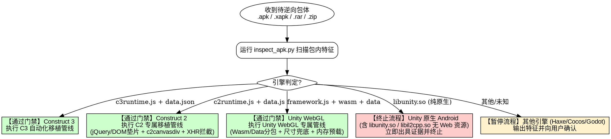

# 移动端游戏逆向与抖音小游戏移植规范 (apk-re-to-minigame)

## Overview

本技能规范了从移动端游戏安装包（`.apk`、`.xapk`、`.apks`、`.rar`、`.zip`）逆向分析、引擎特征门禁识别，到将 **Construct 3**、**Construct 2** 以及 **Unity WebGL** 游戏工程完整移植适配为**抖音小游戏（ByteDance MiniGame）**的端到端标准化流程。

### 核心铁律
1. **门禁在前，精准分流**：拿到游戏包第一步必须运行 `inspect_apk.py` 进行技术栈审计，分流进入对应引擎移植管线。
2. **小游戏适配第一，严禁前置做无广链接**：**所有工程力量必须优先集中在抖音小游戏端（分包构建、运行时垫片、SDKManager 商业化、真机验证跑通）**。CDN 免广告试玩版本仅作为小游戏跑通后的可选附带交付物，绝对禁止在小游戏跑通前提前制作！
3. **严守 4.0 MB 主包红线**：扣除分包后的主包体积必须严格 $\le 4.0\text{ MB}$（推荐 $\le 3.0\text{ MB}$），全部分包根目录必须具备 `game.js`。
4. **禁止破坏原生 C++ 绑定**：在抖音小游戏环境，原生画布对象（`tt.createCanvas()`）严禁使用 `Object.defineProperty` 覆写 `width/height`，必须通过常规赋值触发底层的 C++ Framebuffer 扩容。
5. **产出物路径强约束与工作区防污染**：
   - 原始解压源码必须统一存放于 `extracted/<game_name>_package/`，严禁散落至 `reverse/` 或根目录；
   - 抖音小游戏工程成品必须统一输出至 `reverse/<game_name>-tt-minigame/`；
   - 逆向复盘文档与审计报告必须统一归档于 `reverse/docs/`；
   - **严禁在根目录创建任何临时排错脚本**！所有调试、数据分析、打补丁脚本必须存放于 `scratch/<game_name>/`；
   - 可复用命令行工具统一存放在 `tools/`。

---

## When to Use & 引擎决策流



### 适用场景
- 拿到合作方或竞品游戏包，需要辨别底层技术架构与移植可行性。
- **Construct 3** 游戏移植：处理 ES6 降级、WASM Base64 内嵌、中文字体映射、AudioParam 补齐。
- **Construct 2** 游戏移植：处理 `jQuery 2.1.1` DOM 节点模拟、`#c2canvasdiv` 容器树结构、Spine WebGL 骨骼动画、XHR 本地数据拦截、`.ogg` 音频瘦身。
- **Unity WebGL** 游戏移植：处理画布尺寸陷阱（杜绝 3×3 模糊渐变与黑屏）、触摸坐标映射、`eval` 转 `new Function`、Wasm/Data 内存预加载、PokiSDK 桥接。

---

## Quick Reference & 产出物标准路径映射

### 1. 产出物全生命周期存放目录矩阵 (强制规范)

| 产出物类别 | 唯一标准存放路径 | 命名规范示例 | 强制约束与红线 |
|---|---|---|---|
| **待分析安装包** | `apk/` | `apk/<game>.apk\|rar` | 仅存放待分析原始压缩包，git 忽略，严禁就地解压 |
| **原始解压工程** | `extracted/` | `extracted/<game>_package/` | 所有解压后的原始资源集中放置于此，严禁散落至 `reverse/` |
| **抖音小游戏工程** | `reverse/` | `reverse/<game>-tt-minigame/` | 小游戏成品唯一存放路径，内含完整分包、适配器及入口 |
| **审计与复盘文档** | `reverse/docs/` | `PORTING_<GAME>.md`<br/>`<game>_audit.json` | 逆向复盘报告与审计 JSON 集中归档，严禁置于根目录 |
| **临时调试排错脚本** | `scratch/` | `scratch/<game>/<script>.py` | **绝对禁止在根目录新建临时脚本**！排错痕迹一律按项目归类于 `scratch/<game>/` |
| **CDN 免广告试玩** | `Noad-freelinks/` | `Noad-freelinks/<game>/` | 浏览器脱机试玩版，必须在抖音端跑通后按需生成 |
| **生产力工具链** | `tools/` | `tools/<tool>.py\|js\|exe` | 存放可复用全局命令行工具，不存放项目特化临时逻辑 |

### 2. 常用工具与命令速查

| 目标分类 | 工具 / 脚本 / 模板 | 说明 |
|---|---|---|
| **引擎扫描与审计** | `python tools/inspect_apk.py <path_to_pkg> -o audit.json` | 判定引擎（支持 APK/XAPK/ZIP/RAR，自动识别 C3/C2/Unity） |
| **4MB 主包与分包校验** | `node tools/validate-package.js <minigame_project_dir>` | 严查主包体积 $\le 4.0\text{MB}$ 及每个分包根目录的 `game.js` |
| **素材分包补齐** | `node tools/embed-images.js <minigame_project_dir>` | 自动为图片分包补齐 `game.js` 并生成 Base64 图集映射 |
| **WASM 内嵌工具** | `node tools/embed-wasm.js <minigame_project_dir>` | 针对 C3 将 `.wasm` 转为 Base64 JS 模块，绕开打包扩展名过滤 |
| **Unity 适配器模板** | `<skill>/templates/tt-unity-adapter.template.js` | Unity WebGL 专属适配层（DOM/Window/Audio/Storage/Canvas原生保护） |
| **C2 适配器模板** | `<skill>/templates/tt-c2-adapter.template.js` | Construct 2 专属适配层（jQuery DOM模拟/c2canvasdiv/Spine/XHR拦截） |
| **C3 适配器模板** | `<skill>/templates/tt-c3-adapter.template.js` | Construct 3 专属适配层（双端 Helium/Krypton 垫片/AudioParam/去抖） |
| **统一商业化管理器** | `<skill>/templates/sdk-manager.template.js` | 统一广告调度、15s 超时熔断、开发调试自动发奖、桌面/侧边栏支持 |
| **中文字体全局映射** | `tt.loadFontFace({ family: '<原字体名>', source: 'url("fonts/font.ttf")' })` | 零成本全量生效中文字体，无需逐个修改 Text 实例 |
| **横竖屏锁定防死循环** | 互斥锁 `_isSettingOrientation` + `windowWidth > windowHeight` | 彻底解决小游戏热重启变竖屏及转屏事件自激死循环 |
| **（可选）CDN 免广告链接** | `node tools/export-noad-freelink.js -s <src> -o Noad-freelinks/<name>` | **严禁前置执行**，仅在小游戏跑通后按需导出浏览器脱机试玩版 |

---

## Step-by-Step Workflow (抖音小游戏移植标准化流程)

> [!IMPORTANT]
> **工作流执行铁律**：全流程以 **Phase 1 至 Phase 7（抖音平台适配与跑通验证）** 为核心。任何情况下都**不得在小游戏调通前提前制作无广试玩链接**！

---

### Phase 1: 引擎门禁检测 (Gatekeeper)
```bash
python tools/inspect_apk.py "apk/YourGamePackage.rar" --output reverse/docs/audit.json
```
- **输出 Unity WebGL**：通过门禁，进入 Unity WebGL 移植管线。
- **输出 Construct 2**：通过门禁，进入 Construct 2 移植管线。
- **输出 Construct 3**：通过门禁，进入 Construct 3 移植管线。
- **输出 Unity (Native Android)**：退出码 2，立即终止流程，向用户出具二进制证据。
- **输出 Haxe/Lime、Cocos、Godot**：退出码 3，暂停并向用户汇报。

---

### Phase 2: 资源解压与目录建立
将原始包体解压至 `extracted/<project_name>_package/`：
```bash
# 若为 RAR 包：
tools\UnRAR.exe x -o+ "apk/YourGamePackage.rar" "extracted/your_game_package/"
```
并在 `reverse/<project_name>-tt-minigame/` 初始化标准抖音小游戏工程结构。

---

### Phase 3: 主包瘦身与分包架构划分 (严守 4.0 MB 红线)

1. **根据引擎特征划分分包**：
   - **Unity WebGL**：
     - `wasm/` 分包：存放 `[hash].wasm` + `wasm/game.js`
     - `data/` 分包：存放 `[hash].bin` / `[hash].data` + `data/game.js`
     - 主包：`game.js`、`game.json`、`SDKManager.js`、`adapter/`、`Build/`
   - **Construct 2**：
     - `images/` 分包：所有切片图集 + `images/game.js`
     - `media/` 分包：所有的 `.m4a` 音频 + `media/game.js`（**必须彻底删除所有 `.ogg` 冗余音频**）
     - `data/` 分包：`data.js` + `localisation.json` + `data/game.js`
     - 主包：`c2runtime.js`、`jquery-2.1.1.min.js`、`spine_webgl.js`、适配器与主启动入口
   - **Construct 3**：
     - `images/` 分包：图集与纹理 + `images/game.js`
     - `media/` 分包：音频文件 + `media/game.js`
     - `data/` 分包：`data.json` + `data/game.js`
     - 主包：`c3runtime.js`、`scripts/`、适配器与主入口
2. **生成每个分包的 `game.js`**：
   ```bash
   node tools/embed-images.js ./reverse/my-tt-minigame
   ```
3. **配置 `game.json` 声明横屏与分包**：
   ```json
   {
     "deviceOrientation": "landscape",
     "showStatusBar": false,
     "subPackages": [
       { "name": "wasm", "root": "wasm/" },
       { "name": "data", "root": "data/" }
     ]
   }
   ```

---

### Phase 4: 引擎专有适配器与主入口注入

#### A. Unity WebGL 专用核心要点
1. **注入适配器**：复制 `<skill>/templates/tt-unity-adapter.template.js` 到 `adapter/tt-unity-adapter.js`。
2. **修复 `_JS_SystemInfo_GetCanvasClientSize`（杜绝 3×3 模糊渐变）**：
   在 `Build/*.framework.js` 中将画布选择器查询由 `document.querySelector` 改造为优先回退至 `Module["canvas"]` 及其 `getBoundingClientRect()`，准确返回真实 CSS 尺寸（如 `852 × 393`），让 Unity 自然乘以 DPR 申请视网膜分辨率（`2556 × 1179`）。
3. **严禁使用 `Object.defineProperty` 覆写画布尺寸**：
   保持原生 `canvas.width = targetW` 直接赋值，确保底层 C++ 原生 Framebuffer 正常扩容，防止黑屏。
4. **视口触摸映射修复**：
   在 `_JS_DOM_MapViewportCoordinateToElementLocalCoordinate` 中增加 `Module["canvas"]` 回退，保障手势坐标精准映射。
5. **Wasm & Data 内存预加载**：
   在 `game.js` 中使用 `tt.getFileSystemManager().readFileSync` 预读二进制，直接注入 `unityConfig.wasmBinary` 与 `unityConfig.dataBinary`。
6. **Eval 替换**：
   将 `_JS_Eval_EvalJS` 中的 `eval()` 替换为 `new Function` 执行。

#### B. Construct 2 专用核心要点
1. **注入适配器**：复制 `<skill>/templates/tt-c2-adapter.template.js` 到 `adapter/tt-c2-adapter.js`。
2. **DOM 树与 jQuery 兼容**：提供 `nodeType=9`、`defaultView`、`createComment`、`createDocumentFragment`、`cloneNode`、`contains` 等补全。
3. **画布容器树**：构造 `#c2canvasdiv` 容器包裹 `#c2canvas` 并挂载至 `document.body`。
4. **XHR 零延迟拦截**：在 `XMLHttpRequest` 垫片中拦截 `data.js` 与 `localisation.json`，直接返回预读内容。
5. **Spine WebGL 绑定**：在 `scripts/spine_webgl.js` 导出全局 `window.spine` 与 `globalThis.spine`。

#### C. Construct 3 专用核心要点
1. **注入适配器**：复制 `<skill>/templates/tt-c3-adapter.template.js` 到 `adapter/tt-c3-adapter.js`。
2. **WASM Base64 内嵌**：运行 `node tools/embed-wasm.js ./reverse/my-tt-minigame`。
3. **模块平铺与 CommonJS 降级**：平铺 `scripts/project/` 下的 ES6 模块，移除 `import/export`。
4. **AudioParam 补齐与去抖**：补齐 `cancelScheduledValues` 与画布去抖。

---

### Phase 5: 部署统一商业化与平台管理器 (`SDKManager.js`)
复制 `<skill>/templates/sdk-manager.template.js` 至小游戏根目录：
1. **广告统一调度**：所有插屏广告 (`showInterstitial`) 与激励视频 (`showRewarded`) 统一收拢，自带 15 秒超时熔断保护。
2. **开发降级模式**：`adMode: "development-fallback-success"`，未配真实广告位时自动发奖并弹出 HUD 提示。
3. **测试存档重置**：`clearSaveOnStart: false` 开关便于初次引导排错。
4. **海外 SDK 桥接**：将海外 SDK（如 PokiSDK 的 `commercialBreak`/`rewardedBreak` 或 AppLovin）无缝路由至 `SDKManager`。

---

### Phase 6: 中文汉化与字体别名重映射 (Font Alias Mapping)
1. **别名重映射（零改动 Text 实例）**：
   在 `game.js` 启动前通过 `tt.loadFontFace` 将**游戏原英文字体名（如 `Rounds Black`、`Impact`）注册为 alias 指向中文字体**：
   ```javascript
   tt.loadFontFace({ family: 'Rounds Black', source: 'url("fonts/font.ttf")' });
   ```
   全局所有 Text 实例无需逐个修改配置，小游戏全局自动以中文字体呈现！
2. **多语言提取与修正**：
   - Unity：检查 UI Text 与预制体语言包。
   - C2：提取 `localisation.json`，修正机翻错误（如“兵左”纠正为“剩余棋子”）。
   - C3：汉化 `data.json` 静态 Text 与图集切片文字。

---

### Phase 7: 包体验收与真机/模拟器跑通 (核心里程碑)
1. **执行自动化包体合规核验**：
   ```bash
   node tools/validate-package.js ./reverse/my-tt-minigame
   ```
   **必须确认**：
   - `Main Package Size <= 4.0 MB`
   - 全部分包具备合法的 `game.js` 入口
   - 语法检查无保留字或非法指令
2. **抖音开发者工具导入与验证**：
   - 导入 `reverse/my-tt-minigame`。
   - 观察控制台输出日志：
     - Unity 项目确认：`[GetCanvasClientSize] returning: 852 x 393` 与 `[Canvas SetSize] requested: 2556 x 1179`
     - 确认 3D 模型清晰、UI 布局完整，无 3x3 模糊渐变，无全屏黑屏。
   - 扫码在真机（iOS / Android）上验证：
     - 首屏秒开，触摸点击响应灵敏；
     - 音频出声且切换正常；
     - 胶囊菜单“重新进入小游戏”热重启保持横屏，不发生自激死循环。

---

### Phase 8（附录/可选）: CDN 免广告试玩版本打包 (按需执行)

> [!CAUTION]
> **严禁前置执行本步骤**！必须在 Phase 7 抖音小游戏已完全调通且通过真机验证后，如需对外发链测试或渠道预览，才执行本步骤。

```bash
node tools/export-noad-freelink.js --source ./extracted/your_game_package --output ./Noad-freelinks/your_game --name "Game Name"
```
1. 注入 `noad-bridge.js` 拦截激励广告并实现秒发奖。
2. 自动化生成支持 Windows MIME 纠偏的 `serve.py` 与 `启动网页试玩.bat`。
3. 同步更新 `Noad-freelinks/index.html` 导航门户与 `启动所有免广告试玩.bat`。

---

## Common Rationalizations & Red Flags

| 错误心智与借口 | 真实情况与正确做法 |
|---|---|
| “先做个免广告网页版给策划预览，小游戏后面再调” | **RED FLAG**。违背工作流优先级！网页版跑通不代表小游戏能跑通（DOM/Canvas/Audio/4MB机制完全不同）。必须以小游戏适配为第一优先级。 |
| “画布分辨率太低，直接用 Object.defineProperty 把 canvas.width 改成 2556 就行” | **RED FLAG**。会切断小游戏底层的 C++ 原生 Setter，导致 WebGL 上下文 Framebuffer Incomplete，直接黑屏！必须修复 `_JS_SystemInfo_GetCanvasClientSize` 返回值并使用正常赋值。 |
| “看到画面是一大片渐变色，肯定是 Shader 编译挂了” | **RED FLAG**。很可能是 WebGL 画布被 Unity 缩减成了 3×3 像素并双线性拉伸！检查控制台 `[Canvas SetSize]` 是否请求了极小尺寸。 |
| “Construct 2 的 data.js 很大，放着让小游戏自己去 fetch” | **RED FLAG**。C2 使用同步/阻塞式 XHR 读取 `data.js`，在小游戏异步文件系统下必然超时白屏。必须使用适配器在内存中零延迟拦截。 |
| “保留所有 .ogg 和 .m4a 保证全格式兼容” | **RED FLAG**。双份音频会白白耗费数兆主包空间。抖音小游戏对 `.m4a` 原生硬解支持极佳，必须彻底剔除 `.ogg`。 |
| “主包 4.1 MB，开发者工具能预览就先不管” | **RED FLAG**。开放平台服务端上传接口有 4.0 MB 硬卡点，超过 1 字节都无法提审。必须拆分子分包。 |

---

## Supporting Files & References

- **Unity WebGL 移植实战指南**: [unity-webgl-minigame-guide.md](file:///d:/Desktop/REBench/.agents/skills/apk-re-to-minigame/references/unity-webgl-minigame-guide.md)
- **Construct 2 移植实战指南**: [construct2-minigame-guide.md](file:///d:/Desktop/REBench/.agents/skills/apk-re-to-minigame/references/construct2-minigame-guide.md)
- **双端避坑手册 (Krypton & Helium)**: [krypton-helium-pitfalls.md](file:///d:/Desktop/REBench/.agents/skills/apk-re-to-minigame/references/krypton-helium-pitfalls.md)
- **C3 结构与字体指南**: [c3-logic-and-fonts.md](file:///d:/Desktop/REBench/.agents/skills/apk-re-to-minigame/references/c3-logic-and-fonts.md)
- **抖音规范与限制**: [douyin-minigame-specs.md](file:///d:/Desktop/REBench/.agents/skills/apk-re-to-minigame/references/douyin-minigame-specs.md)
- **免广告 Web 试玩避坑手册**: [noad-freelink-guide.md](file:///d:/Desktop/REBench/.agents/skills/apk-re-to-minigame/references/noad-freelink-guide.md)
- **Unity 适配器模板**: [tt-unity-adapter.template.js](file:///d:/Desktop/REBench/.agents/skills/apk-re-to-minigame/templates/tt-unity-adapter.template.js)
- **Construct 2 适配器模板**: [tt-c2-adapter.template.js](file:///d:/Desktop/REBench/.agents/skills/apk-re-to-minigame/templates/tt-c2-adapter.template.js)
- **Construct 3 适配器模板**: [tt-c3-adapter.template.js](file:///d:/Desktop/REBench/.agents/skills/apk-re-to-minigame/templates/tt-c3-adapter.template.js)
- **SDKManager 平台与商业化管理器模板**: [sdk-manager.template.js](file:///d:/Desktop/REBench/.agents/skills/apk-re-to-minigame/templates/sdk-manager.template.js)
- **引擎门禁扫描工具**: [inspect_apk.py](file:///d:/Desktop/REBench/tools/inspect_apk.py)
- **包体合规校验器**: [validate-package.js](file:///d:/Desktop/REBench/tools/validate-package.js)
- **素材分包工具**: [embed-images.js](file:///d:/Desktop/REBench/tools/embed-images.js)
- **WASM 内嵌工具**: [embed-wasm.js](file:///d:/Desktop/REBench/tools/embed-wasm.js)
- **免广告导出工具**: [export-noad-freelink.js](file:///d:/Desktop/REBench/tools/export-noad-freelink.js)
