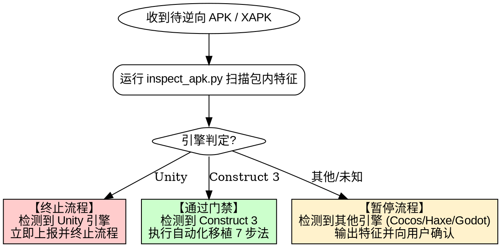

# APK 逆向与移植抖音小游戏 (apk-re-to-minigame)

## Overview

本技能规范了从移动端 APK 逆向分析、引擎门禁判定，到将 **Construct 3** 游戏工程完整移植适配为**抖音小游戏（ByteDance MiniGame）**的端到端标准化流程。核心原则是：**门禁在前、按图索骥、严守包体红线、双端垫片闭环**。

---

## When to Use



### 适用场景
- 策划或合作方提供了 `.apk`、`.xapk`、`.apks` 或解压目录，需要辨识游戏底层引擎。
- 确认游戏采用 **Construct 3** 引擎制作，需要将其移植为能在抖音宿主（iOS Helium 与 Android Krypton 双端）稳定运行的抖音小游戏。
- 调试抖音小游戏 Android 真机扫码黑屏、缺少 `visualViewport`/`atob`/`Blob` 全局对象、主包超过 4MB 限制、SWC 保留字编译错误或位图字体显示错位。

### 绝对禁止场景
- **检测到 Unity 引擎时**：严禁直接套用 Web 移植管线，严禁继续盲目反编译！必须立即终止流程，向用户出具 Unity 特征判定证据并结束当前轮次。

---

## Quick Reference

| 操作目标 | 命令 / 路径 | 说明 |
|---|---|---|
| **引擎扫描与审计** | `python <skill>/scripts/inspect_apk.py <path_to_apk> -o recovery-audit.json` | 判定引擎（Unity 自动中止，C3 输出审计） |
| **提取 C3 Web 资源** | `python <skill>/scripts/inspect_apk.py <path_to_apk> --extract-web <target_dir>` | 提取 `assets/www/` 静态网页工程 |
| **素材分包与入口生成** | `node <skill>/scripts/embed-images.js <minigame_project_dir>` | 确保分包内存在必需的 `game.js` |
| **WASM 二进制内嵌** | `node <skill>/scripts/embed-wasm.js <minigame_project_dir>` | 自动将 `.wasm` 转为 Base64 JS 模块，绕开抖音打包过滤白名单 |
| **4MB 主包与规范校验** | `node <skill>/scripts/validate-package.js <minigame_project_dir>` | 严查主包体积及分包合法性 |
| **打包 CDN 无广告链接** | `node <skill>/scripts/export-noad-freelink.js -s <web_dir> -o Noad-freelinks/<name> -n <game_name>` | 生成可直接上传 CDN 并运行在浏览器的免广告试玩工程 |
| **商业化与平台管理器模板** | `<skill>/templates/sdk-manager.template.js` | 包含统一广告调度、15s熔断、开发调试降级、桌面/侧边栏及清档开关 |
| **无广告试玩垫片模板** | `<skill>/templates/noad-bridge.template.js` | 包含 `tt`/`PokiSDK`/`AppLovin` 激励视频自动发放与 Toast 提示 |
| **适配器模板** | `<skill>/templates/tt-c3-adapter.template.js` | 包含 Helium 与 Krypton 全局垫片、WASM fetch 拦截与 DOMRect |
| **小游戏启动入口模板** | `<skill>/templates/game.template.js` | 包含 `MiniBlob`/`atob`、WASM 预读、SDKManager 集成及异步分包预加载 |

---

## Step-by-Step Workflow (Construct 3 移植与免广告打包 8 步法)


### Phase 1: 引擎门禁检测 (Gatekeeper)
**必须作为第一步运行**，不得跳过：
```bash
python <skill>/scripts/inspect_apk.py "<path_to_game.apk>" --output recovery-audit.json
```
- 若检测出 `libunity.so`、`libil2cpp.so`、`assets/bin/Data/`：脚本退出码为 2，**立即终止后续所有步骤**，向用户报告：“该 APK 由 Unity 引擎开发，已按规范终止自动化移植流程。”
- 若检测出 `c3runtime.js`、`data.json`：脚本退出码为 0，生成 `recovery-audit.json`，自动进入 Phase 2。
- 若检测出 Haxe/Lime（如 G-Switch）、Cocos 或 Godot：暂停并汇报用户，等待明确指示。

---

### Phase 2: Web 资源提取与审计
将 Web 静态工程提取至工作目录：
```bash
python <skill>/scripts/inspect_apk.py "<path_to_game.apk>" --extract-web ./recovered-web
```
- 查看 `recovery-audit.json` 中的关键指标：
  - `layouts`：场景清单
  - `object_types_count`：对象总数
  - `plugins_detected`：海外第三方 SDK（如 `EMI_INDO_AppLovin_Ads`, `CV_FirebaseAnalytics`）

---

### Phase 3: 主包瘦身与分包架构配置
> [!IMPORTANT]
> **抖音小游戏硬性限制**：主包体积（扣除分包后的剩余代码与核心配置）**必须严格 <= 4.0 MB**，推荐控制在 **3.0 MB** 以内。

1. **创建小游戏工程目录结构**：
   ```text
   my-tt-minigame/
   ├── adapter/
   │   └── tt-c3-adapter.js       # 核心运行时适配层
   ├── scripts/
   │   ├── c3runtime.js          # C3 运行时引擎
   │   ├── main.js               # 主游戏初始化脚本
   │   └── objRefTable.js        # 对象引用表
   ├── data/                     # 数据分包
   │   ├── game.js               # 必需分包入口: module.exports = {};
   │   └── data.json             # 核心工程数据
   ├── images/                   # 图片分包
   │   ├── game.js               # 必需分包入口: module.exports = {};
   │   ├── embedded-assets.js    # 自动生成的图集 Base64 映射
   │   └── *-sheet0.webp         # 原始大纹理图集
   ├── media/                    # 音频分包
   │   ├── game.js               # 必需分包入口: module.exports = {};
   │   └── *.webm, *.m4a, *.mp3  # 音频文件
   ├── game.js                   # 小游戏主引导入口
   ├── game.json                 # 小游戏全局配置
   └── project.config.json       # 抖音开发者工具配置
   ```
2. **配置 `game.json`**：
   参考 [game.template.json](file:///C:/Users/CY/.gemini/config/skills/apk-re-to-minigame/templates/game.template.json)，声明横屏及分包：
   ```json
   {
     "deviceOrientation": "landscape",
     "showStatusBar": false,
     "subPackages": [
       { "name": "images", "root": "images/" },
       { "name": "media", "root": "media/" },
       { "name": "data", "root": "data/" }
     ]
   }
   ```
3. **补齐每个分包的 `game.js`**：
   运行工具自动补齐：
   ```bash
   node <skill>/scripts/embed-images.js ./my-tt-minigame
   ```

---

### Phase 4: 注入双引擎适配器、商业化管理器与全局垫片
1. **注入适配器**：
   复制 `<skill>/templates/tt-c3-adapter.template.js` 到 `adapter/tt-c3-adapter.js`：
   - **AudioContext 桥接与 AudioParam 补全**：桥接 `tt.getAudioContext()`，提供 `ensureAudioParam` 补齐 `cancelScheduledValues`、`cancelAndHoldAtTime`，并在 `onTouchStart`/`onShow` 自动触发 `ctx.resume()`。
   - **WebM Opus 阻断声明**：`canPlayType` 对 webm/opus 返回 `""`，阻止原生播放器崩溃并转入 Wasm 软解。
   - **本地存储持久化**：将 `localStorage` 同步桥接至 `tt.getStorageSync`/`tt.setStorageSync`，防止 IndexedDB 缺失导致存档内存化丢失。
   - **W3C 几何对象与 Response 补齐**：提供 `DOMRect`、`DOMPoint`、`DOMQuad`、`MiniResponse` 垫片。
   - **WASM 请求就地拦截**：在 `fetch` 垫片中拦截 `noise.wasm` 与 `opus.wasm.wasm`，直接返回内嵌 ArrayBuffer 响应。
2. **部署商业化与平台调度管理器 (`SDKManager.js`)**：
   复制 `<skill>/templates/sdk-manager.template.js` 到小游戏根目录 `SDKManager.js`：
   - **广告调用统一收拢**：所有激励视频 (`showRewarded`) 与插屏广告 (`showInterstitial`) 均走管理器调度，自带 15s 超时熔断防悬挂。
   - **开发/测试降级发奖模式**：默认开启 `adMode: "development-fallback-success"`，未配真实广告位时自动发奖并弹窗提示。
   - **测试调优与存档控制**：提供 `clearSaveOnStart: false` 开关与 `clearSaveData()` 方法，便于测试随时清空本地存档。
   - **平台能力支持**：短震动 (`vibrateShort`)、分享 (`share`)、添加桌面 (`AddDeskTop`)、侧边栏 (`AddSideBar`)。
3. **执行 WASM 二进制内嵌 (绕开打包扩展名过滤)**：
   运行自动化内嵌工具：
   ```bash
   node <skill>/scripts/embed-wasm.js ./my-tt-minigame
   ```
   工具会自动扫描 `.wasm` 并生成 `scripts/embedded-wasm.js`（Base64 封装，支持 `tt.base64ToArrayBuffer` 极速解码）。
4. **注入主入口 `game.js`**：
   参考 `<skill>/templates/game.template.js`，包含：
   - **`MiniBlob` / `MiniFile` / `MiniResponse`**：实现对 `ArrayBuffer` 与 `URL.createObjectURL` 的支持。
   - **`atob` / `btoa`**：挂载全局纯 JS base64 编解码方法（防 Android Krypton 报 `atob is not defined`）。
   - **`visualViewport`**：提供具备 `addEventListener` 与尺寸查询能力的事件目标（防 Android 扫码黑屏）。
   - **引入 SDKManager 与存档清空检测**：在启动时执行 `if (SDKManager.clearSaveOnStart) SDKManager.clearSaveData();`。
   - **严格时序的分包异步加载与数据/WASM 预读**：
     ```javascript
     await Promise.all([loadSub('images'), loadSub('media'), loadSub('data')]);
     // 通过 FileSystemManager 同步读取 data.json 注入 globalThis.__c3DataJson
     const fs = tt.getFileSystemManager();
     globalThis.__c3DataJson = JSON.parse(fs.readFileSync('data/data.json', 'utf8'));
     // 预载内嵌 WASM 二进制至 globalThis.__noiseWasmBuffer 与 Module.wasmBinary
     ```

---

### Phase 5: 语法、着色器与运行时冲突排错
- **ES6 Module 模块平铺与 CommonJS 降级**：
  - C3 在 `scripts/project/` 下生成的多个脚本若使用 ES6 `import`/`export`，在小游戏 CommonJS 环境会报 `SyntaxError: Cannot use import statement outside a module`。
  - **解法**：将这些模块脚本平铺合并进 `scripts/project/main.js`，移除所有 `import`/`export` 声明，并在 `game.js` 的 `scriptModules` 中显式注册。
- **移动端 WebGL 低精度着色器容差 (Chromakey Shader Failure)**：
  - 针对食物啃食遮罩或色度键特效，`data.json` 中 `tolerance` 设为 `0` 时，移动端 GPU `lowp float` 精度无法匹配精确数学零，导致锯齿灰块残留在画面表面。
  - **解法**：在 `c3runtime.js` 的对应 Shader 中增加移动端最小容差保底：`lowp float effTol = max(tolerance, 0.08);`。
- **GLSL ES 1.00 着色器语法 (S0012 错误)**：
  - Android GPU 严禁在着色器全局作用域中使用非常量（如 `uniform` 变量）初始化全局变量（`S0012: Value being assigned must be a constant`）。
  - 将所有全局变量的非常量赋值移入 `void main()` 函数体内。
  - 在 `c3runtime.js` 的 `WebGLShaderProgram.Compile` 增加 Shader Fallback 降级，避免单个滤镜编译失败导致全屏黑屏。
- **单线程化 Opus Wasm 软解**：
  - 小游戏环境没有 Web Worker，在 `c3runtime.js` / `main.js` 中拦截 `_WasmDecodeWebMOpus`，直接调用主线程挂载的 `JobHandlers["OpusDecode"]` 处理 PCM 提取。
- **ES6 原型 Getter/Setter 严格模式冲突**：
  - 为 `MiniAudio` 上所有原型 Getter（`duration`, `paused`, `readyState`, `ended`）对称提供空 Setter，避免基类构造函数严格模式赋值抛出 `Cannot set property which has only a getter`。
- **保留字冲突 (SWC Parser)**：
  - 在 `scripts/objRefTable.js` 中查找 `switch: class` 或 `function switch(`，重命名为 `_switch` 或 `SwitchObject`。
- **私有属性报错**：
  - 在 `scripts/modernjscheck.js` 中若包含 `#p` 私有属性语法探针，注释该探针，直接显式赋值 `window["C3_ModernJSSupport_OK"] = true;`。
- **Unicode 正则报错**：
  - 在 `scripts/c3runtime.js` 中捕获 `\p{P}` 正则，避免低版本 Krypton 抛出 `Invalid regular expression`。

---

### Phase 6: 汉化与特殊字体字符集偏移排查
1. **文本抽取与字库裁剪**：
   - 提取 `data.json` 内涉及文本，生成 `safe_font.txt`。
   - 对提供的 `zh.ttf` 使用 fontmin 裁剪，体积压缩到 500KB 以内。
2. **位图字体 `0` / `00` 偏移校正**：
   - 若游戏中金币或建造面板出现 `00` 或货币符号消失，排查 `data.json` 中 `Spritefont2` 字符映射表，确保 `£/¥/¢` 特殊符号的图集切片与映射索引完全一致。

---

### Phase 7: 规范校验与真机上机验收
1. **执行自动化包体与静态规则校验**：
   ```bash
   node <skill>/scripts/validate-package.js ./my-tt-minigame
   ```
   **必须确认**：
   - `Main Package Size <= 4.0 MB`
   - 每个分包目录下的 `game.js` 校验通过
   - `tt-c3-adapter.js` 包含 `visualViewport` 与 `ensureAudioParam`
   - 无 SWC 保留字语法错误与 GLSL ES 1.00 非常量初始化特征
2. **首局与新手引导流程回归验证（存档控制）**：
   - 调试和真机初次体验验证时，小游戏持久化存储 (`tt.setStorageSync` / `localStorage`) 不会因为 IDE 重编而清除。
   - 在 `SDKManager.js` 中将 `clearSaveOnStart` 设置为 `true`，验证“全新安装玩家”从初始关卡、新手引导、首次广告弹窗到存档建立的完整流程。
   - 验证通过后，**必须将 `clearSaveOnStart` 改回 `false`**，避免线上正式版本每次启动清空玩家游戏进度。
3. **抖音开发者工具导入与真机验证**：
   - 打开抖音开发者工具，导入 `my-tt-minigame`。
   - 在“项目构成分析”确认主包体积。
   - 使用 Android 手机扫码，确认**无黑屏、能进入主玩法、音效正常出声且无中断、存档正常**。
   - 使用 iPhone 扫码，并在菜单中点击“重新进入小游戏”，确认**屏幕方向锁定正常，无压扁变竖屏**。

---

### Phase 8: 打包 CDN 网页版无广告试玩链接 (No-Ad Free-Link Web Build)
小游戏移植验收完成后，为便于运营发链、渠道测试、商务评审，自动化打包一套**脱离小游戏客户端、可直接上传至 CDN、并在桌面/手机 Web 浏览器直接运行**的免广告试玩版本：
```bash
node <skill>/scripts/export-noad-freelink.js --source ./reverse/recovered-web --output ./Noad-freelinks/mine_line --name "Tiny Miners"
```

**核心保障与自动化能力**：
1. **全链路广告自动发奖 (No-Ad Bypass)**：
   - 注入 `noad-bridge.js`，无缝拦截 `tt.createRewardedVideoAd`、`PokiSDK.rewardedBreak`、Cordova `AppLovinMAX.showRewardedAd`。
   - 玩家点击“看广告获得金币/双倍奖励/复活”时，直接跳过视频，立即触发奖励发放回调，并弹出毛玻璃 HUD 提示：`✨ [免看广告] 奖励已直接发放！`。
2. **浏览器原生适配与生命周期解锁**：
   - 自动响应式监听并派发 Cordova `deviceready` 事件，解耦对原生 Android/iOS 容器的依赖，确保桌面及移动端 Web 浏览器秒开。
   - 自动将 `exportType` 设为 `"html5"`，剔除 native `cordova.js` 依赖与 Android 文件系统冲突。
   - 自动解锁 Web Audio 浏览器手势静音限制。
3. **浏览器 `file:///` 安全限制与一键启动器 (`启动网页试玩.bat`)**：
   - **禁止直接双击 `index.html`**：现代浏览器出于安全策略，严禁在 `file:///` 协议下加载 ES Module 模块脚本与游戏数据配置，直接双击必然黑屏。
   - **自动化生成 `启动网页试玩.bat` 与 `serve.py`**：内置微型 HTTP 服务，并自动纠正 Windows 注册表常有的 `.js` 误识别为 `text/plain` 导致的模块 MIME 阻断问题（强制设定为 `application/javascript`），实现本地一键双击即开。
   - **内置友好阻断提示**：若用户误直接双击 `index.html`，`noad-bridge.js` 自动弹出毛玻璃指引弹窗，引导双击 `.bat` 或上传 CDN。
4. **独立文件夹归类与 CDN 托管**：
   - 每个工程单独归类存储在 `Noad-freelinks/<project_name>/` 目录下。
   - 资源均为自包含纯相对路径（`./`），直接上传至阿里云 OSS、腾讯云 COS、AWS S3 或 Cloudflare Pages 等任意静态托管即可分发。
5. **统一导航门户自动更新**：
   - 每次打包自动更新 `Noad-freelinks/index.html` 导航门户与 `启动所有免广告试玩.bat`，汇总展示所有项目的免广告试玩链接。

---

## Common Rationalizations & Red Flags

| 错误心智与借口 | 真实情况与正确做法 |
|---|---|
| “Unity 的 APK 资源也能拿出来，不如直接逆向改写” | **RED FLAG**。Unity 代码经 IL2CPP 编译为二进制 Native 库，强行反编译改写成本极高且极易烂尾。门禁判定为 Unity 时必须立即终止。 |
| “主包 4.2 MB，抖音工具应该能上传” | **RED FLAG**。抖音开放平台服务端上传接口有 4MB 硬卡点，超过 1 字节都会报错。必须将图片或音频推入分包。 |
| “只在 images 文件夹放图片就行，不需要 game.js” | **RED FLAG**。抖音编译器强制检查分包根目录的 `game.js`，缺少会导致编译阶段直接阻断。 |
| “反编译后的 index.html 直接双击应该就能在浏览器预览” | **RED FLAG**。现代浏览器出于安全规范，严禁在 `file:///`（Origin 为 `null`）下加载 ES Module 模块与 fetch 本地数据。直接双击必黑屏，必须通过 HTTP 服务或双击配套的「启动网页试玩.bat」运行。 |
| “本地预览只要随便开个 python -m http.server 就可以” | **RED FLAG**。Windows 注册表中 `.js` 常被关联为 `text/plain`，Python 默认输出该 MIME 类型会导致 Chrome 依据严格模块规范拒收执行。必须使用强制映射 `application/javascript` 的 `serve.py`。 |
| “做免广告试玩只要注释掉广告代码即可” | **RED FLAG**。游戏内的道具、复活与翻倍深度依赖广告结束事件（`onClose` / `OnRewardedAdReceivedRewardEvent`），直接注释会导致流程卡死。必须使用 `noad-bridge.js` 模拟完整生命周期并秒发奖。 |

---

## Supporting Files & References

- **双端避坑手册**: [krypton-helium-pitfalls.md](file:///C:/Users/CY/.gemini/config/skills/apk-re-to-minigame/references/krypton-helium-pitfalls.md)
- **免广告 Web 试玩避坑手册**: [noad-freelink-guide.md](file:///C:/Users/CY/.gemini/config/skills/apk-re-to-minigame/references/noad-freelink-guide.md)
- **抖音规范与限制**: [douyin-minigame-specs.md](file:///C:/Users/CY/.gemini/config/skills/apk-re-to-minigame/references/douyin-minigame-specs.md)
- **C3 结构与字体指南**: [c3-logic-and-fonts.md](file:///C:/Users/CY/.gemini/config/skills/apk-re-to-minigame/references/c3-logic-and-fonts.md)
- **SDKManager 平台与商业化管理器模板**: [sdk-manager.template.js](file:///C:/Users/CY/.gemini/config/skills/apk-re-to-minigame/templates/sdk-manager.template.js)
- **WASM 内嵌工具**: [embed-wasm.js](file:///C:/Users/CY/.gemini/config/skills/apk-re-to-minigame/scripts/embed-wasm.js)
- **免广告导出工具**: [export-noad-freelink.js](file:///C:/Users/CY/.gemini/config/skills/apk-re-to-minigame/scripts/export-noad-freelink.js)
- **免广告通用垫片模板**: [noad-bridge.template.js](file:///C:/Users/CY/.gemini/config/skills/apk-re-to-minigame/templates/noad-bridge.template.js)
- **引擎扫描工具**: [inspect_apk.py](file:///C:/Users/CY/.gemini/config/skills/apk-re-to-minigame/scripts/inspect_apk.py)
- **包体合规校验器**: [validate-package.js](file:///C:/Users/CY/.gemini/config/skills/apk-re-to-minigame/scripts/validate-package.js)
- **素材分包工具**: [embed-images.js](file:///C:/Users/CY/.gemini/config/skills/apk-re-to-minigame/scripts/embed-images.js)
