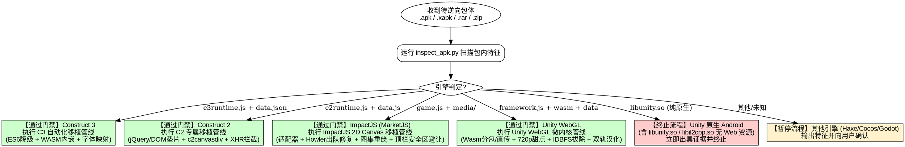

# 移动端游戏逆向与抖音小游戏移植规范 (apk-re-to-minigame)

## Overview

本技能规范了从移动端游戏安装包（`.apk`、`.xapk`、`.apks`、`.rar`、`.zip`）逆向分析、引擎特征门禁识别，到将 **Construct 3**、**Construct 2**、**ImpactJS (HTML5 2D Canvas / MarketJS)** 以及 **Unity WebGL (Unity 2020 / 2021 / 2022 / Unity 6+ / IL2CPP)** 游戏工程完整移植适配为**抖音小游戏（ByteDance MiniGame）**的端到端标准化流程与工业级实战规范。

### 核心铁律
1. **门禁在前，精准分流**：拿到游戏包第一步必须运行 `inspect_apk.py` 进行技术栈审计，分流进入对应引擎移植管线。
2. **小游戏适配第一，严禁前置做无广链接**：**所有工程力量必须优先集中在抖音小游戏端（分包构建、运行时垫片、SDKManager 商业化、真机验证跑通）**。CDN 免广告试玩版本仅作为小游戏跑通后的可选附带交付物，绝对禁止在小游戏跑通前提前制作！
3. **严守 4.0 MB 主包红线与微内核架构**：
   - 扣除分包后的主包体积必须严格 $\le 4.0\text{ MB}$（Unity WebGL 推荐采用 **< 600 KB 微内核主包**），全部分包根目录必须具备 `game.js`。
   - `game.json` 分包声明必须使用严格大写驼峰 **`subPackages`**（同时兼备 `subpackages` 容错）。
   - Windows 环境下分包 `root` 声明**严禁带尾斜杠**（必须是 `"root": "wasm_pkg"` 而非 `"wasm_pkg/"`，防止路径匹配失效导致分包被误计入主包）。
4. **WASM 编译双轨分流与平台 API 禁区**：
   - 字节跳动平台 `TTWebAssembly.instantiate(path)` **严格只接受代码包内相对路径**，绝对不支持 `ArrayBuffer`，且在 Android 端绝对不支持沙盒路径（`ttfile://`）。
   - Android 沙盒/CDN 模式必须使用 `fs.readFile` 读取 ArrayBuffer 并交付宿主原生 V8 `WebAssembly`，**绝对禁止将全局 `WebAssembly` 篡改为 `TTWebAssembly`**！
   - 超大 WASM（>20MB~42MB）推荐采用 **Brotli 压缩（quality=6 压缩至 ~8.65MB）入 `wasm_pkg` 官方分包**，由底层 C++ mmap 流式解压秒开，零 JS 内存占用。
5. **禁止破坏原生 C++ 绑定**：
   - 在抖音小游戏环境，原生画布对象（`tt.createCanvas()`）严禁使用 `Object.defineProperty` 覆写 `width/height`，必须通过常规赋值触发底层的 C++ Framebuffer 扩容，防止黑屏。
6. **双轨制汉化分层重组与严禁直接 `webfile.save()`**：
   - Unity WebGL 商业无源码包汉化分为**静态 TMPro 原地对齐**与 **IL2CPP `global-metadata.dat` (v39) 动态字面量重构平移注入**；
   - **严禁直接对顶层 WebFile 容器调用 `webfile.save()`**（会破坏内部 assets 块对齐抛出 `Position out of bounds!`）。必须分层无损重组并按 `UnityWebData1.0` 规范组装。
   - 每次发版必须**递增 `ASSET_CACHE_VERSION` 并上滑杀死抖音客户端进程**冷启动，彻底击穿真机旧沙盒强缓存。
7. **商业化成对同帧触发与无参 SendMessage 路由**：
   - 模拟广告或异常放行时，**严禁使用异步 `setTimeout`**，必须同帧成对触发 `onStart()` 与 `onFinished()`，杜绝 C# `_origTimeScale=0.0f` 导致时间永久冻结；
   - 针对无参方法（如 `JSLibCallback_AdFinished`）必须路由至零参数 `_SendMessage`，杜绝传空字符串导致反射方法失配被静默丢弃。
8. **产出物路径强约束与工作区防污染**：
   - 原始解压源码统一存放于 `extracted/<game_name>_package/`，严禁散落至 `reverse/` 或根目录；
   - 抖音小游戏工程成品统一输出至 `reverse/<game_name>-tt-minigame/`；
   - 逆向复盘文档与审计报告统一归档于 `reverse/docs/`；
   - **严禁在根目录创建任何临时排错脚本**！所有排错脚本归类存放于 `scratch/<game_name>/`；
   - 可复用命令行工具统一存放在 `tools/`。

---

## When to Use & 引擎决策流



### 适用场景
- 拿到合作方或竞品游戏包，需要辨别底层技术架构与移植可行性。
- **Construct 3** 游戏移植：处理 ES6 降级、WASM Base64 内嵌、中文字体映射、AudioParam 补齐。
- **Construct 2** 游戏移植：处理 `jQuery 2.1.1` DOM 节点模拟、`#c2canvasdiv` 容器树结构、Spine WebGL 骨骼动画、XHR 本地数据拦截、`.ogg` 音频瘦身。
  - Spine 角色透明、消失或动画不播放时，必须先读取 `references/construct2-minigame-guide.md` 的“Spine 角色透明、消失或动画不播放：运行时取证闭环”，证明资产已加载并完成绘制后，才允许修改 Alpha、Shader 或动画时钟。
- **ImpactJS (HTML5 2D Canvas / MarketJS)** 游戏移植：处理 Canvas 2D / DOM 节点树模拟（#ajaxbar/#game/#orientate/#play）、Howler.js `_loadQueue` 出队时序修复（彻底杜绝 Maximum call stack size exceeded）、Krypton 引擎 AudioParam `setValueAtTime` 降级、`window.focus()` 穿透清洗（消除 Illegal invocation）、`ig.VisibilityHandler` 前台常驻保护、`_isValidName` 静态字体正则保护与 Canvas 2D 动态 Fallback 注入、大图集 (`plugins.packer`) 精确重绘写回、以及 iPhone 灵动岛/刘海屏 30px 安全区沉浸式避让。
- **Unity WebGL** 商业包移植（Unity 2020/2021/2022/Unity 6+）：
  - 微内核套壳架构（主包 < 600KB）；
  - Wasm Brotli 官方分包（~8.65MB，彻底根治 Android 15%/40%/50% 死锁与 OOM）；
  - 画布尺寸修复（杜绝 3×3 模糊渐变与黑屏）与 16:9 短边 720p 甜点缩放；
  - WebGL 双缓冲保留（`preserveDrawingBuffer: true` 杜绝 95% 切场景黑屏）；
  - Unity 6 微内核装配（`deinitializers`、`SystemInfo`、`webglContextAttributes`）；
  - 拔除遗留 IDBFS 阻塞依赖（消除 `addRunDependency("JS_FileSystem_Mount")` 秒进主循环）；
  - 跨端关键垫片（iOS `performance.now` 四层防御、Android `TextDecoder` / `crypto.getRandomValues` 纯 JS 解码与防线）；
  - 海外商业 SDK (CrazyGames / Poki) 桥接（SiteLock 域名锁穿透、`_InitSDK` 时序即时握手、成对同帧广告与无参 SendMessage 路由、`unityStringify` 前置垫片）；
  - 全域统一 Loading 遮罩自愈管理（`__dismissLoadingMask` 破除跨语言信号断层）；
  - WebAudio 真实桥接与 3D Panner 旁路直通；
  - 双轨制汉化（静态 TMPro 原地对齐 + 方舟像素 12px 硬描边 + IL2CPP metadata 字符串重排平移注入 + 分层重组严禁 `webfile.save()`）；
  - 敏感外链四重物理隐藏与右上角胶囊避让。

---

## Quick Reference & 常用工具与命令速查

### 1. 产出物全生命周期存放目录矩阵 (强制规范)

| 产出物类别 | 唯一标准存放路径 | 命名规范示例 | 强制约束与红线 |
|---|---|---|---|
| **待分析安装包** | `apk/` | `apk/<game>.apk\|rar` | 仅存放待分析原始压缩包，git 忽略，严禁就地解压 |
| **原始解压工程** | `extracted/` | `extracted/<game>_package/` | 所有解压后的原始资源集中放置于此，严禁散落至 `reverse/` |
| **抖音小游戏工程** | `reverse/` | `reverse/<game>-tt-minigame/` | 小游戏成品唯一存放路径，内含完整分包、适配器及入口 |
| **审计与复盘文档** | `reverse/docs/` | `PORTING_<GAME>.md`<br/>`<game>_audit.json` | 逆向复盘报告与审计 JSON 集中归档，严禁置于根目录 |
| **临时调试排错脚本** | `scratch/` | `scratch/<game>/<script>.py` | **绝对禁止在根目录新建临时脚本**！排错痕迹一律按项目归类于 `scratch/<game>/` |
| **CDN 免广告试玩** | `Noad-freelinks/` | `Noad-freelinks/<game>/` | 浏览器脱机试玩版，必须在抖音端跑通后按需生成 |
| **生产力工具链** | `tools/` | `tools/<tool>.py\|js\|exe` | 存放可复用全局命令行工具，不存放项目特化临时逻辑 |

### 2. 常用工具与命令速查

| 目标分类 | 工具 / 脚本 / 模板 | 说明 |
|---|---|---|
| **引擎扫描与审计** | `python tools/inspect_apk.py <path_to_pkg> -o audit.json` | 判定引擎（支持 APK/XAPK/ZIP/RAR，自动识别 C3/C2/Unity） |
| **4MB 主包与分包校验** | `node tools/validate-package.js <minigame_project_dir>` | 严查主包体积 $\le 4.0\text{MB}$ 及每个分包根目录的 `game.js` |
| **WASM Brotli 压缩** | `python -c "import brotli; open('wasm_pkg/game.wasm.br','wb').write(brotli.compress(open('game.wasm','rb').read(), quality=6))"` | 将 42MB WASM 压缩至 8.65MB 入官方分包，彻底消除 Android 死锁与 OOM |
| **素材分包补齐** | `node tools/embed-images.js <minigame_project_dir>` | 自动为图片分包补齐 `game.js` 并生成 Base64 图集映射 |
| **WASM 内嵌工具** | `node tools/embed-wasm.js <minigame_project_dir>` | 针对 C3 将 `.wasm` 转为 Base64 JS 模块，绕开打包扩展名过滤 |
| **Unity 适配器模板** | `<skill>/templates/tt-unity-adapter.template.js` | Unity WebGL 专属适配层（DOM/Window/Audio/Storage/Canvas原生保护） |
| **C2 适配器模板** | `<skill>/templates/tt-c2-adapter.template.js` | Construct 2 专属适配层（jQuery DOM模拟/c2canvasdiv/Spine/XHR拦截） |
| **C3 适配器模板** | `<skill>/templates/tt-c3-adapter.template.js` | Construct 3 专属适配层（双端 Helium/Krypton 垫片/AudioParam/去抖） |
| **ImpactJS 适配器模板** | `<skill>/templates/tt-impact-adapter.template.js` | ImpactJS (MarketJS) 专属适配层（Canvas/DOM/AudioParam/Howler/Events） |
| **统一商业化管理器** | `<skill>/templates/sdk-manager.template.js` | 统一广告调度、15s 超时熔断、开发调试自动发奖、桌面/侧边栏支持 |
| **全域 Loading 管理器** | `root.__dismissLoadingMask = dismissLoadingMask;` | 一票解除、封锁重复弹窗、1.5s postRun 保底，杜绝遮罩假死 |
| **中文字体全局映射** | `tt.loadFontFace({ family: '<原字体名>', source: 'url("fonts/font.ttf")' })` | 零成本全量生效中文字体，无需逐个修改 Text 实例 |
| **横竖屏锁定防死循环** | 绝对尺寸校准 `Math.max` 赋宽、`Math.min` 赋高 | 彻底解决安卓冷启动竖屏误报及切场景黑屏 |
| **（可选）CDN 免广告链接** | `node tools/export-noad-freelink.js -s <src> -o Noad-freelinks/<name>` | **严禁前置执行**，小游戏跑通后导出免广告试玩版（含 Unity 解包复用） |

---

## Step-by-Step Workflow (抖音小游戏移植标准化流程)

> [!IMPORTANT]
> **工作流执行铁律**：全流程以 **Phase 1 至 Phase 7（抖音平台适配与真机跑通验证）** 为核心。任何情况下都**不得在小游戏调通前提前制作无广试玩链接**！

---

### Phase 1: 引擎门禁检测 (Gatekeeper)
```bash
python tools/inspect_apk.py "apk/YourGamePackage.rar" --output reverse/docs/audit.json
```
- **输出 Unity WebGL**：通过门禁，进入 Unity WebGL 移植管线。
- **输出 Construct 2**：通过门禁，进入 Construct 2 移植管线。
- **输出 Construct 3**：通过门禁，进入 Construct 3 移植管线。
- **输出 Unity (Native Android)**：退出码 2，立即终止流程，向用户出具二进制证据。
- **输出 Haxe/Lime、Cocos、Godot**：退出码 3，暂停并向用户汇报。

---

### Phase 2: 资源解压与目录建立
将原始包体解压至 `extracted/<project_name>_package/`：
```bash
# 若为 RAR 包：
tools\UnRAR.exe x -o+ "apk/YourGamePackage.rar" "extracted/your_game_package/"
```
并在 `reverse/<project_name>-tt-minigame/` 初始化标准抖音小游戏工程结构。

---

### Phase 3: 主包瘦身与分包架构划分 (严守 4.0 MB 红线)

1. **根据引擎特征划分分包**：
   - **Unity WebGL**：
     - **微内核主包架构**：主包体积控制在 **< 600 KB**（仅保留适配器、胶水代码与启动器）。
     - **Wasm 官方分包 (`wasm_pkg/`)**：使用 Brotli (quality=6) 将 42MB WASM 压缩为 **8.65MB**，放入 `wasm_pkg/PCIBuild.wasm.br` + `wasm_pkg/game.js`。
     - **数据处理**：
       - 包体 $\le 20\text{ MB}$：建立 `data_pkg/` 分包直读；
       - 包体 $> 20\text{ MB}$：将 `.data` 与 Addressables `StreamingAssets/` 托管至 CDN，小游戏通过沙盒缓存 `${tt.env.USER_DATA_PATH}/unity_cache` 动态拉取并持久化。
   - **Construct 2**：
     - `images/` 分包：所有切片图集 + `images/game.js`
     - `media/` 分包：所有的 `.m4a` 音频 + `media/game.js`（**必须彻底删除所有 `.ogg` 冗余音频**）
     - `data/` 分包：`data.js` + `localisation.json` + `data/game.js`
     - 主包：`c2runtime.js`、`jquery-2.1.1.min.js`、`spine_webgl.js`、适配器与主启动入口
   - **Construct 3**：
     - `images/` 分包：图集与纹理 + `images/game.js`
     - `media/` 分包：音频文件 + `media/game.js`
     - `data/` 分包：`data.json` + `data/game.js`
     - 主包：`c3runtime.js`、`scripts/`、适配器与主入口
2. **生成每个分包的 `game.js`**：
   每个分包根目录下必须包含 `game.js`（内容可为 `module.exports = {};`）。
3. **配置 `game.json` 声明横屏与分包**：
   ```json
   {
     "deviceOrientation": "landscape",
     "showStatusBar": false,
     "enableIOSHighPerformanceMode": true,
     "iOSHighPerformance": true,
     "subPackages": [
       { "name": "wasm_pkg", "root": "wasm_pkg" },
       { "name": "data_pkg", "root": "data_pkg" }
     ]
   }
   ```
   > [!WARNING]
   > 1. 字段名必须使用大写驼峰 **`subPackages`**；
   > 2. Windows 环境下 `root` **严禁带尾斜杠**（必须写 `"wasm_pkg"` 而非 `"wasm_pkg/"`）。

---

### Phase 4: 引擎专有适配器与主入口注入

#### A. Unity WebGL 专用核心要点 (工业级微内核装配)
1. **注入适配器**：复制 `<skill>/templates/tt-unity-adapter.template.js` 到 `adapter/tt-unity-adapter.js`。
2. **WASM 编译双轨分流**：
   - 代码包内路径：双端统一直传 `TTWebAssembly.instantiate(path, imports)` 流式编译秒开；
   - 沙盒/CDN 模式：必须走 `fs.readFile` 得到 ArrayBuffer 交付宿主原生 V8 `WebAssembly`，**严禁将 ArrayBuffer 传给 TTWebAssembly**。
3. **修复画布尺寸与 720p 甜点缩放**：
   - `_JS_SystemInfo_GetCanvasClientSize` 回退至 `Module["canvas"]`，返回真实 CSS 视口；
   - 严禁 `Object.defineProperty` 覆写 `canvas.width/height`，必须保持常规赋值触发底层 C++ Framebuffer 扩容；
   - 横屏以**短边 720p 为基准等比缩放**，冷启动强制 `Math.max` 赋宽、`Math.min` 赋高。
4. **WebGL 双缓冲保留**：
   在 `webglContextAttributes` 开启 `preserveDrawingBuffer: true`，杜绝切场景 95% 瞬间黑屏。
5. **拔除遗留 IDBFS 阻塞依赖**：
   重写 `unityFileSystemInit` 为同步秒级放行，清除 `addRunDependency("JS_FileSystem_Mount")`，使 `runDependencies` 归零秒进 `callMain()`。
6. **前置垫片注入**：
   - 顶置挂载 `window.unityStringify` 与 `window.UnitySDK`，防止 `Input System initialize` 阶段调用 JSLib 报 TypeError 假死；
   - iOS 注入 `performance.now` 四层防御；Android 注入 `TextDecoder` / `crypto.getRandomValues` 纯 JS 解码与防线。
7. **海外商业 SDK (CrazyGames / Poki) 桥接**：
   - **SiteLock 穿透**：拦截 `_JS_SystemInfo_GetDocumentURL`，恒定返回平台合法线上 URL，消除 Code 3 冻结；
   - **`_InitSDK` 即时握手**：进入 `doInit` 第一时间同步发送 `SendMessage("CrazySDKSingleton", "JSLibCallback_Init")`；
   - **成对同帧广告与无参 SendMessage**：模拟模式同帧同步触发 `onStart()` 与 `onFinished()`，无参回调强转为零参数 `_SendMessage`；广告接口必须返回 Promise 并保证 resolve。
8. **全域统一 Loading 遮罩自愈管理**：
   挂载 `__dismissLoadingMask`，实行一票解除、封锁重复弹窗、多级阶梯保底（1.5s postRun 保底、2.0s 引擎关键日志保底）。
9. **WebAudio 真实发声与 3D 空间音频直通**：
   接入 `tt.getAudioContext()`；`createPanner()` 返回增益为 1 的真实 GainNode 旁路直通；首触 `touchstart` 激活 `audioCtx.resume()`。

#### B. Construct 2 专用核心要点
1. **注入适配器**：复制 `<skill>/templates/tt-c2-adapter.template.js` 到 `adapter/tt-c2-adapter.js`。
2. **DOM 树与 jQuery 兼容**：提供 `nodeType=9`、`defaultView`、`createComment`、`createDocumentFragment`、`cloneNode`、`contains` 等补全。
3. **画布容器树**：构造 `#c2canvasdiv` 容器包裹 `#c2canvas` 并挂载至 `document.body`。
4. **XHR 零延迟拦截**：在 `XMLHttpRequest` 垫片中拦截 `data.js` 与 `localisation.json`，直接返回预读内容。
5. **Spine WebGL 绑定与运行时取证**：在 `scripts/spine_webgl.js` 导出全局 `window.spine` 与 `globalThis.spine`。角色透明/消失/动画停滞时，先记录 `loaded`、`pending/toLoad`、`errors`、纹理尺寸、`completedDraws` 与 `trackTime`；`loaded=false` 时禁止先改 PMA/Alpha/时序。Image 包装器必须保证每个 `src` 只结算一次、不得用超时伪造加载成功，并保护原生 getter-only DOM 属性。
6. **音频引擎模式锁定与原型保护**：在 `c2runtime.js` 的 `cr.plugins_.Audio.prototype.onCreate` 中强制锁定 `api = API_HTML5` 并 `useOgg = false`，绕开小游戏不支持的 WebAudio XHR/decode 流程；在适配层 `MiniElement` 构造函数中使用 `if (this.tagName !== 'AUDIO')` 守卫防止空桩方法遮蔽 `MiniAudio.prototype`，并在 `MiniAudio.src` 处自动将 `.ogg` 重写为 `.m4a`。

#### C. Construct 3 专用核心要点
1. **注入适配器**：复制 `<skill>/templates/tt-c3-adapter.template.js` 到 `adapter/tt-c3-adapter.js`。
2. **WASM Base64 内嵌**：运行 `node tools/embed-wasm.js ./reverse/my-tt-minigame`。
3. **模块平铺与 CommonJS 降级**：平铺 `scripts/project/` 下的 ES6 模块，移除 `import/export`。
4. **AudioParam 补齐与去抖**：补齐 `cancelScheduledValues` 与画布去抖。

#### D. ImpactJS (HTML5 2D Canvas / MarketJS) 专用核心要点
1. **注入适配器**：复制 `<skill>/templates/tt-impact-adapter.template.js` 到 `adapter/tt-adapter.js`。
2. **Howler `_loadQueue` 出队时序解耦 (彻底杜绝 Maximum call stack size exceeded)**：
   在 `game.bundle.js` 的 `_loadQueue` 中，无参数调用 `!event` 分支时**必须先行 `this._queue.shift()` 出队再执行 `action()`**，防止重入调用引发同一微任务栈内的无限自递归崩溃。
3. **Krypton WebAudio 降级与 AudioParam 补齐**：
   - 适配层为 `AudioParam.prototype` 注入 `setValueAtTime` 等属性赋值桩，防止 Howler 初始化阶段 GainNode 报错崩溃；
   - `ig.SoundHandler.init` 内部为 `bgmPlayer` 与 `miningPlayer` 挂载具备 `play/stop/volume/mute` 的 Dummy 防御桩，杜绝连锁空指针；
   - 移动端小游戏环境下强制锁定 Howler `usingWebAudio = false`，全量音效直接由轻量原生的 `tt.createInnerAudioContext` 硬件解码。
4. **穿透清洗 `window.focus()` (消除 Illegal invocation)**：
   全局清洗 `game.bundle.js`，将所有 `window['focus']()` 替换为安全无副作用的 `(void 0)`，杜绝小游戏 Native 宿主抛出 V8 原生错误。
5. **前台常驻与 VisibilityHandler 保护 (消除启动即冻结 Game Paused)**：
   - 适配层提供 `document.visibilityState = 'visible'` 与 `hidden = false`；
   - 桥接 `tt.onShow` 唤醒 `ig.game.resumeGame()`，并在 `pauseGame` 函数入口注入前台守卫（`!document.hidden` 忽略挂起）。
6. **字体文件名正则保护与 Canvas 2D 动态 Fallback 注入**：
   - 保持静态配置中的字体名称与路径为合法纯净字符串（如 `'luckiest-guy'`），严禁在配置中包含逗号与空格，杜绝触发 `_isValidName` 正则校验失败；
   - 在适配层拦截 `CanvasRenderingContext2D.prototype.font` 的 setter，动态拼接 `, "Microsoft YaHei", "PingFang SC", "Heiti SC", sans-serif`，英文卡通粗体与高品质中文黑体平滑并存。
7. **打包大图集 (`plugins.packer`) 精确写回**：
   - 解析 `window['packerplugin']['json']['texture-0']` 中目标切片帧的 UV 坐标；
   - 重绘高清中文字形与 3D 外描边后，使用 Python PIL 精确覆写写回 `media/graphics/packed/texture-0.png`。
8. **灵动岛与刘海屏 30px 安全区下移**：
   - 在 `EntityGameplayUI` 核心类中将基准锚点下移 30px，并以游戏原生底色（如 `#5393ce`）填充顶部安全区；
   - 同步平移关联按钮实体（设置、滚动）与飞行金币吸纳动效目标点 `getTargetMoney()` 的垂直坐标。

---

### Phase 5: 部署统一商业化与平台管理器 (`SDKManager.js`)
复制 `<skill>/templates/sdk-manager.template.js` 至小游戏根目录：
1. **广告统一调度**：所有插屏广告 (`showInterstitial`) 与激励视频 (`showRewarded`) 统一收拢，自带 15 秒超时熔断保护。
2. **开发降级模式**：`adMode: "development-fallback-success"`，未配真实广告位时自动发奖并弹出 HUD 提示。
3. **测试存档重置**：`clearSaveOnStart: false` 开关便于初次引导排错。
4. **海外 SDK 桥接**：将海外 SDK（如 PokiSDK 的 `commercialBreak`/`rewardedBreak` 或 AppLovin）无缝路由至 `SDKManager`。

---

### Phase 6: 中文汉化与双轨制字库注入 SOP

1. **字体别名重映射（零改动 Text 实例）**：
   在 `game.js` 启动前通过 `tt.loadFontFace` 将**游戏原英文字体名（如 `Rounds Black`、`Impact`）注册为 alias 指向中文字体**：
   ```javascript
   tt.loadFontFace({ family: 'Rounds Black', source: 'url("fonts/font.ttf")' });
   ```
2. **Unity WebGL 双轨制深度汉化规范**：
   - **静态场景 TMPro**：在场景序列化流中原地替换（偏移 88 写入长度，偏移 92 写入 UTF-8，4 字节补齐对齐），严禁篡改 PPtr 指针。
   - **像素风格游戏字库（方舟像素 12px）**：原版图集贴在 PIL 左下角（保持原生英文 UV 绝对不变），上方烘焙中文字形并生成 **8 方向 1px 黑色硬描边 (Hard Outline)**。
   - **IL2CPP `global-metadata.dat` (v39) 动态字面量重构注入**：
     - 重建 Sec 00 (`StringLiteralOffsets`) 与 Sec 01 (`StringLiteralData`)；
     - 4 字节边界对齐后，计算平移差值 $\Delta$，级联平移更新 Sec 02~30 的 `offset`；
     - 翻译字典 key 必须 100% 逐字节对齐（包含富文本标签 `<#A6A6A6>`、换行 `\n` 与 `<sprite=0>` 图标占位符）。
   - **分层解包重组，严禁直接调用 `webfile.save()`**：仅单独序列化内部 bundle，按 `UnityWebData1.0` 规范组装二进制，杜绝 `Position out of bounds!` 崩溃。
   - **发版铁律**：递增 `ASSET_CACHE_VERSION`，校准 `downloadStats` 字节数，手机上滑杀死抖音客户端进程冷启动。
3. **敏感外链四重隐藏与胶囊避让**：
   - 隐私协议/外部外链实施四重物理隐藏：根节点禁用、子节点级联禁用、LocalScale 归零、Position 移出视口 `(9999,9999,0)`；
   - 侧边栏整体 y 轴平移 -60px 完美避让官方胶囊。

---

### Phase 7: 包体验收与真机/模拟器跑通 (核心里程碑)

1. **执行自动化包体合规核验**：
   ```bash
   node tools/validate-package.js ./reverse/my-tt-minigame
   ```
   **必须确认**：
   - `Main Package Size <= 4.0 MB`（Unity WebGL 推荐 $\le 600\text{ KB}$）
   - 全部分包根目录具备合法的 `game.js` 入口
   - `game.json` 使用驼峰 `subPackages` 且 root 无尾斜杠
2. **开发者工具与真机验证**：
   - Unity 检查控制台输出：真实视口尺寸（如 `852 x 393`），画布常规赋值扩容；
   - 确认 3D 模型清晰细腻，无 3x3 模糊渐变，无全屏黑屏；
   - 扫码在真机（iOS / Android）上验证：
     - 首屏秒开，无 15%/40%/50% 编译死锁，无 95% 切场景黑屏；
     - 模拟广告 100% 顺畅发奖，弹窗正常关闭，时间恢复 1.0f 无冻结；
     - 主场景就绪后全域 Loading 遮罩 100% 自愈淡出；
     - iOS 与 Android 真机 WebAudio 发声正常；
     - 胶囊菜单热重启保持横屏，不发生自激死循环。

---

### Phase 8（附录/可选）: CDN 免广告试玩版本打包 (按需执行)

> [!CAUTION]
> **严禁前置执行本步骤**！必须在 Phase 7 抖音小游戏已完全调通且通过真机验证后，如需对外发链测试或渠道预览，才执行本步骤。

1. **Unity WebGL 专属无源码复用**：
   - 直接解压小游戏最新汉化数据包 `data_pkg/PCIBuild.data.br` 为 `PCIBuild.data`，100% 复用已调优的汉化与字库成果；
   - 注入纯离线免广告微内核 `crazygames-sdk-v3.js`（45ms 秒发奖 + 绿色毛玻璃 Toast 广播）；
   - 注入 SiteLock 白名单穿透，消除 Code 3 时间冻结；
   - 启动本地高性能多线程服务 `run_server.py`（自动探测端口、局域网 IP 回显、配置 COOP/COEP 与 WASM MIME）。
2. **Construct 2 / 3 专属免广告导出**：
   ```bash
   node tools/export-noad-freelink.js --source ./extracted/your_game_package --output ./Noad-freelinks/your_game --name "Game Name"
   ```

---

## Common Rationalizations & Red Flags

| 错误心智与借口 | 真实情况与正确做法 |
|---|---|
| “先做个免广告网页版给策划预览，小游戏后面再调” | **RED FLAG**。违背工作流优先级！网页版跑通不代表小游戏能跑通（DOM/Canvas/Audio/4MB机制完全不同）。必须以小游戏适配为第一优先级。 |
| “42MB WASM 通过 CDN 下载到沙盒，然后调 TTWebAssembly.instantiate” | **RED FLAG**。平台官方规范明确限定：`TTWebAssembly` 仅支持包内相对路径，绝对不支持沙盒路径（`ttfile://`），会导致 Android 底层 JNI 挂起死锁在 15%！必须使用 Brotli 压缩入 `wasm_pkg` 官方分包流式编译。 |
| “把 ArrayBuffer 传给 TTWebAssembly.instantiate 编译” | **RED FLAG**。`TTWebAssembly` 绝对不支持 ArrayBuffer！必须使用宿主原生 V8 `WebAssembly`，严禁将全局 `WebAssembly` 篡改为 `TTWebAssembly`。 |
| “画布分辨率太低，直接用 Object.defineProperty 把 canvas.width 改成 2556 就行” | **RED FLAG**。会切断小游戏底层的 C++ 原生 Setter，导致 WebGL 上下文 Framebuffer Incomplete，直接黑屏！必须修复 `_JS_SystemInfo_GetCanvasClientSize` 返回值并使用正常赋值。 |
| “用 UnityPy 打开 .data 修改资产后，直接调用 webfile.save() 输出” | **RED FLAG**。会破坏内部 `data.unity3d` 与 assets 块对齐，导致引擎启动报 `The file 'resources.assets' is corrupted! [Position out of bounds!]`。必须分层保存内部 bundle 并手动按 `UnityWebData1.0` 规范重组。 |
| “广告模拟时跳过 onStart() 就能避免暂停游戏时间” | **RED FLAG**。C# `_origTimeScale` 字段默认为 `0.0f`，跳过 onStart 直接调 onFinished 会导致 C# 将 `Time.timeScale` 重设为 0.0f 造成画面永久冻结！必须同帧成对触发 onStart 与 onFinished。 |
| “game.json 中分包 root 写作 'wasm_pkg/'” | **RED FLAG**。Windows 环境下尾斜杠会导致路径匹配失效，IDE 会误将 8.65MB WASM 算入主包导致主包超标（9.7MB+）拒绝上传！必须去掉尾斜杠写作 `"wasm_pkg"`。 |
| “修改了 .data 但真机看起来没生效，一定是汉化脚本写错了” | **RED FLAG**。移动端真机存在旧沙盒强缓存，若本地已有缓存绝不发网络请求。必须递增 `ASSET_CACHE_VERSION` 并在多任务栏彻底上滑杀死抖音客户端进程冷启动！ |
| “看到画面是一大片渐变色，肯定是 Shader 编译挂了” | **RED FLAG**。很可能是 WebGL 画布被 Unity 缩减成了 3×3 像素并双线性拉伸！检查控制台 `[Canvas SetSize]` 是否请求了极小尺寸。 |
| “Construct 2 的 data.js 很大，放着让小游戏自己去 fetch” | **RED FLAG**。C2 使用同步/阻塞式 XHR 读取 `data.js`，在小游戏异步文件系统下必然超时白屏。必须使用适配器在内存中零延迟拦截。 |
| “保留所有 .ogg 和 .m4a 保证全格式兼容” | **RED FLAG**。双份音频会白白耗费数兆主包空间。抖音小游戏对 `.m4a` 原生硬解支持极佳，必须彻底剔除 `.ogg`。 |
| “适配层给 window 加了 AudioContext，C2 就可以用 WebAudio 播音效” | **RED FLAG**。小游戏 WebAudio 无法解码包内 .m4a 且 dummy AudioContext 无法发声。C2 必须锁定 HTML5 Audio 模式（`api = API_HTML5`），由 `MiniAudio` 桥接 `tt.createInnerAudioContext()`。 |
| “MiniAudio 继承了 MiniElement，基类直接给 this.play 赋值就行” | **RED FLAG**。基类构造函数若对 `this.play` 赋值，会作为实例自身属性直接遮蔽子类原型上的真实 `play()` 方法，导致播放静默失效。基类必须增加 `if (this.tagName !== 'AUDIO')` 守卫。 |
| “Spine 角色很淡，先改 Alpha、PMA 或把 update 从 draw 搬到 tick” | **RED FLAG**。淡人影可能只是底层占位精灵；若 `loaded=false`、`textures=[]`、`completedDraws=0`，渲染与动画根本没有开始。先查 AssetManager 错误、Image 重复结算和原生只读 DOM 属性。 |
| “图片 6 秒没加载就主动触发 onload，至少不会卡住” | **RED FLAG**。这会把未解码、宽高为 0 的图片伪装成成功纹理，污染 AssetManager 状态。超时只能报错或重试，不能制造成功。 |
| “主包 4.1 MB，开发者工具能预览就先不管” | **RED FLAG**。开放平台服务端上传接口有 4.0 MB 硬卡点，超过 1 字节都无法提审。必须拆分子分包。 |
| “在 ImpactJS FontInfo 中直接把字体名改为 luckiest-guy, sans-serif” | **RED FLAG**。包含逗号与空格会触发 ImpactJS 内部 `_isValidName` 正则拦截抛出红字中断加载！必须保持静态配置纯净，在 Canvas 2D 上下文 font setter 底层动态追加系统黑体回退。 |
| “直接给原生 InnerAudioContext 实例赋值 readyState = 4” | **RED FLAG**。真机底层宿主对象的 readyState 是只读或未绑定属性，直接赋值会被忽略，导致 Howler 永远判定音频未就绪！必须实现纯 JS 包装对象（Wrapper）进行双向属性代理。 |
| “Howler _loadQueue 无参调用时不 shift 就直接执行 action” | **RED FLAG**。若 action 内部再次触发播放/静音，队头任务未出队会导致同一同步调用栈下陷入无限自递归，抛出 `Maximum call stack size exceeded` 崩溃！必须先 shift 出队再调用 action。 |
| “触控转换逻辑保留 window.focus() 恢复焦点” | **RED FLAG**。小游戏 Native/Helium 宿主环境下直接裸调 `window.focus()` 会触发 V8 `TypeError: Illegal invocation` 原生报错中断事件！必须整体清洗替换为 `(void 0)`。 |
| “汉化只替换了独立散图 buttons-play.png 但没写回 texture-0.png” | **RED FLAG**。ImpactJS 运行时走 `plugins.packer` 从打包大图集切片渲染，独立散图根本不会生效！必须查验 UV 帧坐标并将重绘切片精确覆写回 `texture-0.png`。 |

---

## Supporting Files & References

- **ImpactJS (HTML5 2D Canvas / MarketJS) 移植实战指南**: [impactjs-minigame-guide.md](file:///d:/Desktop/REBench/.agents/skills/apk-re-to-minigame/references/impactjs-minigame-guide.md)
- **ImpactJS 适配器模板**: [tt-impact-adapter.template.js](file:///d:/Desktop/REBench/.agents/skills/apk-re-to-minigame/templates/tt-impact-adapter.template.js)
- **Unity WebGL 移植实战指南**: [unity-webgl-minigame-guide.md](file:///d:/Desktop/REBench/.agents/skills/apk-re-to-minigame/references/unity-webgl-minigame-guide.md)
- **Unity WebGL 商业包零源码移植标准工程指南 (1500+行完整代码与全量配置)**: [unity-webgl-douyin-port-guide.md](file:///d:/Desktop/REBench/.agents/skills/apk-re-to-minigame/references/unity-webgl-douyin-port-guide.md)
- **Construct 2 移植实战指南**: [construct2-minigame-guide.md](file:///d:/Desktop/REBench/.agents/skills/apk-re-to-minigame/references/construct2-minigame-guide.md)
- **双端避坑手册 (Krypton & Helium)**: [krypton-helium-pitfalls.md](file:///d:/Desktop/REBench/.agents/skills/apk-re-to-minigame/references/krypton-helium-pitfalls.md)
- **C3 结构与字体指南**: [c3-logic-and-fonts.md](file:///d:/Desktop/REBench/.agents/skills/apk-re-to-minigame/references/c3-logic-and-fonts.md)
- **抖音规范与限制**: [douyin-minigame-specs.md](file:///d:/Desktop/REBench/.agents/skills/apk-re-to-minigame/references/douyin-minigame-specs.md)
- **免广告 Web 试玩避坑手册**: [noad-freelink-guide.md](file:///d:/Desktop/REBench/.agents/skills/apk-re-to-minigame/references/noad-freelink-guide.md)
- **Unity 适配器模板**: [tt-unity-adapter.template.js](file:///d:/Desktop/REBench/.agents/skills/apk-re-to-minigame/templates/tt-unity-adapter.template.js)
- **Construct 2 适配器模板**: [tt-c2-adapter.template.js](file:///d:/Desktop/REBench/.agents/skills/apk-re-to-minigame/templates/tt-c2-adapter.template.js)
- **Construct 3 适配器模板**: [tt-c3-adapter.template.js](file:///d:/Desktop/REBench/.agents/skills/apk-re-to-minigame/templates/tt-c3-adapter.template.js)
- **SDKManager 平台与商业化管理器模板**: [sdk-manager.template.js](file:///d:/Desktop/REBench/.agents/skills/apk-re-to-minigame/templates/sdk-manager.template.js)
- **引擎门禁扫描工具**: [inspect_apk.py](file:///d:/Desktop/REBench/.agents/skills/apk-re-to-minigame/scripts/inspect_apk.py)
- **包体合规校验器**: [validate-package.js](file:///d:/Desktop/REBench/.agents/skills/apk-re-to-minigame/scripts/validate-package.js)
- **素材分包工具**: [embed-images.js](file:///d:/Desktop/REBench/.agents/skills/apk-re-to-minigame/scripts/embed-images.js)
- **WASM 内嵌工具**: [embed-wasm.js](file:///d:/Desktop/REBench/.agents/skills/apk-re-to-minigame/scripts/embed-wasm.js)
- **免广告导出工具**: [export-noad-freelink.js](file:///d:/Desktop/REBench/.agents/skills/apk-re-to-minigame/scripts/export-noad-freelink.js)
