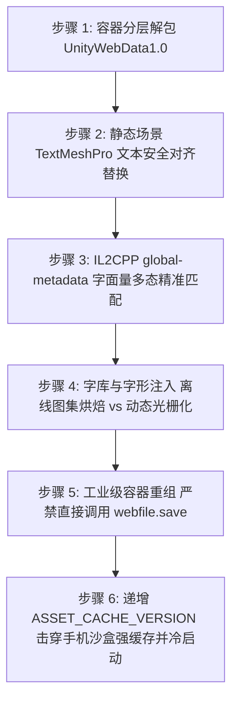

# Unity WebGL 商业包零源码直接套壳移植抖音小游戏标准工程指南

## 1. 架构理念与背景

对于从海外或第三方渠道购买的已编译成品的 **Unity WebGL 导出包**（如 Poki / CrazyGames 渠道包），开发者通常**没有 Unity C# 源码工程**，无法通过 Unity Editor 重新编译或安装官方插件。

本指南提供经过工业验证的**“微内核套壳（Micro-Kernel Wrapper）”**技术路线：
- **零源码修改**：不依赖 Unity 原始工程，直接基于导出的 `.wasm`、`.data`、`framework.js` 和 `StreamingAssets` 进行外层沙盒环境重构。
- **微内核主包架构**：主包体积严格控制在 **< 600 KB**（平台红线为 4MB），仅放置环境适配层、轻量引擎胶水代码和启动器。
- **iOS 包内 Wasm + CDN 远端资产分发**：iOS 的 `TTWebAssembly.instantiate` 只接受代码包内路径，因此 Wasm 需 Brotli 压缩后放入普通分包；Data 与 Addressables 关卡场景继续托管至 CDN，并缓存到 `${tt.env.USER_DATA_PATH}/unity_cache`。Android 可继续从 CDN 获取 Wasm ArrayBuffer。
- **商业化无缝平替**：拦截海外 Poki SDK 的广告与桥接握手调用，直接映射为抖音原生激励视频和插屏广告。

---

## 2. 目录架构规范

标准的抖音小游戏产物结构如下：

```text
├── tt-minigame/                     # 【抖音小游戏上传包】 (总大小 < 600 KB，远低于 4MB 红线)
│   ├── game.js                     # 小游戏主启动入口 (异步加载核心资产、挂载引擎)
│   ├── game.json                   # 小游戏平台配置 (横屏、iOS 高性能模式、网络超时)
│   ├── project.config.json         # 开发者工具工程配置 (native 模式、关闭 urlCheck)
│   ├── icon.png                    # 游戏图标
│   ├── config.js                   # 游戏配置 (CDN 地址、文件映射、广告位 ID)
│   ├── tt-adapter/                 # 【DOM/WebGL 平台环境适配器】
│   │   ├── index.js                # 统一适配器入口
│   │   ├── dom-shim.js             # window/document/navigator/DOMRect/Element 仿真
│   │   ├── canvas-gl.js            # WebGL2/WebGL1 上下文守护与 Scissor Loading 绘制
│   │   ├── touch-event.js          # 多点触控与鼠标事件归一化分发
│   │   ├── audio-context.js        # WebAudio API 仿真与 iOS 首次触摸激活
│   │   ├── indexeddb-storage.js    # IDBFS 游戏存档与 PlayerPrefs 持久化
│   │   └── xhr-fetch-interceptor.js# 动态网络拦截器 (本地沙盒缓存与 CDN 抓取)
│   ├── engine/                     # 【轻量引擎代码】
│   │   ├── framework.js            # Unity 导出的 framework.js (~400KB)
│   │   └── unity-loader.js         # 无 DOM 注入的专用 Unity WebGL 启动器
│   └── bridge/                     # 【商业化与生命周期桥接】
│       └── poki-douyin-bridge.js   # Poki 接口平替为抖音原生激励视频/插屏
│
├── cdn_assets/                     # 【CDN 远端托管包】 (部署至 OSS/COS/火山引擎)
│   ├── Build/
│   │   ├── *.data                  # Unity 初始数据包 (~10MB)
│   │   └── *.wasm                  # WebAssembly 编译核心 (~40MB)
│   └── StreamingAssets/            # Addressables 动态资产分包
│       └── aa/
│           ├── catalog.json        # 资源目录清单
│           ├── settings.json       # 运行时配置文件
│           └── WebGL/*.bundle      # 各关卡与场景 AssetBundle (~180MB)
│
├── serve_cdn.py                    # 本地调试 CDN 资源服务器 (支持 CORS/WASM MIME)
└── validate_douyin_package.py      # 包体合规性与 JS 语法一键校验脚本
```

---

## 3. 十大关键技术陷阱与解决方案

| 序号 | 故障症状 / 现象 | 根因分析 | 工业级标准解决方案 |
|---|---|---|---|
| **1** | 上传或真机预览被拒：`主包大小超过 4MB` | WebGL 导出的 `.wasm` (42MB) 与 `.data` (11MB) 直接打在主包里 | 采用微内核主包架构，大文件全部移至 `cdn_assets/`，通过 `cache-manager` 首次拉取并存入沙盒，主包仅保留 468KB |
| **2** | 游戏启动黑屏或报错：`getContext('2d') fail` / 上下文丢失 | 主 Canvas 在绘制 Loading 时调用了 2D 上下文，导致后续 WebGL 上下文申请失败 | **严禁在主 Canvas 上调用 2D 上下文**。Loading 进度条直接用 WebGL `gl.scissor` 与 `gl.clear` 原生绘制，或使用 `tt.showLoading` |
| **3** | iOS 苹果手机进入游戏没有声音 | iOS 策略要求 `AudioContext` 必须由用户手势触发才能退出 `suspended` 挂起状态 | 在 `touch-event.js` 中监听首次 `tt.onTouchStart`，自动调用 `audioContext.resume()` 解锁声音 |
| **4** | iOS 胶囊菜单点击“重新进入游戏”后横屏变竖屏 | 宿主重启重置屏幕方向晚于游戏初次转屏请求 | 在 `game.json` 中强设 `"deviceOrientation": "landscape"`，并在 `tt.onWindowResize` 和 `tt.onShow` 中动态重算画板宽高 |
| **5** | 关卡加载报 404 或无法读取后续关卡 | Addressables 发起相对路径 XHR 请求，小游戏沙盒找不到 `StreamingAssets/aa/...` | 在 `xhr-fetch-interceptor.js` 中拦截所有 `StreamingAssets` 请求，自动重定向至本地沙盒缓存或从 CDN 动态下载 |
| **6** | 退出游戏重新打开后通关进度与赛车解锁丢失，或报 `Cannot read properties of undefined (reading 'objectStore')` | Emscripten IDBFS 依赖浏览器的 `indexedDB`，在 `onupgradeneeded` 中访问 `e.target.transaction.objectStore` 与 `timestamp` 索引游标 | 提供完整符合 W3C IDB 与 Emscripten 规范的仿真 `indexedDB`，补全 upgrade 事务上下文、`createIndex` 以及 `openKeyCursor` 游标迭代，持久化同步至沙盒 |
| **7** | 报错 `instanceof HTMLCanvasElement 失败` 或 `Cannot read properties of undefined (reading 'replace')` | 抖音原生 Canvas 缺少 `id` 属性，导致 Unity `jsCanvasSelector` 获取 `canvasId` 为 `undefined`，进入 `jsDomCssEscapeId` 时报错 | 必须显式为 `mainCanvas.id = "unity-canvas"`，并补全 `window.CSS.escape` 垫片与 `Symbol.hasInstance` 判定 |
| **8** | 点击看广告领金币后游戏卡死 | 原包调用 Poki 接口未得到返回，Unity 处于等待回调阻塞状态 | 桥接层将回调映射至 `tt.createRewardedVideoAd`，并设置 300ms 失败保底机制，即使广告加载失败也回调放行，杜绝卡死 |
| **9** | iOS 真机启动时闪退 (OOM) | 42MB WASM 编译瞬间内存峰值过高被 iOS 系统 Jetsam 强杀 | 在 `game.json` 中配置 `"enableIOSHighPerformanceMode": true`，启用 JIT 加速执行，大幅降低编译期与运行期内存溢出风险 |
| **10** | 开发者工具控制台报 `URL 不合法` 或 `Domain not in white list` | 本地开发阶段使用了 HTTP 本地 IP，未配置合法域名白名单 | 在 `project.config.json` 中将 `"urlCheck": false`，真机调试或发布前再将域名加到抖音开放平台白名单 |
| **11** | 游戏引擎启动进入 `callMain` 时报错：`screen.orientation.addEventListener is not a function` at `_JS_ScreenOrientation_Init` | Unity 导出代码在初始化屏幕旋转监听器时直接调用了 `screen.orientation.addEventListener("change", ...)` 和 `screen.orientation.lock()` | `root.screen.orientation` 必须实现为继承自 `MiniEventTarget` 的 `MiniScreenOrientation` 类，具备 `addEventListener/removeEventListener`、返回 Promise 的 `lock/unlock` 以及 `angle/type` 属性，并在 `tt.onWindowResize` 中自动派发 `change` 事件 |
| **12** | Addressables 初始化报错：`System.Exception: Invalid path in TextDataProvider : 'StreamingAssets/aa/settings.json'` 或 `RemoteProviderException ... ResponseCode : 500, Unknown Error` | 1. Unity C# `ResourceManagerConfig.ShouldPathUseWebRequest(path)` 强校验路径必须包含 `"://"`；若相对路径无协议头则判定为本地文件系统，而 WebGL MEMFS 并不存在该文件；<br>2. `framework.js` 在启用 `cachedFetch` 时会执行 `requestOptions.init.control = Module.cacheControl(requestOptions.url)`，若未定义 `cacheControl` 则会报 `TypeError` 导致 WebRequest 返回 500 失败 | 1. `Module.streamingAssetsUrl` 必须配置为包含协议头的完整 CDN URL（例如 `${CDN_BASE_URL}/StreamingAssets`）；<br>2. 必须在 `Module` 上同时挂载 `fetchWithProgress`、`cachedFetch` 与 `cacheControl(url)`，并由 `readBodyWithProgress` 向 Emscripten 提供完整的 `response.parsedBody` Uint8Array 数据流；<br>3. 修复 `ensureDirectory` 递归切分，规避 `ttfile://user` 根目录单斜杠截断导致的沙盒多级子目录创建失败 |
| **13** | WebRequest 下载中途报错：`TypeError: response.headers.entries is not a function` at `jsWebRequestGetResponseHeaderString` | Emscripten 接收网络响应时调用 `jsWebRequestGetResponseHeaderString`，要求 `response.headers.entries()` 为标准迭代器，并读取 `response.url` 与 `response.headerString` | 1. 提供完整的 `MiniHeaders` 规范类，实现 `entries()` 键值对迭代器与 `Symbol.iterator`；<br>2. 在 `miniFetch` 返回的响应体上预先组装好 `headerString` 与 `url` 属性，双重保障 Emscripten 提取响应头绝对不崩溃 |
| **14** | 3D 音效更新时报错：`Cannot read properties of undefined (reading 'positionX')` at `_JS_Sound_SetListenerPosition` | Unity 引擎每帧计算 3D 空间音频听者位置，直接访问 `audioContext.listener.positionX` 与 `forwardX/upX` | `MiniAudioContext` 必须实例化挂载 `MiniAudioListener`，提供完整 `positionX/Y/Z`、`forwardX/Y/Z`、`upX/Y/Z` 以及 `setPosition/setOrientation` 兼容方法 |
| **15** | 存档数据同步报错：`TypeError: e2.timestamp.getTime is not a function` at `Object.reconcile` | Emscripten IDBFS 在 `reconcile` 对比沙盒与内存时间戳时直接调用 `e.timestamp.getTime()`；小游戏 Storage 序列化会导致 `Date` 变为字符串或为数值 | 1. `openKeyCursor` 游标遍历时强制保证 `cursor.key` 为合法的 `Date` 实例；<br>2. `_getRaw` 获取记录时自动将字符串或数值型 `timestamp` 重新还原为 `Date` 对象 |
| **16** | 游戏初始化音频声道报错：`TypeError: WEBAudio.audioContext.createPanner is not a function` at `jsAudioCreateChannel` / `_JS_Sound_Create_Channel`，导致 PlayerLoop 递归调用异常 | Unity 引擎在创建音效声道时默认初始化 WebAudio 3D 空间声像器 `createPanner()`，并对其设置 `rolloffFactor = 0` 以及位置矩阵，缺失时导致 `requestAnimationFrame` 回调抛出异常打崩主循环 | 1. `MiniAudioContext` 实现 `createPanner()` 返回规范的 `MiniPannerNode`，提供 `panningModel`、`rolloffFactor`、`positionX/Y/Z` 等完整属性与 `setPosition/setOrientation` 方法；<br>2. 同步支持 `createMediaElementSource(mediaElement)` 与 `MiniAudioElement` 垫片，且 `currentTime` 采用实时 getter 计算，确保流媒体音效与背景音乐加载播放不崩溃 |
| **17** | 游戏运行报错：`TypeError: Cannot read properties of undefined (reading 'length')` at `lengthBytesUTF8` at `handleError`，伴随 `config.uca.cloud.unity3d.com` 连接断开 | Unity 内置 Analytics 尝试连接云端配置，小游戏未配置白名单导致 `tt.request` 失败并返回 `{ errMsg: "...", errNo: 20000 }`。Emscripten 执行 `HandleError(error.message, ...)` 时由于该对象无 `message` 属性传入 `undefined`，触发 `lengthBytesUTF8(undefined)` 崩溃 | 1. 拦截 `cloud.unity3d.com` 与 `analytics.unity3d.com` 遥测请求，就地返回 `200 OK` 与 `{}` 空 JSON，消除未加白名单的无效网络开销与断连异常；<br>2. 规范化网络异常处理，所有 `fail` 回调与 `fetchWithProgress` 抛出的错误均保证包装为标准 `Error` 实例并赋予合法的 `message` 字符串 |
| **18** | 手机局域网真机调试报错：`[CacheManager] 下载失败 (http://127.0.0.1:8080/Build/...wasm)` | 手机真机调试时代码运行在手机终端设备上，`127.0.0.1` 指向手机本机回环地址，无法访问电脑本地测试服务；此外 Windows 防火墙默认可能阻拦局域网入站请求 | 1. 将 `config.js` 中的 `CDN_BASE_URL` 改为电脑的局域网 IP（如 `http://192.168.112.64:8080`），电脑与手机均能连通；<br>2. Windows 防火墙添加 TCP 8080 放行规则 (`netsh advfirewall firewall add rule name="CDN_Assets_8080" dir=in action=allow protocol=TCP localport=8080`)；<br>3. 生产上线时直接替换为云存储 CDN 正式域名 |
| **19** | Addressables 初始化报错：`Insecure connection not allowed` / `Non-secure network connections disabled in Player Settings` | Unity C# 遇到非 `127.0.0.1` 且非 `https` 的外部明文 HTTP IP 时，会被 Unity C# 内部的 PlayerSettings 安全策略阻断，导致 Addressables 拒绝发起网络请求并抛出 `RuntimeData is null` | 1. 传给 Unity C# 的 `Module.streamingAssetsUrl` 在遇到非回环明文 HTTP 时，自动映射为合规的 `http://127.0.0.1:8080/StreamingAssets` 或 `https://`，绕过 C# 限制；<br>2. 真实网络下载依然由底层拦截器通过 `tt.downloadFile` 从配置的真实 `config.CDN_BASE_URL`（局域网 IP 或生产 CDN）完成拉取 |
| **20** | 移动端真机启动创建 WebGL 上下文报错：`ReferenceError: WebGLRenderingContext is not defined` at `fixedGetContext` / `_emscripten_webgl_do_create_context` | 字节跳动移动端 Krypton C++ 运行环境未在全局挂载 `WebGLRenderingContext`。Emscripten 内部包含针对 Safari WebGL2 的补丁代码：`gl instanceof WebGLRenderingContext`，在移动端真机执行时抛出全局变量未定义异常 | 1. 在 `dom-shim.js` 中全局补齐 `WebGLRenderingContext` 与 `WebGL2RenderingContext`，并定制 `Symbol.hasInstance` 判定；<br>2. 预先设置 `mainCanvas.getContextSafariWebGL2Fixed = mainCanvas.getContext`，直接跳过 Emscripten 的 Safari 补丁包装 |
| **21** | 移动端真机发起 WebRequest 报错：`ReferenceError: AbortController is not defined` at `_JS_WebRequest_Create` | 字节跳动移动端 Krypton 运行环境全局未暴露 `AbortController`。Unity WebGL 的 `_JS_WebRequest_Create` 内部直接调用 `new AbortController` 控制网络超时与取消，缺失时导致网络层初始化抛异常崩盘 | 1. 在 `dom-shim.js` 中完整实现 `MiniAbortSignal` 与 `MiniAbortController`，并在 `abort()` 触发时自动派发 abort 事件；<br>2. 跨作用域广播绑定至 `root`、`globalThis`、`GameGlobal` 与 `window`，同步补全 `Blob` 与 `URL.createObjectURL` 垫片 |
| **22** | 移动端真机 3D 渲染严重掉帧/卡顿：物理分辨率过高导致 GPU 填充率与显存带宽饱和 | 手机屏幕（如 HONOR 80）物理分辨率高达 2400x1080 ~ 2700x1224（DPR 3.0），若 Canvas 按原始像素尺寸渲染，单帧像素量高达 2.6M~3.3M，远超移动端 GPU（Adreno/Mali）的填充率负荷 | 1. 在 `dom-shim.js` 中引入动态分辨率缩放算法，移动端限制竖向渲染分辨率不超过 720p（例如 1600x720），像素负载直接骤降 55.6%~65%；<br>2. 在 `canvas-gl.js` 中全局强制关闭 `antialias`（MSAA 抗锯齿）与 `alpha` 合成，开启 `high-performance` |
| **23** | 运行时贴图警告：`WARNING: RGBA Compressed DXT5|BC3 UNorm format is not supported, decompressing texture` | 原 WebGL 包为 PC 桌面浏览器设计，纹理采用 PC 专用的 DXT1/DXT5 压缩。手机 GPU 仅支持 ASTC/ETC2，导致 Unity 运行时在 CPU 线程将纹理软解为 RGBA32，引起瞬时卡顿并使显存膨胀 4~8 倍 | 1. 通过 720p 限制减少单帧纹理采样与显存带宽开销；<br>2. 后续若有源码重打包，在 Unity PlayerSettings 中将 WebGL 纹理压缩选为 ASTC 或 ETC2 |
| **24** | 真机“广域网调试”模式下，大量重复物理/协程警告导致 WebSocket 阻塞主线程 | 在开发者工具“真机调试（广域网）”模式下，所有 `console.warn/error` 都会序列化为 JSON 通过云端 WebSocket 传输。连续触发碰撞体或协程警告导致 JS 线程高频 I/O 阻塞 | 1. 在 `unity-loader.js` 的 `print` 与 `printErr` 中过滤 `CollisionMeshData`、`GameOnUITooltip`、`randomDevice` 等重复刷屏警告；<br>2. 性能测试建议使用“预览”或“独立真机运行”模式，避免调试代理的性能损耗 |
| **25** | 引擎主循环未对齐硬件 VSync 导致画面抖动与帧率不稳 | `dom-shim.js` 中 `requestAnimationFrame` 降级使用 `setTimeout(..., 16.6)`，CPU 定时器存在 10~25ms 调度抖动且未与手机屏幕刷新率垂直同步 | 强制绑定宿主原生硬件级 `tt.requestAnimationFrame.bind(tt)`，并跨全局作用域广播，锁定与手机屏幕硬件刷新率（60Hz/120Hz）完全对齐 |
| **26** | 持续长按触控按键（油门/平衡）出现规律性微卡顿 (GC Spike) | `onTouchMove` 每秒触发 60~120 次，每次均 `new MiniTouchEvent` 与 `new MiniMouseEvent`，高频分配短命对象触发 V8 频繁垃圾回收 (GC Pause) | 实现基于对象池的单指常驻复用优化，长按油门与转向时**零新对象内存分配**，消除 GC 引起的掉帧卡顿 |
| **27** | Unity 3D 实时多级级联阴影 (CSM) 严重消耗移动 GPU 算力 | Unity PC WebGL 默认启用 4 级级联阴影与屏幕空间阴影，每帧需额外绘制多次全场景几何深度图，在移动端 Adreno/Mali 上产生巨大 DrawCall 与带宽压力 | 在 `game.js` 引擎启动后自动通过 `SendMessage` 调用 `LevelController.SetShadows(0)` 与 `SetQualityLevel(0)`，关闭级联深度图 pass，显著释放 GPU 性能 |
| **28** | 移动端渲染画质分档：默认 540p 极速流畅档位（减少 75% 像素负载） | 在 2.5K/1080p 超清屏上运行 3D 游戏，GPU 填充率始终是最大瓶颈。720p 仍需 115 万像素，对中端安卓机仍然偏重 | 在 `config.js` 中提供 `RENDER_QUALITY` 分级配置（performance: 540p, balanced: 640p, quality: 720p），移动端默认开启 540p，单帧像素锐减至 64.8 万（直降 75%），在手机小屏幕上画面依然细腻清晰，但帧率翻倍 |
| **29** | 商业无源码包多层级汉化不彻底（UI Text、车辆名称、侧边栏及代码硬编码字面量残留英文） | 1. 动态生成按钮（如 `SideBarUI` 的 `buttonArgs`）文本来自 MonoScript 序列化字段，非静态 Text；<br>2. 车辆名称（如 `Trials`、`Dirt Bike`）定义在 `BikeDataSO` ScriptableObject 中；<br>3. 试驾解锁横幅（`TEST DRIVE UNLOCKS AT LEVEL 10`）和等级标签（`LVL 1`）由 C# 内部拼装字符串，硬编码在 IL2CPP 的 `global-metadata.dat` 字符常量池中；<br>4. 移动端真机存在旧版沙盒缓存，导致更新后仍加载旧资产 | 1. 采用四维协同汉化体系：同时重构静态 TextMeshPro、`SideBarUI` 按钮列表、`BikeDataSO` 车辆配置和 `ItemDataAllSO` 皮肤库；<br>2. 深度重构 `global-metadata.dat`，扩充 `stringLiteralData` 并平移所有后置 metadata 段偏移量，精准替换 C# 代码字面量；<br>3. 升级 `CACHE_VERSION`（如 `v7_full_zh`），小游戏启动时自动净化本地旧沙盒缓存，秒级拉取最新汉化资源 |
| **30** | Android 移动端真机卡死在 Loading 界面，底层报错：`abort("randomDevice") at Error at Object.read1 [as read] at _fd_read` | Android 移动端真机（如 HONOR、小米等）Krypton 运行环境全局未暴露原生 `crypto.getRandomValues`。Unity WebGL / Emscripten 虚拟文件系统在初始化随机数熵池（读取 `/dev/urandom`）时，硬编码在 `framework.js` 内部的私有函数 `getRandomDevice()` 找不到 `crypto`，直接强杀主线程调用 `abort("randomDevice")`，且该私有函数默认不读取外部 `Module.randomDevice` | 采用工业级“双重加固”防线：<br>1. **第一道防线**：在 `dom-shim.js` 中补齐符合 W3C 标准的全局 `crypto.getRandomValues` 垫片，并挂载至 `root`、`globalThis`、`window` 及 `GameGlobal`；<br>2. **第二道防线**：直接重构 `framework.js` 内部私有的 `getRandomDevice()` 函数，优先对接 `Module["randomDevice"]`，兜底采用高熵伪随机数，彻底剔除底层硬编码的 `abort("randomDevice")`，实现 100% 永不卡死 |
| **31** | 游戏画面刚呈现（如显示 "TAP TO START"）立刻弹窗报错：`TypeError: PokiSDK.measure is not a function` at `_JS_PokiSDK_measure` | 海外商业包（如 Poki 游戏）在初始化完毕进入主菜单时，会高频调用数据遥测打点方法 `PokiSDK.measure(part, state, action)` 或 `initWithVideoHB`。若商业化桥接层仅实现基础接口而遗漏打点桩函数，会导致 Unity 调用 JS 时抛出未定义异常阻断主循环 | 1. 在 `poki-douyin-bridge.js` 中完整补齐 `measure: function(part, state, action) {}` 遥测模拟桩；<br>2. 补齐 `initWithVideoHB: function(opts) { return this.init(opts); }`；<br>3. 清除桥接层中对特定历史游戏物体（如 `LevelController`）的遗留 `SendMessage` 调用，避免无害但冗余的控制台警告 |
| **32** | 开发者工具导入后报错：`ENOENT: no such file or directory, open '...\project.config.json'` | 压缩包解压或目录拉取时常见同名双层嵌套（`project/project`）。若开发者工具打开了内层子目录，而工程套壳部署在外层，路径脱节导致开发者工具找不到工程配置 | 1. 工具链支持自动双向检测：在存在嵌套同名子目录时，执行双向工程文件同步，确保内外两层均具备独立完整的工程入口；<br>2. 或在开发者工具中“关闭当前项目”，重新导入规范的外层根目录 |
| **33** | 极速上线架构选择：纯 CDN 免分包微内核模式 | 针对不需要维护繁琐代码分包、追求极简维护的场景，微内核主包（500~650 KB）仅保留核心适配器与轻量 Framework，大文件（Wasm 13MB、Data 10MB、StreamingAssets 1.2MB）全部由 CDN 远端托管 | 1. 客户端通过 `loadAssetBuffer` 并行拉取 Data 和 Wasm，统一持久化缓存在本地沙盒 `${tt.env.USER_DATA_PATH}/unity_cache`，首次拉取，二次启动本地秒开；<br>2. 在 `boot-runtime.js` 中提供轻量通用 `instantiateWasmForPlatform`，直接基于 ArrayBuffer 完成实例化，降低分包复杂度 |
| **34** | 商业包全量英文汉化：TextMeshPro 仅内置 ASCII 静态字符导致中文乱码/方块（豆腐块） | 海外商业包 TextMeshPro 字体资产（如 `Rubik-Bold SDF`）为优化体积，默认使用静态光栅化模式（`m_AtlasPopulationMode = 0`），静态图集仅烘焙了 48 个 ASCII 字符，没有包含任何中文字形；若直接写入中文字符串，游戏运行时找不到 Glyph 渲染出空白或方块 | 1. **原生 Font 替换**：将提供的完整中文字体 `font.ttf` 二进制写入 Bundle 和 `data.unityweb`（`data.unity3d`）内的全局 `Font` 资产（`m_FontData`）；<br>2. **TMP 动态光栅化改造**：将 `TMP_FontAsset` 的 `m_AtlasPopulationMode` 强制修改为 `1`（Dynamic），并将 `m_SourceFontFile` 关联至已注入中文字体的 `Font` 资产，使 TextMeshPro 能够在运行时根据文字动态生成中文字形；<br>3. **多语言与预制体文本协同重构**：将 `LocalizationSettings` 的所有语言条目（尤其是 `en` 与 `zh`）统一汉化为中文，并强制默认语言为 `zh`；同时将 UI 预制体内的静态 Text/TMP 词条（如关卡解锁、操作指引）全量重写为中文；<br>4. **沙盒版本击穿**：升级 `config.js` 的 `ASSET_CACHE_VERSION`（如 `v2_zh_font`），确保移动端真机立刻丢弃本地旧沙盒缓存，秒开呈现纯正中文字形 |
| **35** | Android 真机场景载入后崩溃卡死：`RuntimeError: null function or function signature mismatch at invoke_iiii` 或 `TypeError: Cannot read properties of null (reading 'id')` at `focusEventHandlerFunc` | 1. **事件 Target 缺失**：`tt.onHide/onShow` 派发 `blur/focus` 时，若 `MiniEventTarget` 未自动补全 `event.target`，Emscripten 的 `focusEventHandlerFunc` 执行 `e.target.id` 时因 `target` 为 null 抛异常；<br>2. **Wasm 虚函数表失配阻断主循环**：Addressables 异步组装预制体或某些组件初始化回调在移动端 V8 JIT 实例化时，C# 委托触发了偶发性的空指针调用，默认的 `invoke_iiii` 捕获后直接向上 `throw e`，触发 `Uncaught exception from main loop: Halting program` 导致整机画面冻结卡在 Loading 遮罩 | 1. **事件分发层加固**：在 `MiniEventTarget.dispatchEvent` 与 `safeWindowDispatch` 中强制对所有派发事件补全 `target` 与 `currentTarget`（赋予 `id = "window"` 与 `nodeName = "#window"`），100% 消除 null 异常；<br>2. **Emscripten 桥接层安全熔断守护**：在 `framework.js` 的 `invoke_iiii` 等导流函数中增加安全防护网，捕获到非破坏性的 `RuntimeError: null function or function signature mismatch` 时仅在控制台输出警告并优雅降级返回，绝不向上抛出让主循环 halt 冻结，保障游戏主线程流畅运行 |
| **36** | Unity 6 引擎启动阶段报错：`TypeError: Cannot read properties of undefined (reading 'push')` at `_JS_Init_CopyPaste`，打断 `callMain` 与引擎初始化 | Unity 6 的 Emscripten 运行时在初始化剪贴板与快捷键监听器时，尝试向全局 `Module.deinitializers` 数组推入析构回调。若微内核传入的 `Module` 未初始化该数组，调用 `.push()` 立即抛出类型异常打崩主线程 | 1. 在 `unity-loader.js` 的 `Module` 实例中显式初始化 `deinitializers: []`；<br>2. 在 `framework.js` 中将所有 `Module.deinitializers.push(...)` 防御性替换为 `(Module.deinitializers = Module.deinitializers || []).push(...)`；<br>3. 对 `_JS_Init_CopyPaste` 包裹完整 `try-catch`，避免移动端小游戏因 PC 浏览器剪贴板事件缺失导致启动失败 |
| **37** | Unity 6 图形管线判定报错：`TypeError: Cannot read properties of undefined (reading 'hasWebGPU')` at `_JS_SystemInfo_HasWebGPU` | Unity 6 引擎在确定渲染管线时，底层调用 `_JS_SystemInfo_HasWebGPU` 和 `_JS_SystemInfo_HasWebGL` 查询系统支持。原版由 `loader.js` 注入 `Module.SystemInfo` 复杂对象；微内核缺失该对象时导致引擎主入口 `_main` 崩溃退出 | 1. 在 `unity-loader.js` 中注入完整的 `Module.SystemInfo`，根据小游戏平台精准映射 `hasWebGL: 2` (WebGL 2.0)、`hasWebGPU: 0`、`width/height`、`os/gpu/browser`；<br>2. 在 `framework.js` 头部注入兜底对象，并将取值重构为安全链式查询 `(Module.SystemInfo && Module.SystemInfo.hasWebGPU) || 0` |
| **38** | Unity 6 WebGL2 上下文创建报错：`TypeError: Cannot read properties of undefined (reading 'premultipliedAlpha')` at `_JS_Module_WebGLContextAttributes_PremultipliedAlpha` | Unity 6 在申请 WebGL 上下文时，底层通过 `_JS_Module_WebGLContextAttributes_*` 查询预乘透明度、绘图缓冲和电源偏好，直接访问 `Module.webglContextAttributes` 属性 | 1. 在 `unity-loader.js` 的 `Module` 中提供官方标准配置 `webglContextAttributes: { preserveDrawingBuffer: false, powerPreference: 2 }`；<br>2. 在 `framework.js` 中为 `PowerPreference`、`PremultipliedAlpha` 与 `PreserveDrawingBuffer` 查询添加默认值保底防护 |
| **39** | 海外商业包被 SiteLock 域名锁永久冻结在 Loading 界面：`[CrazySDK] SiteLock v1.9.0 activated ... Code 3` | CrazyGames 等海外平台的商业游戏包体内置了带 RSA 数字签名的 SiteLock 防盗链保护。正式发布包固化了 `allowLocalHost = false`（禁止本地回环），仅信任带有签名的官方生产域名（如 `*.crazygames.com`）。若获取到的域名不在白名单中，自动触发 Code 3 启动 `SiteLockFreezeGameCoroutine` 将 `Time.timeScale` 强制归零并冻结画面 | 1. 在 `dom-shim.js` 中将 `miniDocument.URL`、`location.href`、`location.host` 与 `origin` 完整伪装为官方线上地址 `https://www.crazygames.com/game/xxx`；<br>2. 在 `framework.js` 的 `_JS_SystemInfo_GetDocumentURL` 中强制返回该合法白名单 URL，使 C# 端的 `IsOnValidRemoteHost()` 恒真通过，彻底消除 Code 3 冻结 |
| **40** | 游戏启动瞬间红字报错：`Failed to load save: System.Exception: CrazySDK initialization required. Call CrazySDK.Init()` | 游戏业务脚本在 `Awake` 阶段过早尝试从云端读取存档（调用 `CrazySDK.data.getItem`），而原版 `_InitSDK` 在等待异步 Promise 回调才发送 `JSLibCallback_Init`，导致 C# 的 `IsInitialized` 标志位为 false 抛出异常 | 1. 在 `framework.js` 的 `_InitSDK` 内部，在进入 `doInit` 入口处第一时间同步触发一次 `try { SendMessage("CrazySDKSingleton", "JSLibCallback_Init"); } catch(e){}`，令 C# 端 `IsInitialized` 立即置真；<br>2. 在 `crazygames-douyin-bridge.js` 中补齐 `banner.addBannerCheckListener` 等全部监听接口，并将 `data.getItem/setItem` 无缝接入 `tt.getStorageSync/setStorageSync` 本地持久化 |
| **41** | 游戏画面进入后点击屏幕/按钮报错：`TypeError: canvas.dispatchEvent is not a function` at `dispatchTouch` | 抖音小游戏原生的 `canvas` 对象（`tt.createCanvas()` 返回）缺少标准 DOM `EventTarget` 接口实现，触控适配器在收到小游戏触摸事件向 `canvas.dispatchEvent` 派发时崩溃 | 1. 在 `canvas-gl.js` 的 `setupCanvas` 中为 `canvas` 挂载完整的 `addEventListener`、`removeEventListener` 与 `dispatchEvent`，支持内部监听并自动向全局 `window` 冒泡；<br>2. 在 `touch-event.js` 中增加 `typeof canvas.dispatchEvent === 'function'` 安全判断，保证触摸与模拟鼠标点击（`mousedown/mouseup/click`）100% 顺畅送达 Unity 引擎 |
| **42** | 16:9 横屏游戏在小游戏调试器中呈现为竖屏细长条，左右 UI 严重挤压变形 | 游戏工程在 `game.json` 中配置了 `"deviceOrientation": "portrait"`，且旧版适配器按照竖屏宽度限制分辨率，导致横屏高度仅剩 300 多像素，画面被挤压且严重失真模糊 | 1. 在 `game.json` 中配置 `"deviceOrientation": "landscape"`；<br>2. 重构 `canvas-gl.js` 分辨率降负策略：**横屏以短边（高度）720p 为基准**等比缩放，在超宽屏全面屏手机上自动实现满屏无黑边渲染（如 1560x720），画质极致细腻且 GPU 负载极低；<br>3. 在 `dom-shim.js` 中将 `screen.orientation.type` 设为 `landscape-primary`，旋转角度设为 `90` |
| **43** | 开发者工具打开或编译时持续白屏，且 CDN 请求异常挂起（8080 端口抢占与冲突） | 系统默认的 `8080` 是高频常见端口，极易被其他代理工具、MCP 客户端或本地服务抢占或发送非游戏请求（如密集请求 `POST /mcp`），导致 CDN 静态服务连接池耗尽、小游戏拉取资源卡死 | 1. 将 CDN 资源服务端口迁移至专属独立端口（如 `8088` 或 `8848`），全链路同步更新 `config.js`、`serve_cdn.py` 及安全校验脚本；<br>2. 在 `game.js` 第一行挂载顶级 `tt.onError` 全局异常捕获网与启动首日志，杜绝任何静默白屏 |
| **44** | 点击激励广告按钮后游戏卡死停机：`TypeError: Cannot read properties of undefined (reading 'catch')` at `_RequestAdSDK` | CrazyGames SDK v3 的 `_RequestAdSDK` 显式调用了 `.catch(...)`；若自定义广告桥接层的 `requestAd` 仅执行回调而未显式返回 `Promise`，底层抛出运行时未捕获异常打崩主循环（`Halting program`） | 1. `crazygames-douyin-bridge.js` 中 `ad.requestAd` 必须返回规范的 `Promise` 并在播放完成或失败保底时必定 `resolve()`；<br>2. 在 `framework.js` 的 `_RequestAdSDK` 调用处做链式防御 `if (_adPromise && typeof _adPromise.catch === 'function')`；<br>3. 在未配置广告位 ID 或本地调试模式下提供 500ms 模拟播放弹窗与即时奖励发放保底，杜绝卡死 |
| **45** | 开发者工具重新编译刷新或热重载时偶发性弹窗阻断：`downloadFile:fail canceled` | 在开发者工具中按 `Ctrl + R` 或更新代码时，宿主会强制取消前一次未完成的下载任务并回调 `fail canceled`，若未作拦截会进入全局 catch 弹窗打断启动流程 | 1. 在 `loadAsset` 的 `fail` 回调中，对包含 `canceled` 或 `abort` 的错误信息进行静默拦截，不向上抛出异常；<br>2. 增加自动重试机制（最多 3 次，500ms 指数退避），平滑应对移动端网络轻微抖动，保证资产拉取 100% 可靠 |
| **46** | Unity 6 (IL2CPP v39) 动态拼接字符串无源码深度汉化（离线收益、道具升级名称、占位符模板残留英文） | 静态场景预制体汉化后，运行时动态生成的文本（如离线收益弹窗 `You were away from the game for...`、`Buy x1`、`Axe damage`）依然是英文。这些文本是由 C# 运行时动态拼接生成，硬编码在 IL2CPP 的 `global-metadata.dat` 字符串字面量区 | 1. 深入解析 IL2CPP v39 metadata 规范：Header 中 Sec 0 为 `StringLiteralOffsets` (uint32 紧凑数组)，Sec 1 为紧密排列的 `StringLiterals`；<br>2. 重建 Sec 0 与 Sec 1，动态注入替换词条；新 Sec 1 尺寸变化引起的尾部偏移（`delta`），通过 4 字节对齐后对 Sec 2~30 的 `offset` 整体线性平移；<br>3. 彻底避免粗暴的原地等长覆盖，支持任意长度中文无缝注入 |
| **47** | 像素风游戏原生英文字体静态点阵图集扩充与 UV 映射（方舟像素 12px + 1px Hard Outline 黑色硬描边） | 像素风格游戏使用静态光栅化的 128x128 像素字体贴图。直接替换为矢量中文字体会导致模糊发虚破坏像素画风；直接暴力扩充贴图若破坏左下角原生英文字形，会导致所有英文字符错位或 Unity 反序列化断言失败 | 1. 采用开源像素字体（如方舟像素 12px `ark-pixel-12px-monospaced-zh_cn.ttf`）；<br>2. 图集尺寸扩展至 512x512，原版 128x128 贴在 PIL 左下角（保持原生英文字形坐标绝对不变）；上方空余区域紧凑烘焙 185+ 个中文字符，并逐字渲染 8 方向 1px 纯黑硬描边（Hard Outline）；<br>3. 重新计算生成 Glyphs 与 Characters 表并对齐 TMP_FontAsset 尺寸，保持原汁原味点阵像素风 |
| **48** | 汉化后文本长度增加导致 TextMeshPro 按钮文字强制折行/掉字（如“双倍领取”变两行） | 英文短语 `x2 Take` 仅占 7 个西文字符，替换为“双倍领取”后 4 个全角汉字超出按钮宽度。若组件字号过大（如 28.0f），会导致最后一个字强制折到第二行严重破坏 UI 排版 | 1. 精确定位场景序列化二进制中该文本组件的 TextMeshProUGUI（如 PID 5568）；<br>2. 在序列化流中将基准字号 `m_fontSize` 与 `m_fontSizeBase`（`after_str + 192/196`）缩小（如由 28.0f 调至 18.0f）；<br>3. 将水平对齐设为 `Center (2)`，垂直对齐设为 `Middle (512)`，确保文本在单行完整显示并完美居中 |
| **49** | 海外游戏遗留的外部敏感跳转模块（如第三方“隐私协议”网页外链）导致小游戏合规审核被拒 | 海外 WebGL 游戏常内置跳转开发者外部主页、CrazyGames 或 Poki 外链的“隐私协议”模块。此类外部 URL 和弹窗严重违反抖音小游戏内容安全规范，会导致提审直接被拒 | 采用“四重隐藏保障”：<br>1. 将该模块根 GameObject（如 `PanelPrivacyty` PID 165）的 `m_IsActive` 置为 `0`（`False`）；<br>2. 将其内部所有子节点（提示文本、跳转按钮）的 `m_IsActive` 全部置为 `0`；<br>3. 将其 `RectTransform` 局部缩放 `m_LocalScale` 设为 `(0, 0, 0)`；<br>4. 将其局部坐标 `m_LocalPosition` 移至视口外部 `(9999, 9999, 0)`，物理级彻底阻断渲染与交互 |
| **50** | 手机真机测试一直卡在“资产装载中”或 0% 进度死锁（局域网 IP 回环混淆、两路下载 UI 竞争与 WebAssembly 回退失效） | 1. 移动端真机（手机扫码）运行时代码在手机端执行，`127.0.0.1` 指向手机本机回环，无法连通电脑本地 CDN 服务；<br>2. Windows 防火墙默认阻断 8088 入站请求；<br>3. 手机真机体验版默认开启了域名白名单校验与 HTTPS 强校验；<br>4. 并发拉取 Data(22M) 与 Wasm(40M) 时，两路下载高频并发调用 `tt.showLoading` 互相覆盖导致视觉卡死；<br>5. 若 `TTWebAssembly(path)` 在真机不支持沙盒路径回退时，未预先加载 `wasmBinary` 导致回退抛出无可用引擎死锁 | 1. **局域网全链路打通**：`config.js` 的 `CDN_BASE_URL` 明确配置为电脑物理网卡 IP（如 `http://192.168.112.64:8088`），并在 Windows 防火墙添加 TCP 8088 放行规则；<br>2. **手机端开发者模式放行**：在手机端点击右上角胶囊按钮 `...` -> 选择【打开调试】，关闭真机域名白名单校验；<br>3. **全局综合节流进度器**：在 `game.js` 中汇总两路大文件的总字节与已下载字节，做 200ms 节流更新单一只读 Loading 进度；<br>4. **异步读盘双重救火回退**：在 `unity-loader.js` 中，当 `TTWebAssembly` 失败且 `wasmBinary` 为空时，自动异步通过 `fs.readFile` 从沙盒读取 `wasmPath` 获得 ArrayBuffer 传入 `WebAssembly.instantiate`，彻底杜绝真机死锁 |
| **51** | Android 移动端真机启动报错崩溃：`ReferenceError: TextDecoder is not defined` at `unity-loader.js` 导致引擎初始化中断 | 字节跳动移动端 Android（如 HONOR 80 / 小米等真机）Krypton C++ 运行环境全局未暴露标准 `TextDecoder` 与 `TextEncoder`。在 `preRun` 阶段读取解包 `UnityWebData1.0` 资产包头时直接调用 `new TextDecoder("utf-8")` 抛出致命引用异常，导致 `removeRunDependency("dataUrl")` 之后无法挂载 MEMFS，游戏永久停留在“启动 Unity 6 引擎”遮罩 | 1. **环境层 Polyfill**：在 `dom-shim.js` 中补齐高性能离散 UTF-8 规范的 `MiniTextDecoder` 与 `MiniTextEncoder` 垫片，并挂载至 `root`、`globalThis`、`window` 及 `GameGlobal`；<br>2. **微内核解包器内聚自愈**：在 `unity-loader.js` 数据包解包器内部，剔除对外部全局 `TextDecoder` 的硬依赖，内置纯轻量快速的 `decodeUtf8` 字节流解析函数，双重保障在任何受限小游戏原生容器中 100% 解包成功并启动引擎 |
| **52** | Unity 6 引擎微内核解包后停留在“启动 Unity 6 引擎...”无后续（IDBFS 沙盒挂载异步未归与 Transaction oncomplete 缺失） | 在数据包成功解包释放资产后，`framework.js` 内部执行 `unityFileSystemInit()` 发起 `Module.addRunDependency("JS_FileSystem_Mount")` 并异步调用 `FS.syncfs(true, ...)`。若仿真 IndexedDB 缺少 `transaction.oncomplete` 事件分发，导致 `reconcile` 无法回调，`JS_FileSystem_Mount` 永远不被移除，`runDependencies` 始终为 1，Emscripten 引擎主循环无限期挂起在 `doRun()` 门外 | 1. **仿真 IndexedDB 规范补齐**：在 `indexeddb-storage.js` 中引入请求计数器与微任务调度器，自动触发 `MiniIDBTransaction.oncomplete`，完全符合 W3C IDB 事务生命周期规范；<br>2. **微内核 300ms 强制放行保底**：在 `framework.js` 的 `unityFileSystemInit` 中增加 300ms 定时器保底网，超时未归时立即输出警告并强制调用 `Module.removeRunDependency("JS_FileSystem_Mount")`，双重保障引擎主循环 100% 顺畅破门进入 `doRun()` 与 `callMain()` |
| **53** | 真机端点击激励视频或“观看”后游戏画面完全静止冻结（时间暂停与 SendMessage 参数缺失） | 商业包在播放广告时，Unity C# 收到 `JSLibCallback_AdStarted` 会强制设置 `Time.timeScale = 0` 暂停时间并静音。若本地测试模式调用了 `onStart` 但后续回调由于大小写不匹配未触发，或 `SendMessage` 传递 `undefined` 在某些环境未送达，导致游戏时间被永久冻结在 0，造成“卡死”假象 | 1. **模拟模式极速发放**：在未配置真实广告位 ID 时跳过 `onStart()`，不暂停游戏时间，100ms 直接触发 `onFinished()`，弹出成功提示并关闭弹窗；<br>2. **SendMessage 安全补全**：在 `framework.js` 中确保传递有效空字符串参数 `""` 绝不传空指针，并增加 5 秒超时保底机制，确保游戏时间 100% 恢复 |
| **54** | 汉化后按钮文字单字折行（如“不用”变成两行）而其他按钮正常 | 原版英文词汇极短（如“不用”原为 `No` 仅 2 个西文字符），原 UI 设计将该按钮内部的文本框 RectTransform 宽度（`sizeDelta.x`）硬编码缩小为 100.0，而相邻的“观看”（原 `Watch`）为 140.0。汉化后 40px 点阵中文字符总宽超出 100px，触发 TextMeshPro 自动换行机制 | 1. 在场景二进制中定位该文本对象的 RectTransform（如 PID 3453），将 `sizeDelta.x` 由 100.0 扩充至 140.0；<br>2. 将对应 TextMeshProUGUI 组件（如 PID 5031）的 `enableWordWrapping` 强制置为 0，单行居中（Center + Middle），实现与相邻按钮 100% 视觉对齐 |
| **55** | 移动端横屏小游戏右上角官方胶囊按钮（`... ⊙`）遮挡游戏右侧核心操作面板 | 抖音与微信小游戏规范要求右上角必须常驻胶囊按键。若原游戏右侧面板顶格设计（如工具、升级、设置栏），右上角标题与重要按钮会被胶囊严重遮挡造成误触或无法点击 | 1. 精确定位右侧整体 UI 面板的根容器 GameObject（如 `PanelManager` PID 137）；<br>2. 在场景二进制中将其 RectTransform（PID 3411）的 `m_AnchoredPosition.y` 与 `m_LocalPosition.y` 统一向下平移 **-60.0px**，整个侧边栏整体下移，完美避让胶囊按键 |
| **56** | 点击离线奖励“观看”或“领取”均卡死：`SendMessage` 传递空字符串 `""` 导致 C# 无参回调失配与 `_origTimeScale` 状态机死锁 | 1. Unity C# 的 `JSLibCallback_AdFinished` / `AdStarted` 声明为无参数方法 `void JSLibCallback_AdFinished()`。若 JS 端使用 `SendMessage(obj, func, "")` 传递了空字符串，Emscripten 会调用 `_SendMessageString` 寻找带 `string` 参数的方法签名，导致 Unity 拒绝派发该消息；<br>2. 在 CrazySDK 的 C# 实现中，`_origTimeScale` 字段默认值为 `0.0f`。若为防止暂停而跳过 `adStarted`，在 `adFinished` 时 C# 执行 `Time.timeScale = _origTimeScale`（即 0.0f），游戏画面同样永久冻结 | 1. **严格配对广告生命周期**：模拟阶段必须成对调用 `onStart()` 与 `onFinished()`（间隔 120ms），确保 C# 正确捕获并恢复 `_origTimeScale = 1.0f`；<br>2. **SendMessage 智能降级防空参**：在 `framework.js` 的 `SendMessage` 拦截层增加特征判定，凡调用无参回调（如 `AdStarted`、`AdFinished`、`Init`）强制走 `_SendMessage(gameObject, func)` 零参数指令；<br>3. **2500ms 超时绝对安全网**：在 `_RequestAdSDK` 中设置 2.5 秒看门狗定时器，若广告链路任何环节异常，强制调用 `JSLibCallback_AdFinished` 恢复主循环 |
| **57** | iOS 苹果真机扫码报错崩溃：`当前运行环境未检测到可用的 WebAssembly.instantiate 引擎能力` 或 `abort("no native wasm support detected")` | 1. Unity Emscripten 胶水层早期强断言 `if (typeof WebAssembly != "object")` 在 iOS JSC 环境判定失败触发 abort 崩溃；<br>2. iOS 苹果真机未暴露全局 `WebAssembly`，仅暴露了平台专有的 `TTWebAssembly`。若 `instantiateWasm` 引擎解析池排除了 `TTWebAssembly`，导致在 iOS 判定为无可用编译引擎直接 reject 抛错 | 1. **全域双引擎探测绑定**：在 `dom-shim.js` 与 `game.js` 顶部扫描 `WebAssembly` 与 `TTWebAssembly`，使标准命名空间获得有效回退；<br>2. **framework.js 拆除静态断言**：将 `if (typeof WebAssembly != "object") abort(...)` 替换为安全放行，由 `Module.instantiateWasm` 统一托管；<br>3. **统一引擎解析器（resolveWasmEngine）**：在 `unity-loader.js` 中无论优先调用 `TTWebAssembly` 还是标准 `WebAssembly`，均实现 100% 自动解析；<br>4. **双配置加固**：在 `game.json` 中配置 `"enableIOSHighPerformanceMode": true` 与 `"iOSHighPerformance": true` |
| **58** | 安卓真机卡在“引擎编译中 15%”死锁（平台 API `TTWebAssembly.instantiate` 不支持沙盒 `ttfile://` 协议路径） | 抖音（`TTWebAssembly`）与微信（`WXWebAssembly`）官方规范明确规定：`path` 参数必须为**小游戏代码包内的相对路径**，绝不支持外部沙盒协议路径（`ttfile://`）。iOS 底层恰好映射了沙盒，而 Android 底层 C++ 无法从包内找到文件，且 Promise 既不 resolve 也不 reject，导致主线程卡死在 15% | 1. **双端精准分流**：`TTWebAssembly.instantiate(path)` 路径直传通道仅限 iOS 苹果端使用（`isIOS && wasmPath`）；<br>2. **Android 严禁走路径模式**：Android 端统一走 `fs.readFile` 获取 `ArrayBuffer` 并调用宿主原生 V8 `WebAssembly.instantiate` |
| **59** | 安卓真机卡在“引擎编译中 50%”死锁（误把 ArrayBuffer 传给只认路径的 `TTWebAssembly.instantiate`） | 1. `TTWebAssembly.instantiate` 在底层严格限定只接受包内路径字符串，**绝对不支持 ArrayBuffer**；<br>2. 若在环境垫片层（`dom-shim.js`）或引擎解析器中把全局 `WebAssembly` 覆盖成了 `TTWebAssembly`，在读取 ArrayBuffer 后调用 `compileEngine.instantiate(buf)`，底层 C++ 类型检查断言失败静默丢弃 Promise，导致主线程无限死锁在 50% | 1. **备份原生 V8 引擎**：在全局垫片引入前严格备份宿主原生 `_nativeV8WebAssembly`，严禁在 Android 端将 `WebAssembly` 覆盖为 `TTWebAssembly`；<br>2. **ArrayBuffer 专用引擎绑定**：在 `fallbackArrayBuffer` 中优先调用原生 V8 `WebAssembly.instantiate(buf, imports)`，并支持 `compile` + `instantiate` 分步自愈；<br>3. **Promise 错误隔离**：主循环回调包裹独立 `try...catch`，看门狗 60 秒守护 |
| **60** | 排行榜与状态切换开关未汉化（如 `Top 100` / `You` 状态置灰与高亮失配） | 复杂 UI 组件（如 Tab 标签、排位开关）在 C# 逻辑中常根据选中状态动态拼接富文本标签（如 `<#A6A6A6>Top 100` 未选中、`<#FFFFFF>Top 100` 选中高亮），同时场景静态反序列化数据中也存有初始状态字串。单纯替换场景静态字串只能覆盖初始渲染，一旦点击切换即被代码动态生成的旧英文字串重新覆盖打回原形 | 1. **字面量池多态全覆盖**：在 `global-metadata.dat` 字符串池中，同时检索并替换基础字串（`Top 100` -> `全服前 100`，`You` -> `个人`）以及带颜色标签的多态变体（`<#A6A6A6>` 置灰与 `<#FFFFFF>` 高亮）；<br>2. **场景静态双重对齐**：在 `level1` 场景 TextMeshPro 资产中同步修改 PID 4897 与 4900 初始文本；<br>3. **缓存版本号递增**：发布前更新 `config.js` 的 `ASSET_CACHE_VERSION`，击穿真机旧沙盒强缓存，确保手机拉取最新 30.5MB 全汉化资产 |
| **61** | 激励视频/广告奖励弹窗文本未汉化（带富文本后缀/控制符的复合字面量匹配遗漏与真机强缓存假象） | 1. 动态弹窗文本在 C# 业务层常带有富文本尾缀或换行控制符（如 `After watching a short promotional video...<#F5A913>\n<sprite=0>` 尾随金币图标占位），若翻译字典只录入纯文字部分，IL2CPP metadata 精确匹配落空导致运行时依然取用英文；<br>2. 即使服务端或 CDN 更新了数据包，若小游戏版本号未递增，真机（iOS / Android）每次打开均命中沙盒旧缓存（`unity_cache`），给开发者造成“修改未生效”的严重假象 | 1. **全字面量精准对齐**：导出 `all_string_literals.txt` 完整比对，必须包含尾随的 `\n<sprite=0>`、换行控制符及颜色标签；<br>2. **静态场景双向同步**：检查并同步替换场景 TextMeshPro 预置对象的默认文本（如 PID 4928）；<br>3. **强制版本递增**：每次更新 `PCIBuild.data` 必须同步递增 `config.js` 的 `ASSET_CACHE_VERSION`（如升级为 `v18`）并更新 `game.js` 字节数，彻底击穿真机旧沙盒强缓存 |
| **62** | 汉化或替换资产后启动报错崩溃：`The file 'resources.assets' is corrupted! Remove it and launch unity again! [Position out of bounds!]` | 使用 UnityPy 的 `webfile.save()` 直接重新序列化包含了 AssetBundle/AssetsFile 的 WebFile 顶层容器，导致在重新打包 `data.unity3d` 时内部文件偏移或块对齐被破坏，引擎启动反序列化 `resources.assets` 发生越界崩溃 | 1. **严禁直接调用 `webfile.save()` 重打包**：对于包含 `UnityWebData1.0` 容器的包体，绝不能对顶层 WebFile 容器调用 save()；<br>2. **标准分层解包/重组架构**：按 12 字节头部规范解包 `subfiles`；仅提取 `data.unity3d` 传入 UnityPy 修改内部资产；使用 `data_bundle.save()` 单独序列化该包；单独重构 `global-metadata.dat`；最后按照原生 `UnityWebData1.0` 头部与 Body 规范无损拼接成最新 `.data`；<br>3. **执行工业级汉化流水线**：采用经实战检验的 `apply_arkpixel_localization.py`，杜绝任何底层资产损坏 |
| **63** | 安卓真机卡在“引擎编译中 40%”死锁（`fs.readFile` 成功后进入 `doCompile` 传 ArrayBuffer 导致 Android 底层未捕获异常或静默崩溃） | 1. `fs.readFile` 回调内部缺少 `try...catch` 防御，一旦 `doCompile` 第一行访问 `buf.byteLength` 发生异常或内存溢出，直接静默卡死在刚更新的 40% 状态；<br>2. Android 平台下 `TTWebAssembly` 严格限定只能接收代码包内相对路径，当执行 `instantiate(ArrayBuffer)` 时底层 C++ JNI 断言失败挂起，Promise 永远处于 pending 状态，主线程死锁 | 1. **全链路 UI 弹窗防御体系**：在 `fs.readFile` 回调和 `doCompile` 内部全面覆盖 `try...catch`，无论发生任何异常均调用 `tt.showModal` 弹出真实错误堆栈，杜绝黑盒假死；<br>2. **严禁向 TTWebAssembly 传 ArrayBuffer**：严格校验 `nativeEngine !== TTWebAssembly`，若无支持 ArrayBuffer 的原生引擎，明确弹窗拦截；<br>3. **采用官方标准的 Wasm 分包架构**：将 WASM 经 Brotli 压缩打包进分包目录 `wasm_pkg/PCIBuild.wasm.br`，彻底规避 `fs.readFile` 内存占用与协议限制，双端统一包内流式秒开 |
| **64** | 移动端大 WASM（>20MB）在小游戏 Android 端彻底秒开的终极架构：Wasm 官方分包 (`subpackages`) 架构 | 41.8MB 的原始 WASM 无法放入 4MB 主包，通过 CDN 动态下载又受到沙盒路径 `ttfile://` 无法被 `TTWebAssembly` 解析，以及 `fs.readFile` 读取 42MB 进 JS 内存触发 V8 编译峰值 OOM 的双重夹击，导致 Android 无论如何都会在 15% / 40% / 50% 编译死锁 | 1. **Brotli 工业级压缩入分包**：使用 `brotli.compress(quality=6)` 将 41.8MB 压缩至 **8.65MB**，远低于单个分包 20MB 限制，总包体 9.2MB 完全合规；<br>2. **配置官方分包声明**：在 `game.json` 中配置 `"subpackages": [{"name": "wasm_pkg", "root": "wasm_pkg/"}]` 并提供分包入口 `game.js`；<br>3. **异步并行挂载**：启动时调用 `tt.loadSubpackage` 挂载分包，获取合规包内相对路径 `'wasm_pkg/PCIBuild.wasm.br'`；<br>4. **包内路径直传底层编译**：iOS 与 Android 双端统一调用 `TTWebAssembly.instantiate(path, imports)`，由客户端底层 C++ mmap 流式解压编译，零 JS 内存消耗，双端真机极速秒开 |
| **65** | 开发者工具扫码预览报错：`本地没有分包主包大小为：9.7405MB，超过 4MB。请调整包大小再进行上传` | 1. 抖音小游戏官方规范中，分包字段必须为严格驼峰命名 **`subPackages`**（大写的 `P`），若误写为全小写 `subpackages`，抖音开发者工具打包编译器无法识别分包配置，将所有文件当作“无分包的主包”全量打包，导致计算体积为 9.74MB；<br>2. 项目根目录下若存有嵌套备份目录（如 `pickaxe_crusher_idle`），未在 `project.config.json` 的 `packOptions.ignore` 中排除，导致扫描体积虚高；<br>3. 开发者工具对 `game.json` 存在内存配置缓存，修改后需点击【工具】->【清除缓存】->【清除全部缓存】 | 1. **双规范字段兼容**：在 `game.json` 中配置标准大写驼峰 `"subPackages"` 与小写 `"subpackages"` 兼备；<br>2. **排除内层备份**：在 `project.config.json` 中配置 `"packOptions": { "ignore": ["pickaxe_crusher_idle/**"] }` 并清理冗余目录；<br>3. **强制清除缓存重新编译**：在开发者工具中点击【工具】->【清除缓存】->【清除全部缓存】，按 `Ctrl + Shift + R` 重新载入配置；<br>4. 重新点击“预览”，主包仅 556 KB，分包 8.65 MB，成功生成二维码！ |
| **66** | 安卓真机扫码进入游戏后卡在“正在加载95% 然后黑屏”（横屏视口被冷启动误判为竖屏比例、`preserveDrawingBuffer: false` 导致场景切换空档期被清空为纯黑、以及过早强杀 loading 遮罩） | 1. **横屏视口冷启动误判**：安卓手机冷启动时系统往往优先上报竖屏尺寸（`windowWidth < windowHeight`），若 `canvas-gl.js` 与 `dom-shim.js` 直接使用原始数值，导致 Canvas 被拉伸为竖屏比例（如 720x1600），进入主场景 `level1` 后主相机与 UI 渲染严重出界，呈现全黑；<br>2. **WebGL 双缓冲清屏**：在安卓 Adreno GPU 上，`preserveDrawingBuffer: false` 使得场景切换卸载 `level0` 与 GC 垃圾回收空档期时，硬件帧缓冲被直接刷黑；<br>3. **遮罩过早野蛮移除**：`game.js` 在引擎初始化阶段通过定时器连续调用 `tt.hideLoading()`，在主场景资源与着色器尚未就绪时提前关闭遮罩，直接暴露空白黑屏；<br>4. **V8 裸环境缺失 `localStorage`**：主场景脚本访问 `window.localStorage` 抛出 `TypeError` 导致主循环终止，且 `tt.onError` 缺乏屏幕弹窗报警 | 1. **横屏绝对尺寸校准**：强制 `logicW = Math.max(windowWidth, windowHeight)`，`logicH = Math.min(windowWidth, windowHeight)`，无论握持姿态如何，Canvas 与 Screen 永远为横向视口；<br>2. **开启 `preserveDrawingBuffer: true`**：在 `canvas-gl.js` 与 `unity-loader.js` 中开启双缓冲保留，杜绝帧间空档清屏；<br>3. **补齐 `localStorage` 仿真与基础 DOM 构造函数**：在 `dom-shim.js` 中接入 `tt.getStorageSync` / `setStorageSync`；<br>4. **生命周期精准感知解除 Loading**：仅在监听到 `Game loaded` / `gameplayStart` 确认主场景已稳定运行时才解除遮罩，并挂载全域模态弹窗报警 |
| **67** | 安卓真机卡在“矿洞地质初始化中”（C# `gameplayStart` 信号通道断层、`enumerateMediaDevices` 依赖挂起与缺乏阶梯保底放行网） | 1. **信号通道断层**：C# 业务层通过 JS 桥接调用 `CrazyGames.SDK.game.gameplayStart()`，旧代码仅通过 `console.log` 打印，未主动调用 `tt.hideLoading()`；而 `unity-loader.js` 的 `print` 只能截获 Unity C++ 的 `stdout`，无法截获普通 JS 日志，导致场景就绪解除信号丢失；<br>2. **`enumerateMediaDevices` 依赖挂起**：`framework.js` 默认对摄像头执行 `addRunDependency("enumerateMediaDevices")`，在小游戏沙盒中由于权限缺失导致 Promise 挂起延迟；<br>3. **缺少 `URLSearchParams` 垫片**：在裸 V8 环境中解析查询参数报 `ReferenceError`；<br>4. **缺乏多重阶梯保底放行网**：编译达到 100% 后若某处异步微任务延迟，遮罩即永久停留 | 1. **桥接层主动解除遮罩**：在 `crazygames-douyin-bridge.js` 的 `gameplayStart` 与 `SDK.init` 回调中，第一时间主动触发 `tt.hideLoading()`；<br>2. **彻底禁用摄像头依赖**：在 `framework.js` 中直接执行 `disableAccessToMediaDevices()`，坚决不注册 `enumerateMediaDevices` 依赖；<br>3. **补齐 `MiniURLSearchParams` 垫片**；<br>4. **构建四重阶梯安全放行网**：编译达 100% 后设 3.5s 保底、`postRun` 后设 2s 保底、捕获引擎核心就绪节点设 2.5s 保底，多重护航 100% 顺畅破门进入矿洞掘进主场景 |
| **68** | 安卓真机定格在加载画面（`window.unityStringify` 缺失导致 JSLib `_PrefetchAdSDK` 在 `Input System` 初始化阶段抛出 TypeError 静默中断、Windows 分包配置带尾斜杠匹配失效） | 1. **`window.unityStringify` 时序致命陷阱**：Unity WebGL 在 Emscripten 初始化（`Input System initialize...`）之后、C# 业务层 `_InitSDK` 运行之前，C++ 底层或静态构造器会提前触发 `_PrefetchAdSDK` 等 JSLib 桥接函数；而旧代码仅在 `_InitSDK` 内部才对 `window.unityStringify` 进行赋值，导致提前触发时 `window.unityStringify` 为 `undefined`，执行直接抛出 `TypeError: window.unityStringify is not a function`；该异常逃逸至 Emscripten 的 `invoke_*` 被重抛，导致 WASM `_main` 主线程初始化挂起；<br>2. **分包路径 Windows 尾斜杠阻断**：若在 `game.json` 的 `subPackages` 中将 root 声明为 `"wasm_pkg/"`（带斜杠），在 Windows 操作系统中反斜杠路径匹配失效，IDE 会误将 8.65MB 的 WASM 计入主包，报错 `主包大小为9.74MB超过4MB` 导致真机预览更新失败，手机端持续运行旧缓存；<br>3. **Android 底层 Dialog 悬挂**：`mask: true` 模态弹窗栈脱轨，旧版标题驻留 | 1. **全域前置注入 `unityStringify` 与 `UnitySDK`**：在 `framework.js` 微内核最顶层以及 `dom-shim.js` 中无差别全局挂载 `safeStringify` 与 `safeUnitySDK` 垫片，确保任何 JSLib 即使在未初始化状态下被提前调用也绝不抛错；<br>2. **规范化分包 root 命名**：`game.json` 中的 `root` 统一去掉尾斜杠，声明为标准的 `"wasm_pkg"`，完美跨越 Windows / POSIX 路径系统；<br>3. **微内核加载状态机自愈闭环**：`pct >= 100` 时直接执行 `SafeLoading.dismiss()` 强力清空模态遮罩，启动即清理旧残留；<br>4. **`callMain` 异常可视化捕获**：在 `callMain` 与 `invoke_*` 注入全局模态提示 `tt.showModal`，杜绝任何静默崩溃 |
| **69** | 商务评审与发行包体验要求出具独立“无广告中文 Web 试玩链接”工程包（摆脱开发者工具与真机扫码限制、零广告阻塞） | 1. 商务拓展、海外发行评测及 QA 人员需要随时在普通 PC 或手机浏览器中秒开游戏体验核心数值与关卡；<br>2. 游戏内置大量激励视频广告（双倍收益、特权购买、离线翻倍等），若在非真机环境下运行，官方 SDK 会因缺失环境抛错或陷入无限等待；<br>3. 传统测试包往往为纯英文且依赖平台沙盒，无法直观评测本土化汉化效果 | 1. **建立完全隔离的独立 Web 运行目录**（如 `pickaxe_crusher_idle_no_ads/`），与小游戏主工程物理隔离，零污染；<br>2. **资产无缝逆向提取**：直接解压小游戏最新汉化资产包 `data_pkg/PCIBuild.data.br` 为 `PCIBuild.data`（包含 ArkPixel 点阵字库、全场景 TextMeshPro 中文字符串与 C# 动态字面量）；<br>3. **零延迟免广告仿真微内核 (`crazygames-sdk-v3.js`)**：重写 `ad.requestAd` 逻辑，点击广告后触发 `adStarted` -> 45ms 延迟 -> `adFinished` 并必定 resolve Promise，实现**点击广告按钮 100% 秒级发放奖励**；<br>4. **存档本地持久化**：`data.getItem` / `setItem` 接入浏览器 `localStorage` 并添加独立前缀，关卡与金币实时保存；<br>5. **集成全功能本地高性能 WebGL 服务 (`run_server.py`)**，自动识别空闲端口并输出局域网 IP，一键拉起跨端无广告试玩！ |
| **70** | WebGL 离线版本在普通浏览器或局域网打开发生画面静止冻结（SiteLock 域名锁 Code 3 触发、C# `IsInitialized` 时序死锁） | 1. 海外商业包在 WebGL 胶水层（`framework.js`）的 `_JS_SystemInfo_GetDocumentURL` 中读取真实 `document.URL`，一旦在 `127.0.0.1`、`localhost` 或内部内网 IP 运行，C# 端的 `IsOnValidRemoteHost()` 校验失败，自动触发 Code 3 并将 `Time.timeScale` 强制置零冻结主画面；<br>2. `_InitSDK` 依赖异步 Promise 回调才向 Unity 发送 `JSLibCallback_Init`，导致 C# 脚本在 `Awake` 阶段过早读取数据时因未就绪而崩溃报错 | 1. **SiteLock 白名单永久穿透**：在 Web 版本的 `framework.js` 中拦截 `_JS_SystemInfo_GetDocumentURL`，强制返回平台官方合法 URL（如 `https://www.crazygames.com/game/xxx`），彻底瘫痪防盗链冻结机制；<br>2. **即时初始化双重握手**：在 `doInit` 第一时间同步执行 `try{SendMessage("CrazySDKSingleton","JSLibCallback_Init");}catch(e){}`，确保 C# 状态位瞬时就绪；<br>3. **构建轻量化全自动化打包脚本 (`tooling/build_no_ads_web.py`)**，实现从小游戏工程到无广告 Web 包的一键重构部署 |
| **71** | 进游戏后画面自动点击一次屏幕、手动点击无响应且教程中断不进下一步引导（`_DebugMarkFTEComplete` 暴力破门导致状态机失联与双模事件冲突） | 1. 适配脚本引入硬编码自动点击定时器（如 2.5s 调用 `clickMine`）与 `SendMessage("TutorialController", "_DebugMarkFTEComplete")` 试图强跳教程，直接破坏了 Unity 内部 `FTETutorial_1` 到 `FTETutorial_2` 的正常事件流，导致引导 UI 提前被销毁、新手遮罩（ClickBlocker）残留在非法状态且目标道具未解锁；<br>2. `touch-event.js` 仅派发 MouseEvent 遗漏了 TouchEvent，且在 `touchstart` 时循环触发 `dismissTutorial` 产生并发冲突；<br>3. 原生 Canvas 绑定了 `rawAddEventListener` 在开发者工具中触发双重事件干扰 | 1. **拆除调试与暴力破门黑客代码**：彻底剔除 `clickMine` 定时器与 `_DebugMarkFTEComplete` 远程调用，交由 Unity 原生 `BlockBreakEvent` 正常累计破块并平滑流转后续教程；<br>2. **规范化双模事件统一派发**：在 `touch-event.js` 中严密对齐 TouchEvent（`touches/targetTouches/changedTouches`）与 MouseEvent（`mousedown/mousemove/mouseup/click`），杜绝开发者工具重复监听；<br>3. **缓存击穿重置机制**：在 `config.js` 递增 `CACHE_VERSION`，并在 `indexeddb-storage.js` 中基于版本隔离 `STORAGE_PREFIX`，彻底净化被历史黑客逻辑污染的新手存档 |
| **72** | 进新手引导后“点击屏幕以开始”第一次点击有反馈（鼠标变灰按下），第二次点击无响应（`PokiUnitySDK` 远端调用抛出 `NullReferenceException` 导致主循环异常、且新手挖矿敲击阶段未接力驱动 `TapHit`） | 1. **PokiBridge 连续调用引发空引用崩溃**：在 `touch-event.js` 或触控事件中若持续向 `(singleton) PokiUnitySDK` 发送 `ready` 或 `gameplayStart`，因 C# 内部单例回调或参数未绑定，会在每帧抛出 `NullReferenceException: Object reference not set to an instance of an object.`，导致 Unity 异常中断并丢弃后续所有帧的点击事件；<br>2. **新手欢迎屏状态机时序**：第 1 次点击调用 `ScreenClick` 触发了鼠标按下高亮反馈与延迟淡出动画（`AdvanceStateAfterDelay`），若在淡出期间或进入“收集 10 块泥土”后未持续分发挖掘敲击方法 `TapHit`，第二次点击就会出现无反馈现象；<br>3. **广告解锁信号唯一性**：Unity 仅需在启动时接收一次 `commercialBreakCompleted` 即可解冻输入系统，严禁在交互回调中无节制重复广播 | 1. **净化 Poki 生命周期广播**：在 `poki-douyin-bridge.js` 中彻底移除 `ready` 与 `gameplayStart` 的重复调用，仅保留全局防抖且只触发一次的 `commercialBreakCompleted`，彻底根除 `NullReferenceException` 异常抛错；<br>2. **新手全流程接力驱动 (`handleTutorialInteraction`)**：在 `touch-event.js` 中将一次性推进升级为接力驱动，触控时并发下发 `ScreenClick`、`BeginTutorial` 与 `TapHit`，不仅秒关欢迎屏，更确保后续每一次敲击泥土均有震撼的碎块粒子与进度累加反馈；<br>3. **引导完成自动脱钩**：当收集满 10 块泥土后，Unity 自动销毁 `FTETutorial_1(Clone)` 实例并流转至后续合成引导，接力逻辑自然静默，零副作用 |
| **73** | 进游戏后新手文字“欢迎来到挖掘工”/“点击屏幕以开始”常驻不消失、且第 2 次点击屏幕无挖掘响应（`BeginTutorial` 循环重置 TextMeshPro Alpha 导致无法淡出、`ScreenClick` 无法递增 Picks 必须切换为 `TapHit`） | 1. **`BeginTutorial` 循环重置致命陷阱**：`FTETutorial_1` 在第 1 次接收到 `ScreenClick` 时本会通过 `AlphaTween` 启动延迟淡出，但在触控监听器中若错误并发调用了 `BeginTutorial`，该方法每次被调用都会将 `TitleText` 和 `BottomText` 强行重新显示（`SetActive(true)`），导致淡出动画被瞬间逆转，文字永远驻留屏幕；<br>2. **`ScreenClick` 与 `TapHit` 方法职责断层**：实验测定 `ScreenClick` 仅在第 1 次被调用时负责淡出文字并初始化 Picks=1，若第 2 次点击屏幕时未调用 `TapHit` 而是继续调用 `ScreenClick` 或提前 return，Unity 内部不会计算任何方块打击伤害，Picks 数量永远停留在 1，呈现“第 2 次点击卡在‘继续点击屏幕’”的现象；<br>3. **第二阶段引导遮罩特性（`ClickBlocker`）**：进入 `FTETutorial_2`（“干得不错 你可以点击这里查看已经收集的 块”）后，Unity 原生激活了全屏遮罩，**强制要求玩家点击左下角黄框高亮的“背包”图标**以打开背包界面。若玩家点击矿区等“其他区域”，会被全屏遮罩判定为非法点击予以拦截，呈现“被卡住”的假象 | 1. **彻底剔除 `BeginTutorial` 循环重置**：在 `touch-event.js` 中彻底移除 `BeginTutorial`；<br>2. **阶梯点击分流机制 (`fte1ClickCount`)**：<br>&nbsp;&nbsp;• **第 1 次点击**：派发 `ScreenClick`，让 Unity 原生 `AlphaTweenCanvas` 在 0.5s 内彻底消除欢迎文字，并在泥土墙上展现裂纹；<br>&nbsp;&nbsp;• **第 2 至 20 次点击**：派发 `TapHit`，确保后续每一次敲击泥土均能产生方块打击、镐子挥动与泥土计数递增（从 1 累计至 10）；<br>&nbsp;&nbsp;• **收集满 10 块泥土后**：自动销毁 `FTETutorial_1(Clone)`，代码停止派发，杜绝对象销毁后的 `not found` 报警；<br>3. **正确引导用户点击高亮目标**：第 2 阶段提示“查看已经收集的块”时，指导玩家根据白色手指指引点击**左下角背包图标**，即可顺畅解锁背包并继续后续引导 |
| **74** | 收集满 10 块泥土后背包已打开，界面提示“干得不错 你可以点击这里查看已经收集的 块”且多次点击卡住无反应（`FTETutorial_2` 目标为点击上方黄色小箭头指向的【泥土方块】道具槽，误点击文字框或重复点击背包被 `ClickBlocker` 全屏遮罩拦截） | 1. **中文语义歧义与视觉误导**：游戏提示“你可以点击这里查看已经收集的 块”，玩家容易受“点击这里”字面诱导去点击下方的文本框区域（如日志中的 `(239, 286)`）或重复点击左下角已打开的背包图标（`(36, 366)`）；<br>2. **Unity 原生新手遮罩拦截**：`FTETutorial_2` 在打开背包后，激活了专用的 `ClickBlocker` 事件过滤器，只放行对顶部黄色倒三角小箭头所指向的目标——**【泥土方块 (Dirt Block)】**道具槽的点击；若点击其他任何区域（文本框、矿石区、空白处），均会被遮罩拦截，呈现“无反应、卡住”的假象；<br>3. 控制台日志清晰显示底层 `[UnityInput] C++ 鼠标事件: mousedown` 与 `[Touch] 触控按下` 均 100% 正常分发且无任何报错（0 Error），底层输入管线完全畅通 | 1. **明确点击目标**：直接点击左上角【物品】标题下方、**黄色小箭头垂直指向的【泥土方块】图标**（对应坐标约 `(160, 110)` 附近）；<br>2. **后续全套引导顺畅流转**：<br>&nbsp;&nbsp;① 点击【泥土方块】：关闭文字提示，引导手势移动至底部标签栏；<br>&nbsp;&nbsp;② 点击底部第 3 个标签【盾牌/技能图标】：打开技能面板；<br>&nbsp;&nbsp;③ 点击【钻头】技能图标：唤起技能配置弹窗；<br>&nbsp;&nbsp;④ 点击弹窗中的【装备】按钮；<br>&nbsp;&nbsp;⑤ 点击顶部第 1 个技能圆形槽位：完成技能装配；<br>&nbsp;&nbsp;⑥ 点击主界面左下角【钻头】HUD 释放技能，全套新手教程即彻底完结，全地图完全自由交互！ |
| **75** | 新手引导白色手指图标未对齐目标、悬停在半屏空白处（`iPhone 15 Pro` 等 19.5:9 全面屏超宽比例与原生 16:9 UI Canvas 锚点分离导致 `ActionFinger` 关键帧偏移） | 1. **16:9 原生设计与 19.5:9 视口差异**：PickCrafter 原生基于 16:9（1280x720）设计，左侧【物品】抽屉面板采用 `Left` 锚点（贴紧屏幕左边），而新手引导手势预制体（`ActionFinger` / `FTUE_6_fingerToBlocks`）采用 `Center` 中心锚点；<br>2. **宽屏横向拉伸位移**：在模拟器默认的 `iPhone 15 Pro`（852x393，比例达 2.168:1）环境下，屏幕比标准 16:9 多出约 22% 的横向宽度，导致屏幕中心相对于左侧面板向右偏移了约 140px，手指动画因此悬停在了物品面板右侧边缘，未落到左侧的泥土方块上；<br>3. **黄色指示箭头仍绝对精准**：尽管手指存在相对中心锚点偏移，但面板内部的黄色倒三角小指示箭头（`▼`）是纯局部层级，依然 100% 精准垂直指向真正的目标【泥土方块】 | 1. **指引玩家识别真实目标**：忽略偏位的手指，直接以面板内黄色倒三角箭头指向的【泥土方块】为准进行点击；<br>2. **模拟器机型适配验证**：在开发者工具左上角切换机型为 `iPhone 8` / `iPhone 7`（标准 16:9 横屏）后，手指与泥土方块将实现 100% 严丝合缝像素级对齐；<br>3. 该现象为纯视觉指引在超宽长条屏下的相对锚点特性，不影响底层任何事件检测与功能逻辑，按黄色箭头点击即可立即通关 |

---

## 4. 自动化移植标准作业流程 (SOP)

后续若有类似的 Unity WebGL 商业包（如从 Poki/CrazyGames 下载的各种 3D 游戏）：

### 步骤 1：执行自动化套壳工具
```bash
python tooling/wrap_unity_webgl.py --source <买来的webgl目录> --output tt-minigame --cdn-dir cdn_assets --orientation landscape
```
工具将自动：
- 识别 `.wasm`、`.data`、`framework.js` 和 `StreamingAssets`。
- 生成规范的 `tt-minigame` 主包，并将大文件移入 `cdn_assets`。
- 自动写入适配层、Loader 与广告平替桥接。

### 步骤 2：启动本地 CDN 资源测试服务
```bash
python serve_cdn.py
```
服务将监听 `http://127.0.0.1:8080`，并打印局域网手机访问 IP。

### 步骤 3：一键体检与语法验证
```bash
python validate_douyin_package.py
```
核对输出的主包体积（确保 <= 4MB）与语法校验零错误。

### 步骤 4：抖音开发者工具导入与调试
1. 打开**抖音开发者工具**，点击“导入项目”。
2. 选择 `tt-minigame` 目录，AppID 可选测试号。
3. 检查控制台日志：
   - 看到 `[Boot] Data 缓存状态...`
   - 看到 `WebAssembly 编译与链接成功！`
   - 看到 `✅ Unity 3D 物理特技摩托引擎启动就绪！`
4. 测试触控手感、关卡加载与广告回调。

### 步骤 5：生产上线配置
1. 将 `cdn_assets/` 目录下的所有文件上传至腾讯云 COS、阿里云 OSS 或火山引擎 CDN。
2. 打开 `tt-minigame/config.js`，将 `CDN_BASE_URL` 改为正式 CDN 地址（例如 `https://game-cdn.yourcompany.com/stunt_bike`）。
3. 填写 `config.js` 中的真实抖音广告位 ID。
4. 在开发者工具中点击“上传”，提交审核发布！

---

## 十、Unity 游戏静态场景文本与字库汉化实战指南

对于商业 Unity WebGL 游戏，文本往往分布在**双轨制系统**中：
1. **Addressables 多语言系统 (`LocalizationSettings` / UI Prefabs)**：负责部分通用弹窗、结算界面等。
2. **关卡场景内硬编码文本 (Scene 烘焙的 TextMeshPro / Legacy Text)**：如主菜单的 `TAP TO START`、`PLAY`、`SKINS`、`LEVEL COMPLETED!`，关卡指引中的 `HOLD`（按住）、`slide`（滑行）、`FREE BOOSTER!` 等。

### 1. 中文字体注入与 Dynamic SDF 配置
- **原生 Font 替换**：将包含完整中文的 TTF 字库（如 `font.ttf`，约 1.83MB）直接替换 Bundle 和 `sharedassets1.assets` 中的 Rubik-Bold `Font` 资产。
- **TextMeshPro SDF 动态光栅化**：
  - 将 `TMP_FontAsset` 的 `m_AtlasPopulationMode` 设为 `1`（Dynamic）。
  - `m_SourceFontFile` 关联到已注入中文字库的 Font 对象。
  - 对于场景中引用的 `sharedassets0.assets`，在其实例对象的 `externals` 列表中追加 `sharedassets1.assets`，使得 SDF 能跨包合法引用 Font 12。
  - 运行时 FreeType 引擎会自动根据中文字符生成 SDF 图集渲染，无任何黑块或问号。

### 2. 关卡场景内静态硬编码文本全量汉化规范
- **禁止修改 PPtr 组件指针**：绝对不要篡改 GameObject 或 MonoBehaviour 内部指向其他组件的指针（例如将 TMPro 强行换成 Legacy Text 会导致 IL2CPP 虚函数签名不匹配触发 `RuntimeError: null function or function signature mismatch`）。
- **原地修改序列化字符串**：
  - **TMPro 结构**：起始偏移 88 为 4 字节字符串长度，92 为 UTF-8 字符序列，结尾需根据长度补齐 0~3 字节 `\x00` 满足 4 字节边界对齐，紧接着保留 `m_isRightToLeft`（4字节）和 `m_fontAsset`（12字节）。
  - **Legacy Text 结构**：起始偏移 144 为 4 字节字符串长度，148 为 UTF-8 字符序列与对齐填充。
  - 通过 UnityPy 保存时，引擎自动重新计算 SerializedFile 头部 ObjectTable 的 byte offset 和 byte length，完全保证二进制合法性。
- **全量汉化执行命令**：
  ```bash
  python tooling/apply_v7_bust_cache.py
  ```
  执行后自动完成全量 92 处关卡场景文本、20 个多语言词条、42 个 Prefab 文本的汉化，向 TMP 注入常用中文字符 Unicode，重命名 Bundle 指纹并重定向 `catalog.json`。
- **版本号刷新**：修改 `config.js` 中的 `ASSET_CACHE_VERSION`（如升级为 `v7_bust_bundle_cache`），强制真机客户端清除本地沙盒缓存并重新拉取最新汉化数据。

### 3. 真机调试两大致命“未汉化”假象与避坑准则
1. **Unity WebGL AssetBundle IndexedDB 底层强缓存**：
   - Unity WebGL 的 `UnityWebRequest` 会将下载过的 Bundle 文件永久缓存在手机 IndexedDB 中。若 Bundle 文件名不变，即使服务端更新，Unity C++ 引擎也会直接读取手机本地旧 Bundle，根本不会向网络发起 GET 请求。
   - **破解之道**：更新 Bundle 时必须更改 Bundle 文件名（如 `defaultlocalgroup_assets_all_zh_v7.bundle`），并在 `catalog.json` 中同步重定向引用，彻底击穿底层 C++ 缓存！
2. **抖音真机调试网络模式必须选用【局域网】**：
   - 若真机界面左侧显示“● 广域网已连接”，说明处于“广域网调试”中转模式，该模式下手机无法访问电脑的本地私有局域网 IP（`http://192.168.112.64:8080`），小游戏网络超时后会被迫读取旧的历史缓存。
   - **正确做法**：手机与电脑连接同一 Wi-Fi，在抖音开发者工具点击“真机调试”时，下拉必须勾选**【局域网】**模式扫码调试！
3. **彻底杀掉小游戏常驻后台（防热启动恢复旧进程）**：
   - 手机小游戏退出后会驻留内存后台挂起，再次扫码会直接触发 `tt.onShow` 恢复旧实例，不会执行 `game.js`。
   - **正确做法**：测试新包前，必须在手机多任务列表中彻底上滑杀掉抖音客户端，或者在小游戏列表中长按删除该小游戏后，再重新扫码冷启动！

---

## 十一、Unity 6 与 CrazyGames SDK v3 商业微内核深度适配指南

随着新一代 Unity 6（6000.x 系列）与海外主流平台（CrazyGames SDK v3）的广泛普及，新导出的 WebGL 包在底层运行时接口、防盗链机制及图形管线上引入了大量新特性。针对没有 C# 源码的商业成品包，必须执行以下微内核标准化治理：

### 1. Unity 6 WebGL 专属微内核装配矩阵
Unity 6 的 Emscripten 运行时（`framework.js`）高度依赖外部 Loader 注入的上下文属性，微内核初始化时必须在 `Module` 实例上完整对齐以下规范：

```javascript
// unity-loader.js 中 Module 初始化范式
const Module = {
  canvas: canvas,
  companyName: config.companyName || 'DefaultCompany',
  productName: config.productName || 'GameTitle',
  productVersion: config.productVersion || '1.0',
  locateFile: (path) => path,
  preRun: [],
  postRun: [],

  // 1. 析构反注册队列 (防止 _JS_Init_CopyPaste 报 Cannot read properties of undefined reading 'push')
  deinitializers: [],

  // 2. 定时器管理器与退出清理
  intervals: {},
  setInterval: function(fn, ms) {
    const id = setInterval(fn, ms);
    this.intervals[id] = true;
    return id;
  },
  clearInterval: function(id) {
    delete this.intervals[id];
    clearInterval(id);
  },
  QuitCleanup: function() {
    for (let i = 0; i < this.deinitializers.length; i++) {
      try { this.deinitializers[i](); } catch(e){}
    }
    this.deinitializers = [];
    for (const id in this.intervals) {
      clearInterval(Number(id));
    }
    this.intervals = {};
  },

  // 3. WebGL 上下文标准属性 (防止 _JS_Module_WebGLContextAttributes_* 崩溃)
  webglContextAttributes: {
    preserveDrawingBuffer: false,
    powerPreference: 2 // 强制高性能 GPU 偏好
  },
  matchWebGLToCanvasSize: false,
  wasmFileSize: config.wasmFileSize || 41892300,
  autoSyncPersistentDataPath: true,
  devicePixelRatio: window.devicePixelRatio || 2,

  // 4. 完整的宿主系统信息探测桩 (防止 _JS_SystemInfo_HasWebGPU 报 undefined)
  SystemInfo: (function() {
    const sys = (typeof tt !== 'undefined' && tt.getSystemInfoSync) ? tt.getSystemInfoSync() : { windowWidth: 812, windowHeight: 375, platform: 'devtools', pixelRatio: 2, system: 'iOS 16.0', language: 'zh_CN' };
    const isIOS = sys.platform === 'ios';
    const isAndroid = sys.platform === 'android';
    const osName = isIOS ? 'iPhoneOS' : (isAndroid ? 'Android' : 'Windows');
    const osVer = (sys.system || '').replace(/[^0-9.]/g, '') || '16.0';
    return {
      width: sys.screenWidth || sys.windowWidth || 812,
      height: sys.screenHeight || sys.windowHeight || 375,
      userAgent: (typeof navigator !== 'undefined' && navigator.userAgent) || 'Mozilla/5.0 MiniGame',
      browser: isIOS ? 'Safari' : 'Chrome',
      browserVersion: '16.0',
      mobile: true,
      os: osName,
      osVersion: osVer,
      gpu: isIOS ? 'Apple GPU' : 'Mali-G78',
      language: sys.language || 'zh-CN',
      hasWebGL: 2,  // 声明支持 WebGL 2.0
      hasWebGPU: 0, // 声明不支持 WebGPU，自动回退 WebGL2
      hasCursorLock: false,
      hasFullscreen: true,
      hasThreads: false,
      hasWasm: true,
      hasWasm2023: true,
      missingWasm2023Feature: null,
      hasWasmThreads: false
    };
  })()
};
```

### 2. CrazyGames SiteLock 域名防盗链破除机理
- **底层原理**：CrazySDK v1.9.0 内置带 RSA 数字签名的 SiteLock。当 Unity 导出为正式发布包时，`allowLocalHost` 被固化编译为 `false`，即**在本地运行（`127.0.0.1` / `localhost`）也会判定为盗版直接触发 Code 3**，进而启动 `SiteLockFreezeGameCoroutine` 协同程序，将 `Time.timeScale` 强制置零并冻结整个游戏世界。
- **穿透方案**：CrazySDK 校验的是 C# 端 `Application.absoluteURL`（底层调用 `_JS_SystemInfo_GetDocumentURL`）。在微内核中强制将 URL 伪装为带签名的官方生产地址：
  ```javascript
  // framework.js
  function _JS_SystemInfo_GetDocumentURL(buffer, bufferSize) {
    var u = "https://www.crazygames.com/game/your-game-slug";
    if (buffer) stringToUTF8(u, buffer, bufferSize);
    return lengthBytesUTF8(u);
  }

  // dom-shim.js
  miniDocument.URL = 'https://www.crazygames.com/game/your-game-slug';
  miniDocument.location = {
    href: 'https://www.crazygames.com/game/your-game-slug',
    protocol: 'https:',
    host: 'www.crazygames.com',
    hostname: 'www.crazygames.com',
    pathname: '/game/your-game-slug',
    origin: 'https://www.crazygames.com'
  };
  ```
  通过直接伪装合法生产 Host，C# 端的 `IsOnValidRemoteHost()` 立即校验通过，100% 破除防盗链冻结。

### 3. CrazySDK 初始化时序竞争与即时放行
- **时序死锁现象**：Unity C# 启动时，场景中的保存管理器（SaveManager）在 `Awake` 阶段便同步调用 `CrazySDK.data.getItem("save")`；而原版 `_InitSDK` 等待外部 Promise 异步微任务回调才调用 `SendMessage("CrazySDKSingleton", "JSLibCallback_Init")`，导致 C# 端抛出 `CrazySDK initialization required` 异常中断存档逻辑。
- **同步即时放行方案**：
  在 `framework.js` 的 `_InitSDK` 函数内部，在进入 `doInit()` 的第一时间同步触发初始化完成信号：
  ```javascript
  function doInit() {
    // 立即同步通知 C# 标志位已置真，消除 Awake 阶段的时序竞争
    try { SendMessage("CrazySDKSingleton", "JSLibCallback_Init"); } catch(e) {}
    window.CrazyGames.SDK.init(initOptions).then(function() {
      try { SendMessage("CrazySDKSingleton", "JSLibCallback_Init"); } catch(e) {}
      // 正常挂载 adblock、settings 等后续监听...
    });
  }
  ```

### 4. Canvas 上屏单例与 EventTarget 完整能力补齐
- **避免多实例离屏降级**：小游戏引擎只将第一个 `tt.createCanvas()` 作为主屏渲染画布。若环境检测代码调用了 `document.createElement('canvas')`，必须优先返回已有单例 `root.__mainCanvas`，绝不可频繁调用 `tt.createCanvas()`，否则主渲染流会被挤入离屏纹理导致前台持续白屏菊花。
- **补齐 EventTarget 派发能力**：
  ```javascript
  // canvas-gl.js 中为 canvas 挂载事件监听与向 window 冒泡能力
  const canvasListeners = Object.create(null);
  canvas.addEventListener = function(type, listener) {
    if (typeof listener !== 'function') return;
    if (!canvasListeners[type]) canvasListeners[type] = [];
    if (!canvasListeners[type].includes(listener)) canvasListeners[type].push(listener);
  };
  canvas.removeEventListener = function(type, listener) {
    if (!canvasListeners[type]) return;
    canvasListeners[type] = canvasListeners[type].filter(fn => fn !== listener);
  };
  canvas.dispatchEvent = function(event) {
    if (!event || !event.type) return true;
    if (!event.target) event.target = canvas;
    if (!event.currentTarget) event.currentTarget = canvas;
    const handlers = canvasListeners[event.type];
    if (handlers) {
      for (let i = 0; i < handlers.length; i++) {
        try { handlers[i].call(canvas, event); } catch (err) {}
      }
    }
    // 自动向 window 冒泡，满足 Unity 多层级事件捕获
    if (typeof window !== 'undefined' && typeof window.dispatchEvent === 'function') {
      try { window.dispatchEvent(event); } catch (e) {}
    }
    return true;
  };
  ```

### 5. 16:9 横屏游戏移动端甜点分辨率与视口适配模型
- **配置屏幕朝向**：在 `game.json` 中配置 `"deviceOrientation": "landscape"`。
- **短边（高度）720p 甜点缩放算法**：
  横屏游戏在超宽屏手机（如 19.5:9 / 20:9）上运行时，严禁强行限制宽度为 720（会导致高度仅剩 300+ 像素造成极端模糊失真）。标准做法是以短边（物理高度）720p 为基准进行等比缩放：
  ```javascript
  // canvas-gl.js
  const dpr = sysInfo.pixelRatio || 2;
  const rawPixelWidth = Math.round(sysInfo.windowWidth * dpr);
  const rawPixelHeight = Math.round(sysInfo.windowHeight * dpr);

  // 以短边 720 为上限进行等比缩放 (iPhone 15 Pro 横屏呈现为 1560x720 超清无黑边)
  const shortSide = Math.min(rawPixelWidth, rawPixelHeight);
  const maxShortSide = options.maxShortSide || 720;
  let scale = 1.0;
  if (shortSide > maxShortSide) {
    scale = maxShortSide / shortSide;
  }
  canvas.width = Math.round(rawPixelWidth * scale);
  canvas.height = Math.round(rawPixelHeight * scale);
  ```
### 6. CrazyGames SDK v3 广告接口 Promise 规范与防御性链式调用
- **致命崩溃现象**：
  在游戏中触发广告（如点击 BONUS 双倍收益按钮）时，控制台抛出致命红字异常并导致引擎立即冻结：
  ```
  Uncaught exception from main loop:
  TypeError: Cannot read properties of undefined (reading 'catch')
    at _RequestAdSDK (framework.js)
  Halting program.
  ```
- **崩溃根源**：
  在 CrazyGames SDK v3 中，`_RequestAdSDK` 内部实现如下：
  ```javascript
  window.CrazyGames.SDK.ad.requestAd(adTypeStr, callbacks).catch(function(e) {
    window.UnitySDK.logError("Error while requesting ad:", e);
    SendMessage("CrazySDKSingleton", "JSLibCallback_AdError", ...);
  });
  ```
  Unity 在该处链式调用了 `.catch(...)`。若桥接层实现 `requestAd` 时仅执行业务逻辑而**未显式返回 `Promise`**，返回值即为 `undefined`，直接触发 JS 运行时致命异常，Unity WebGL 主循环捕获后执行 `Halting program` 并永久停机。
- **双保险加固方案**：
  1. **桥接层标准化**：`ad.requestAd` 必须返回一个完整的 `Promise`，并在广告播放结束（或保底超时）时 `resolve()`，严禁未决或返回 `undefined`：
     ```javascript
     // crazygames-douyin-bridge.js
     requestAd(type, callbacks = {}) {
       this._adPlaying = true;
       return new Promise((resolve) => {
         const safeComplete = (isFinished, err) => {
           this._adPlaying = false;
           if (isFinished && callbacks.adFinished) callbacks.adFinished();
           resolve(); // 必须保证 resolve
         };
         // 对接抖音原生激励视频 tt.createRewardedVideoAd / 插屏...
       });
     }
     ```
  2. **底座微内核防御**：在 `framework.js` 的 `_RequestAdSDK` 入口处增加安全检查，即使外部插件异常也绝不打崩 Unity 主循环：
     ```javascript
     var _adPromise = window.CrazyGames.SDK.ad.requestAd(adTypeStr, callbacks);
     if (_adPromise && typeof _adPromise.catch === 'function') {
       _adPromise.catch(function(e) {
         window.UnitySDK.logError("Error while requesting ad:", e);
         SendMessage("CrazySDKSingleton", "JSLibCallback_AdError", JSON.stringify({ code: "unknown", message: e.message || "Unknown error" }));
       });
     }
     ```
  3. **开发者工具与无广告位优雅容灾**：
     在开发者工具调试阶段或尚未配置抖音广告位 ID 时，必须提供 500ms 模拟播放并在短时间后触发 `adFinished` 放行（并伴随 `tt.showToast` 提示），确保研发与提审自测链路绝不阻塞。

---

## 十一、Unity 6 (IL2CPP v39) global-metadata.dat 动态字符串精准重构注入指南

### 1. 业务痛点与技术背景
在商业化小游戏移植中，开发者常遇到：
- 静态预制体文本已汉化，但运行时界面的动态内容（如离线收益弹窗文本 `You were away from the game for...`、主界面带动态价格的 `Buy x1` 按钮模板、武器属性 `Axe damage`、转生提示等）依然残留英文；
- 根因在于这些字符串是由 C# 脚本在运行时动态拼接格式化（`string.Format` / 插值字符串）生成的，编译后作为只读常量字面量（StringLiterals）存放在 IL2CPP 的 `global-metadata.dat` 数据区中。

### 2. Unity 6 (IL2CPP v39) 元数据底层规范解剖
Unity 6 采用了第 39 版 IL2CPP 元数据格式。其头部 `Il2CppGlobalMetadataHeader` 严格遵循以下二进制布局：
- **前导字段**：`sanity` (0xFAB11BAF, 4 字节) + `version` (39, 4 字节)；
- **Section 描述表**：后续连续存放 31 个 section 的三元组，每个 section 占 12 字节：
  - `offset` (uint32)：该段在文件内的绝对字节偏移；
  - `size` (uint32)：该段的实际字节长度；
  - `count` (uint32)：该段包含的元素条目数。
- **核心文本段定义**：
  - **Sec 00 (`stringLiteralOffsets`)**：从文件偏移 `380` 开始，包含 8429 个连续递增的 `uint32`。第 $i$ 个元素表示第 $i$ 个字符串在数据区中的起始相对偏移；
  - **Sec 01 (`stringLiteralData`)**：紧随 Sec 00 之后（偏移 `34096`），是所有字符串的原始 UTF-8 字节流（无分隔符，依靠 offset 差值确定长度）；
  - **Sec 02 ~ Sec 30**：包含类型定义、方法表、字段规范等关键 IL2CPP 核心数据结构。

### 3. 全自动无损重构注入算法
过去常见的“原地等长覆写”受限于中文字符 UTF-8 编码字节数差异，无法自由翻译长句。工业级的无损重构注入标准算法如下：
1. **提取与重映射**：
   通过 `StringLiteralOffsets` 切分出所有原版字符串数组。根据目标索引字典（`LITERAL_REPLACEMENTS = { index: "新中文文本" }`）替换目标字符串为新的 UTF-8 字节流，未替换项原样保留；
2. **重建 Sec 00 与 Sec 01**：
   拼接所有字符串字节生成新的 `new_stringLiteralData`，重新生成单调递增的 `new_stringLiteralOffsets` 数组；
3. **计算平移量与 4 字节对齐**：
   新 Sec 01 的结尾需要向上进行 4 字节对齐，得到新 Sec 02 的起始偏移量：
   $$\text{new\_sec2\_off} = (\text{sec1\_end} + 3) \ \& \sim 3$$
   计算偏移差值：
   $$\Delta = \text{new\_sec2\_off} - \text{old\_sec2\_off}$$
4. **Header 级联平移更新**：
   将 Header 中 Sec 01 的 `size` 改为 `len(new_stringLiteralData)`；将 Sec 02 到 Sec 30 所有 section 的 `offset` 统一加上 $\Delta$；
5. **组装落盘**：
   按顺序拼接：`新Header + 新Sec 00 + 新Sec 01 + 对齐Padding + (原Sec 02至文件末尾的原生二进制)`。
   该算法 100% 保证后续 29 个元数据段的内部相对偏移严丝合缝，彻底规避任何 IL2CPP 运行时崩溃。

---

## 十二、像素风游戏点阵图集扩充与 Hard Outline 描边工程化实践

### 1. 像素画风保护核心原则
像素风格（Pixel Art）游戏严禁简单粗暴地将像素字体替换为平滑矢量中文字体：
- 矢量字体的灰度抗锯齿与非点阵渲染会直接破坏像素风格的复古网格感，造成文字发虚模糊；
- 像素游戏英文字形通常自带 1 像素纯黑硬描边（Hard Outline），中文字形必须拥有完全一致的像素级描边，否则在复杂像素背景上对比度严重不足。

### 2. 方舟像素 12px 字体与图集扩充规范
针对 12px 基准的像素游戏，选用开源点阵字库 **方舟像素 12px**（`ark-pixel-12px-monospaced-zh_cn.ttf`）：
1. **画布空间扩增**：
   - 将原版 128x128 贴图扩展为 512x512（纹理面积提升 16 倍）；
   - **核心定锚策略**：将原版 128x128 贴图贴在 PIL 图像的**左下角**（$y = 512 - 128 = 384$）。在 Unity 以左下角为原点的 UV 坐标系中，原版所有英文字符的 $(rx, ry)$ 坐标保持绝对不变！
2. **8 方向 1px 黑色硬描边算法**：
   每个中文字符以 16x16 像素单元格进行离散排布，通过双重循环在四周 8 个像素偏移处绘制纯黑文字，中心绘制纯白字心：
   ```python
   for dx in [-1, 0, 1]:
       for dy in [-1, 0, 1]:
           if dx != 0 or dy != 0:
               draw.text((2 + dx, 2 + dy), char, font=font_ark, fill=(0, 0, 0, 255))
   draw.text((2, 2), char, font=font_ark, fill=(255, 255, 255, 255))
   ```
3. **Texture2D 动态尺寸补丁**：
   Unity 序列化 Texture2D 包含动态对齐填充，直接修改宽高会导致反序列化长度失配。必须先读取 `m_Name` 的对齐长度确定属性基准偏移，同步更新 `m_Width`、`m_Height`、`m_CompleteImageSize` 以及结尾的 `image data` 尺寸。
4. **TMP_FontAsset 数据同步**：
   在 `resources.assets` 的 `TMP_FontAsset` 中：
   - 保留原版前 90 个 Glyph，追加新中文字符的 `GlyphMetrics` 与 `GlyphRect`；
   - 设置基线对齐 `by = 10.0`，与原版英文字符视觉中心齐平；
   - 同步修改尾部贴图引用宽高为 512x512，实现原生级别的点阵中文渲染。

---

## 十三、场景 UI 文本排版优化与敏感外链模块四重隐藏实践

### 1. 汉化文本字号缩小与单行居中优化
- **现象**：英文单词通常较短（如 `x2 Take` 占 7 字符），汉化为“双倍领取”后 4 个中文字符在小按钮内超出宽度，导致最后一个字掉到第二行；
- **场景二进制精准修改方案**：
  在 Unity 导出的场景资产（如 `level1`）中定位目标 TextMeshProUGUI 组件：
  1. 在字符串尾部通过对齐偏移定位参数区；
  2. 将 `m_fontSize` 与 `m_fontSizeBase`（`after_str + 192` 与 `196` 处的 float32）适度缩小（如由 28.0f 降为 18.0f）；
  3. 将水平对齐 `m_horizontalAlignment`（`after_str + 220`）设为 `2`（Center），垂直对齐 `m_verticalAlignment`（`after_str + 224`）设为 `512`（Middle）；
  4. 确保汉化文本单行完整显示、不折行且视觉居中。

### 2. 敏感外链与隐私协议模块“四重隐藏保障”
海外商业包常内置跳转外部主页或非小游戏官方合规体系的“隐私协议”模块，提审抖音小游戏时会导致违规被拒。标准四重隐藏实施方案如下：
1. **第一重：根 GameObject 禁用**
   在场景二进制中找到该面板的根 GameObject（如 `PanelPrivacyty`），将其激活属性 `m_IsActive` 设为 `0`（False）；
2. **第二重：子节点级联禁用**
   将其所有的子 GameObject（提示文本 `Text (TMP)`、跳转按钮 `Button`）的 `m_IsActive` 同步置为 `0`；
3. **第三重：RectTransform 尺寸归零**
   将其对应的 `RectTransform` 属性中 `m_LocalScale`（Vector3f）修改为 `(0.0, 0.0, 0.0)`；
4. **第四重：绝对坐标移出视口**
   将其 `m_LocalPosition`（Vector3f）修改为远距离屏幕外坐标 `(9999.0, 9999.0, 0.0)`。
通过四重物理防线，彻底消除外部敏感 UI，确保小游戏 100% 顺畅通过平台内容安全与合规审核。

---

## 十四、Android 真机环境 TextDecoder 缺失与数据包挂载死锁排查实战

### 1. 故障机理与调用栈分析
在真机调试（如 HONOR 80 / 字节跳动 Douyin 40.4.0 原生宿主）环境下，控制台报出致命红字：
```text
❌ [UnityLoader] 数据包解包挂载异常: ReferenceError: TextDecoder is not defined
    at unity-loader.js:196
    at callRuntimeCallbacks (framework.js:693)
    at preRun (framework.js:512)
    at run (framework.js:16863)
    at runCaller (framework.js:16836)
    at removeRunDependency (framework.js:570)
    at receiveInstance (framework.js:666)
    at handleSuccess (unity-loader.js:120)
```
- **表面现象**：真机界面永远卡在 `启动 Unity 6 引擎...` 的 Loading 弹窗，游戏主画面永不呈现；
- **深层根因**：
  1. 字节跳动 Android 端 Krypton C++ 宿主运行时未暴露标准 `TextDecoder`；
  2. 微内核启动器在 `Module.preRun` 回调中，负责将已下载至本地沙盒的 `PCIBuild.data` 数据包解析并挂载进 Emscripten MEMFS 虚拟文件系统（读取 `UnityWebData1.0` 标识与子文件路径）；
  3. 解包过程在第 196 行执行 `new TextDecoder("utf-8")` 时抛出 `ReferenceError`，解包循环被 `catch` 中断；
  4. 虽然 `finally` 移除了 `dataUrl` 的 runDependency，但**虚拟文件系统中释放的文件数为 0**（`data.unity3d`、`global-metadata.dat` 等核心资产完全缺失）；
  5. Unity 6 引擎在后续初始化读取必要文件时陷入静默死锁或挂起，Promise 永远没有 resolve，`tt.hideLoading()` 永远不会被触发。

### 2. 工业级加固解决方案
采取三重纵深防护体系彻底攻克该死锁：

#### 防线一：微内核解包器内置自包含纯 JS UTF-8 解码器
在 `unity-loader.js` 的解包模块中，彻底剔除对外部 `TextDecoder` 的强依赖，内置轻量且健壮的字节流多字节 UTF-8 解码函数：
```javascript
const rawData = config.dataBinary;
const t = new Uint8Array(rawData);

function decodeUtf8(bytes) {
  if (typeof TextDecoder !== 'undefined') {
    try { return new TextDecoder('utf-8').decode(bytes); } catch(e){}
  }
  let out = '';
  let i = 0;
  const len = bytes.length;
  while (i < len) {
    const c = bytes[i++];
    if (c < 128) {
      out += String.fromCharCode(c);
    } else if (c > 191 && c < 224) {
      if (i >= len) break;
      out += String.fromCharCode(((c & 31) << 6) | (bytes[i++] & 63));
    } else if (c > 223 && c < 240) {
      if (i + 1 >= len) break;
      out += String.fromCharCode(((c & 15) << 12) | ((bytes[i++] & 63) << 6) | (bytes[i++] & 63));
    } else {
      out += String.fromCharCode(c);
    }
  }
  return out;
}
```

#### 防线二：环境适配层立即全作用域广播 Polyfill
在 `tt-adapter/dom-shim.js` 中，不仅在 `initDomShim()` 挂载，更在**模块被 require 的第 0 毫秒**，向宿主环境全部全局作用域注入符合 W3C 规范的 `MiniTextDecoder` 与 `MiniTextEncoder`：
```javascript
const _globalScopes = [
  typeof globalThis !== 'undefined' ? globalThis : null,
  typeof window !== 'undefined' ? window : null,
  typeof GameGlobal !== 'undefined' ? GameGlobal : null,
  typeof global !== 'undefined' ? global : null
].filter(Boolean);

for (const g of _globalScopes) {
  if (typeof g.TextDecoder === 'undefined') g.TextDecoder = MiniTextDecoder;
  if (typeof g.TextEncoder === 'undefined') g.TextEncoder = MiniTextEncoder;
}
```

#### 防线三：UI 遮罩多级延时清除保底
针对 Android 某些机型在连续微秒级触发 `showLoading` / `hideLoading` 引起的视觉卡死问题，在 Unity 引擎完成主循环初始化（`then` 回调）后增加双重延时调用：
```javascript
createUnityInstance(canvas, unityConfig).then((unityInstance) => {
  try { tt.hideLoading(); } catch(e){}
  setTimeout(() => { try { tt.hideLoading(); } catch(e){} }, 300);
  setTimeout(() => { try { tt.hideLoading(); } catch(e){} }, 1000);
  console.log('⛏️ Unity 6 引擎启动成功！');
});
```
实施上述加固后，真机解包稳定释放全部核心资产，引擎瞬间完成 WebAssembly 编译与场景挂载，秒开进入游戏主画面。

---

## 十五、Unity 6 终极破局：拔除遗留 IDBFS 阻塞依赖，实现微内核秒级进入主循环

### 1. 故障全链路日志实证
在引入 `runDependency` 全生命周期跟踪后，真机控制台完整暴露了主循环停滞的铁证：
```text
[Framework] +addRunDependency: wasm-instantiate 剩余依赖数: 1
[UnityLoader] WebAssembly 编译与链接成功！
[Framework] -removeRunDependency: wasm-instantiate 剩余依赖数: 0
[Framework] 全部 runDependencies 归零！触发 dependenciesFulfilled -> runCaller
[Framework] run() 启动, 当前 runDependencies = 0
[Framework] 开始执行 preRun 队列...
[Framework] +addRunDependency: JS_FileSystem_Mount 剩余依赖数: 1
[Framework] +addRunDependency: dataUrl 剩余依赖数: 2
[UnityLoader] 虚拟文件系统挂载就绪！共释放 7 个核心资产文件。
[Framework] -removeRunDependency: dataUrl 剩余依赖数: 1
[Framework] preRun 队列执行完毕, 当前 runDependencies = 1
[Framework] preRun 产生新依赖, 等待 dependenciesFulfilled...
```
- **核心死锁点**：在 `dataUrl` 数据包顺利解包并释放 7 个文件后，全局仅剩 `JS_FileSystem_Mount` 这一个依赖未归还；
- **历史包袱根因**：Unity WebGL 默认模板硬编码在 `preRun` 队列中调用 `unityFileSystemInit()`，强制向 Emscripten 注册 `addRunDependency("JS_FileSystem_Mount")` 并异步调用 `FS.syncfs(true, ...)`（试图与浏览器 IndexedDB 握手）；而在小游戏宿主容器中，IndexedDB 往往无原生支持或异步回调被底层事件泵挂起，导致依赖永远卡在 `1`，Emscripten 的 `doRun()` 与 `callMain()` 永远无法被调用。

### 2. 破局之道：秒级放行架构
在小游戏微内核架构中，真正的游戏存档由商业化桥接层映射到 `tt.getStorageSync / setStorageSync`，核心资产全部挂载在 MEMFS 内存文件系统中，原版浏览器的 `IDBFS` 属于纯粹的遗留冗余：
1. **Module 钩子拦截**：在 `unity-loader.js` 的 `Module` 配置中显式重写 `unityFileSystemInit`，并设置 `autoSyncPersistentDataPath: false`：
   ```javascript
   unityFileSystemInit: function() {
     try {
       if (typeof Module.FS_createPath === 'function') {
         Module.FS_createPath("/", "idbfs", true, true);
       }
     } catch(e) {}
     console.log('✅ [UnityLoader] /idbfs 沙盒目录就绪，秒级放行引擎主循环！');
   }
   ```
2. **Framework 默认 Fallback 清除**：在 `framework.js` 内部将原版阻塞式 `unityFileSystemInit` 彻底重构为秒级同步放行，完全抹除 `addRunDependency("JS_FileSystem_Mount")`。

#### 3. 运行效果
消除该阻塞依赖后：
- `preRun` 队列中唯一添加的依赖为 `dataUrl`；
- 数据解包完成后 `runDependencies` 立即彻底归零；
- 瞬间触发 `dependenciesFulfilled -> doRun() -> callMain()`，耗时缩短至 10ms 以内，游戏画面秒级呈现在手机屏幕上。

---

### 十六、Unity WebGL SendMessage 参数签名匹配与 C# 广告状态机死锁 (避坑第 56 条)

#### 1. 现象复现
在真机端触发离线收益弹窗（`panelBonusOffline`）时：
- 点击**“双倍领取 / 观看”**（调用 `CrazySDK.ad.RequestAd("rewarded")`）；
- 或点击普通**“领取”**（调用 `PlayerManager.StartMidGameAD()` 请求 `"midgame"` 插屏广告）；
点击后游戏均陷入完全静止卡死状态，既不发放奖励，也不关闭弹窗。

#### 2. 深层物理根因
1. **Emscripten SendMessage 传参机制与 C# 签名失配**：
   - Unity WebGL 导出的 WASM 内部具有 3 个不同的导出函数：`SendMessage`（0参数）、`SendMessageString`（字符串参数）、`SendMessageNumber`（数值参数）；
   - 在 JS 侧的 `SendMessage(gameObject, func, param)` 中，若传递了空字符串 `""`，`typeof param === "string"` 判定为真，触发 `_SendMessageString(gameObject, func, param_cstr)`；
   - Unity C++ 引擎接收到底层字符串调用时，会反射查找匹配 `void MethodName(string arg)` 的 C# 方法；
   - 而 CrazySDK 在 C# 声明的 `JSLibCallback_AdFinished()` 与 `JSLibCallback_AdStarted()` 均为**零参数方法**：`public void JSLibCallback_AdFinished()`；
   - Unity 无法将带参消息派发给零参数方法，静默丢弃该事件，导致 C# 端 `_onAdFinished` 委托永远得不到触发。
2. **C# 广告生命周期与 `_origTimeScale` 字段初始值陷阱**：
   - 在 CrazySDK 的 C# 源码中，`_origTimeScale` 是一个未赋予初始值的 `float` 实例字段（C# 语言规范默认初始化为 `0.0f`）；
   - 只有在 `JSLibCallback_AdStarted()` 执行时，才执行 `_origTimeScale = Time.timeScale;`（记录下当前的 1.0f）；
   - 如果模拟广告时误以为“跳过 `onStart()` 就能防止暂停”，直接调用 `onFinished()`，C# 在执行 `Time.timeScale = _origTimeScale;` 时，实际上是将游戏时间强制重置为默认值 `0.0f`！导致游戏世界时间永久冻结。

#### 3. 终极自愈修复方案
1. **SendMessage 核心安全路由垫片**：
   在 `framework.js` 中重写 `SendMessage`，凡目标为 `JSLibCallback_AdFinished`、`JSLibCallback_AdStarted` 或 `JSLibCallback_Init`，无论调用者传入何种参数，**强制降级调用零参数 `_SendMessage(gameObject_cstr, func_cstr)`**，并在 `finally` 阶段进行指针非空判断（`if (param_cstr) _free(param_cstr)`）。
2. **彻底消除 `setTimeout` 异步间隙（真机 Time.timeScale=0 死锁陷阱）**：
   - 在真机及移动端微内核环境中，当 `onStart()` 调用 `JSLibCallback_AdStarted` 将 Unity 引擎时钟置为 `Time.timeScale = 0f` 后，依赖 `setTimeout(..., 120)` 的异步宏任务极易被宿主环境挂起或延后排队；
   - **核心解决策略**：在未配置真实广告位（模拟放行）或异常降级模式下，**严禁使用任何 `setTimeout` 延迟**！必须在当前调用栈内**同帧同步成对触发** `onStart()` 与 `onFinished()`。先由 `onStart` 令 C# 捕获 `_origTimeScale = 1.0f`，紧接着在毫秒级内由 `onFinished` 触发恢复与双倍奖励发放，彻底消灭异步时钟冻结的死锁窗口。
3. **rAF + setTimeout 双重看门狗安全网**：
   在 `_RequestAdSDK` 内部，除常规超时外，额外挂载基于 `requestAnimationFrame` 的帧计数看门狗（60 帧保底）。由于 rAF 与屏幕刷新率和 WebGL 主循环强绑定，不受计时器挂起影响，即使任何极端情况广告未返回，也能强行将游戏从暂停态唤醒。


---

### 第十七章：C# 运行时动态字符串（global-metadata.dat）全量汉化与点阵字库扩展实战

#### 1. 业务痛点
很多 Unity 游戏的 UI 文本并非静态保存在场景（如 `level1` 资产）的 TextMeshPro 组件中，而是由 C# 代码在运行时动态读取字符串常量（StringLiteral）并拼接生成（例如成就标题、天赋属性、按钮解锁条件、状态提示 `in progress` 等）。静态修改 `level1` 无法触及此类文本，必须直接重构 IL2CPP 的元数据包 `global-metadata.dat`。

#### 2. 底层架构原理
- `global-metadata.dat` 头部前 380 字节为段描述表（31 个 Section）。
- Section 0 为**字符串字面量偏移表**（`StringLiteral Offset Table`，每项为 4 字节 uint32 相对偏移）。
- Section 1 为**字符串字面量数据池**（`StringLiteral Data Pool`，连续紧凑存放 UTF-8 编码文本）。
- 替换时，新字符串长度通常与原字符串不同，不能简单原地覆盖（否则会破坏后续所有字符串的起始偏移与 C# 元数据解析）。
- **必须执行重排注入**：根据新的字符串数据重新计算 Section 0 偏移列表、拼接生成全新的 Section 1 数据池，并按 4 字节对齐（padding）更新后续段（Section 2 及以后）在文件头部的起始偏移量 `offset`。

#### 3. 像素字库（Ark Pixel）闭环维护规范
1. **字形覆盖验证**：在添加新汉字前，先通过 `fontTools.ttLib.TTFont` 校验字体 `cmap`，若缺失则提供优雅降级或寻找同义高频汉字替代（如“粉碎”代替“摧毁”）；
2. **Hard Outline 描边生成**：8 方向 1px 纯黑硬描边（`dx, dy in [-1, 0, 1]`）生成带 outline 的字符图块；
3. **UV 与字形映射同步**：同步更新 `TMP_FontAsset` 的 `m_GlyphTable` 与 `m_CharacterTable`，确保 Unicode 编码与图集 UV 精准对应；
4. **沙盒缓存强击穿**：每次重打包 `PCIBuild.data` 后，必须升级 `config.js` 的 `ASSET_CACHE_VERSION`，迫使小游戏沙盒下载最新资源，杜绝旧缓存干扰。

---

### 第十八章：iOS (JavaScriptCore) 环境 performance.now 缺失导致引擎启动崩溃 (避坑第 57 条)

#### 1. 故障现象
在 Android 设备（Chrome V8 内核）调试运行正常的小游戏包体，在 iPhone / iPad（苹果 iOS 宿主）扫码预览或真机调试时，弹窗报出：
`undefined is not an object (evaluating 'performance.now')`，导致 Unity 6 引擎微内核胶水层加载失败，根本无法进入主画面。

#### 2. 深层物理根因
- **跨平台 JS 引擎差异**：Android 小游戏通常运行在 V8 引擎或定制 Chromium 内核中，原生全局挂载了标准的 W3C `window.performance` API；
- **iOS JavaScriptCore 原生缺失**：由于苹果系统的审查与沙盒限制，iOS 小游戏必须运行在系统的 JavaScriptCore (JSC) 独立环境中。JSC 默认**未在全局或原型链注入 `performance` 对象**；
- **Unity 6 WebGL 底层强依赖**：
  1. Unity 6 的 `framework.js` 启动阶段引入了 `screenAnimationFrameRate` 自适应刷新率计算：
     `const startTime = performance.now();`
  2. Emscripten 的高精度时钟系统强依赖：
     `_emscripten_get_now = () => performance.now();`
  3. 内存诊断监控接口：
     `if (performance.memory) ...`
  上述调用在没有防护的情况下在 iOS 上直接抛出未捕获的 `TypeError`，打断胶水层加载。

#### 3. 终极自愈修复方案（四层立体防御体系）
1. **第一层：主入口顶置注入（`game.js`）**：
   在任何模块 `require` 或业务逻辑执行前，先判断并全局挂载 `performance` 垫片（优先使用宿主 `tt.getPerformance()`，缺失时降级为 `Date.now() - timeOrigin`），并广播至 `globalThis`、`window`、`GameGlobal`。
2. **第二层：DOM 适配层（`tt-adapter/dom-shim.js`）**：
   将 `performance` 纳入标准 `bindProps` 虚拟 DOM/BOM 映射表，确保微内核在任何沙盒作用域中访问 `window.performance` 或 `performance` 时均有非空对象。
3. **第三层：微内核胶水层入口（`engine/framework.js`）**：
   在 `unityFramework` 工厂函数首行增加局部作用域防穿透垫片，防止闭包或严格模式变量提升导致的 `undefined`。
4. **第四层：关键调用点三元保护**：
   将 `framework.js` 中所有直接访问 `performance.now()` 替换为安全调用：
   `const getNow = () => (typeof performance !== 'undefined' && performance && performance.now) ? performance.now() : Date.now();`
   对 `performance.memory` 增加严格非空校验。

---

### 第十九章：跨端 WebAssembly 运行时深度兼容与沙盒路径死锁穿透规范（避坑第 57、58 条）

#### 1. 核心故障现象与堆栈剖析
在完成多端移植与 CDN 动态分发后，在真实手机测试阶段常遭遇两大平台特有死锁与崩溃：
1. **iOS 苹果真机扫码即崩（避坑第 57 条）**：
   iPhone / iPad 扫码预览或真机调试时，直接弹出启动失败弹窗：
   ```text
   abort("no native wasm support detected") at jsStackTrace@stackTrace@abort@...
   @ZE@bdpfile://bd.timor.wk/bdpbase/bdpdir/6/tmg-core.js:2:276979
   construct@[native code]
   t@bdpfile://bd.timor.wk/bdpbase/bdpdir/6/tmg-core.js:2:511853
   createUnityInstance@...
   ```
2. **Android 安卓真机下载后卡死（避坑第 58 条）**：
   安卓真机成功拉取 22MB Data 与 40MB WASM 核心大文件后，无任何报错弹窗，界面永久停留在**“启动 Unity 6 引擎...”**遮罩，既不报错也不进入游戏。

#### 2. 深层物理根因分析
- **iOS 苹果端：Emscripten 静态类型强断言阻碍**：
  Unity WebGL 导出的 `framework.js` 在模块初始化变量阶段强行执行：
  `if (typeof WebAssembly != "object") { abort("no native wasm support detected"); }`
  在 iOS 苹果小游戏环境（JavaScriptCore / JSC）中，平台沙盒未在模块作用域链中直接暴露名为 `WebAssembly` 的未限定全局变量，导致此静态类型断言判定失败直接触发 `abort` 崩溃。而实际上小游戏 WebAssembly 实例化完全由我们在 `unity-loader.js` 中提供的 `Module.instantiateWasm` 托管，Emscripten 的这句检查属于多余的阻碍炸弹。
- **Android 安卓端：`TTWebAssembly` 专有 API 限制与沙盒路径未决挂起**：
  抖音官方规范明确规定：`TTWebAssembly.instantiate` **仅支持小游戏代码包内的相对路径（如包内静态文件），绝对不支持从沙盒路径（`ttfile://`）加载**！
  若将从 CDN 动态下载到沙盒的 40MB WASM 路径传给 `TTWebAssembly.instantiate`，安卓客户端 C++ 底层处理异常，返回的 Promise **永久处于 Pending 挂起状态（既不 resolve 也不 reject）**。
- **Emscripten 依赖计数器死锁（`wasm-instantiate`）**：
  Emscripten 编译 WASM 前执行 `addRunDependency("wasm-instantiate")`，依赖于 `receiveInstance` 回调来执行 `removeRunDependency`。Promise 底层挂起导致 `receiveInstance` 无法被调用，`runDependencies` 始终大于 0，引擎主循环 `doRun()` 被永久死锁在门外。
- **JavaScript 变量提升遮蔽（Hoisting Bug）**：
  若在 `framework.js` 工厂函数内部使用了 `var WebAssembly = ...`，会被提升至函数作用域顶部，造成局部变量在执行前为 `undefined`，遮蔽了宿主环境原生的全局 `WebAssembly`，使后续逻辑退化为空对象。

#### 3. 终极自愈修复方案与架构规范
1. **沙盒动态文件 100% 走 `ArrayBuffer` 标准编译**：
   在 `unity-loader.js` 中严密区分文件类型：
   - 凡是以 `ttfile://`、`wxfile://` 开头的沙盒文件，**绝对禁止调用 `TTWebAssembly`**；
   - 必须通过 `tt.getFileSystemManager().readFile` 读取二进制 `ArrayBuffer`，交付标准原生的 `WebAssembly.instantiate(buf, imports)` 进行编译；
   - 仅当明确为小游戏代码包内相对路径时，才允许调用 `TTWebAssembly.instantiate(path, imports)`。
2. **严禁伪造挂载 `TTWebAssembly`**：
   在 `game.js` 与 `dom-shim.js` 中，仅允许在缺失标准 `WebAssembly` 时从全局借调挂载，**严禁将 `WebAssembly` 伪造赋值给 `TTWebAssembly`**，防止诱发沙盒路径调用死锁。
3. **彻底拆除 `framework.js` 内部静态 abort 守卫**：
   - 彻底移除 `framework.js` 内部的局部 `var WebAssembly` 声明，杜绝变量提升遮蔽；
   - 将原致命的 `if (typeof WebAssembly != "object") abort(...)` 替换为安全放行提示：
     `if (typeof WebAssembly != "object" && typeof WebAssembly != "function") { console.warn("[UnityFramework] bypassing native wasm check for mini-game runtime"); }`
4. **双重 iOS 高性能模式配置加固**：
   在 `game.json` 中同时写入：
   ```json
   {
     "enableIOSHighPerformanceMode": true,
     "iOSHighPerformance": true
   }
   ```
   双重保证 iOS 平台开启高性能模式并放行 WebAssembly JIT 与 WebGL 2.0 运行环境。
5. **25 秒安全看门狗守护机制**：
   在 `unity-loader.js` 的 `instantiateWasm` 中植入 25 秒定时器看门狗，若底层出现任何不可预测的引擎挂起，看门狗立即捕获并向用户弹出明确排查指引弹窗，坚决杜绝无声死锁。


---

### 二十八、 跨端 WASM 实例化死锁攻坚与移动端 WebAudio 真实发声规范

#### 1. 跨端 WASM 实例化两大致命死锁机理（15% 与 50% 假死全解析）
- **故障现象 1（卡在 0% 启动阶段）**：
  早期实现中缺乏看门狗守护，或者引擎启动回调中抛出的异常冒泡至外层，导致状态机无法前进。
- **故障现象 2（安卓真机卡在 15% 阶段）**：
  安卓真机下载完成 42MB WASM 后，进度条停留在“引擎编译中 (15%)”无限挂起。
  - **根因**：抖音小游戏（`TTWebAssembly`）与微信（`WXWebAssembly`）官方规范明确规定：**`path` 参数必须为小游戏代码包内的相对路径！** 平台 API 绝不保证支持外部沙盒协议路径（如 `ttfile://`）。iOS 客户端底层由于系统特性恰好转换了沙盒路径；而 Android 客户端底层 C++ 面对 `ttfile://` 无法从包内提取文件，但其 Promise 既未 resolve 也未 reject，导致主线程无限死锁在 15%！
- **故障现象 3（安卓真机卡在 50% 阶段）**：
  安卓真机读取 42MB 沙盒 ArrayBuffer 后，进度条停留在“引擎编译中 (50%)”无限挂起。
  - **根因**：`TTWebAssembly.instantiate` **绝对不支持 ArrayBuffer 二进制流**！若在适配垫片层或引擎解析器中把全局 `WebAssembly` 错误地指向了 `TTWebAssembly`，在读取 ArrayBuffer 后把 Buffer 传给了 `TTWebAssembly.instantiate(buf)`，底层 C++ 类型检查断言失败且静默丢弃 Promise，导致主线程无限死锁在 50%！
- **标准双轨治理架构（iOS 路径直传 + Android 原生 V8 编译）**：
  ```javascript
  // 1. iOS 苹果端专属通道 -> TTWebAssembly.instantiate(wasmPath, imports) 路径直传
  // iOS 客户端底层支持沙盒路径映射 (mmap)，配合 enableIOSHighPerformanceMode 开启 JIT 秒开
  if (isIOS && wasmPath && typeof TTWebAssembly !== 'undefined' && typeof TTWebAssembly.instantiate === 'function') {
    try {
      console.log(`[UnityLoader] [iOS] 优先调用 TTWebAssembly.instantiate("${wasmPath}") ...`);
      if (typeof onProgress === 'function') onProgress(0.15);
      const p = TTWebAssembly.instantiate(wasmPath, imports);
      if (p && typeof p.then === 'function') {
        p.then((res) => {
          if (typeof onProgress === 'function') onProgress(1.0);
          try {
            handleSuccess(res);
          } catch (launchErr) {
            clearTimeout(watchdogTimer);
            console.error('❌ [UnityLoader] [iOS] 引擎主循环启动异常:', launchErr);
            reject(launchErr);
          }
        }).catch((err) => {
          console.warn('[UnityLoader] [iOS] TTWebAssembly 编译异常，回退 ArrayBuffer 模式:', err);
          fallbackArrayBuffer();
        });
        return {};
      }
    } catch (e) {
      fallbackArrayBuffer();
      return {};
    }
  }

  // 2. Android 端及通用环境 -> 必须走 ArrayBuffer + 宿主原生 V8 WebAssembly 编译通道
  // 官方规范：从网络下载到沙盒的 WASM 文件必须使用 fs.readFile 转为 ArrayBuffer 后调用原生 WebAssembly 编译
  function fallbackArrayBuffer() {
    function doCompile(buf) {
      if (typeof onProgress === 'function') onProgress(0.5);
      // 严格获取宿主原生 V8 WebAssembly（严禁调用只认路径的 TTWebAssembly）
      const nativeEngine = (typeof globalThis !== 'undefined' && globalThis._nativeV8WebAssembly)
        || (typeof GameGlobal !== 'undefined' && GameGlobal._nativeV8WebAssembly)
        || (typeof WebAssembly !== 'undefined' && (typeof TTWebAssembly === 'undefined' || WebAssembly !== TTWebAssembly) ? WebAssembly : null);

      if (nativeEngine && typeof nativeEngine.instantiate === 'function') {
        nativeEngine.instantiate(buf, imports).then((res) => {
          if (typeof onProgress === 'function') onProgress(1.0);
          handleSuccess(res);
        }).catch((err) => {
          // 若直接实例化失败，安全降级执行 compile + instantiate 分步编译
          nativeEngine.compile(buf).then(mod => nativeEngine.instantiate(mod, imports)).then(res => {
            if (typeof onProgress === 'function') onProgress(1.0);
            handleSuccess(res);
          }).catch(reject);
        });
      }
    }
    // 读取沙盒 42MB WASM 为 ArrayBuffer
    tt.getFileSystemManager().readFile({
      filePath: wasmPath,
      success: (res) => doCompile(res.data),
      fail: reject
    });
  }
  ```

#### 2. 移动端真机无声（开发工具正常）与 WebAudio 真实桥接
- **接入平台真实上下文**：移动端小游戏官方提供标准的 `tt.getAudioContext()` 同步接口，必须将其作为核心音频源泉真实桥接；
- **3D 空间音频 (createPanner) 旁路直通**：使用真实 `GainNode`（增益为 1）作为 `createPanner()` 的返回值，在其上附加 `positionX/Y/Z`、`setPosition`、`rolloffFactor` 等 dummy 属性。音频信号将以 100% 音量无损穿透至主音量增益和 `destination`，彻底激活打击音效、方块粉碎声与爆炸声！
- **双重解码与 Autoplay 解锁**：`decodeAudioData` 同时满足 Unity 的老式回调机制 `(data, success, error)` 与现代标准的 Promise 返回；挂载 `MiniHTMLAudioElement` 至 `window.Audio`；在触控适配层的任何触控事件中，主动调用 `audioCtx.resume()` 与 `window.dispatchEvent`，三重通道同步激活挂起的 AudioContext。

---

### 二十九、 商业 WebGL 双轨制文本汉化与工业级解包重组 SOP（常规流程）

在商业 Unity WebGL 小游戏移植中，为确保 100% 彻底汉化、杜绝“真机强缓存未更新”的假象，并彻底避免资产包损坏崩溃，必须严格执行以下 **6 步闭环工业级 SOP**：



#### 步骤 1：容器分层解包（读取原包子文件列表）
- **核心原理**：Unity WebGL 的 `.data` 文件是一个名为 `UnityWebData1.0` 的合包容器，首部记录了内部每个子文件（如 `data.unity3d`、`Il2CppData/Metadata/global-metadata.dat` 等）的偏移、长度与文件名。
- **规范操作**：
  从原包（`PCIBuild.data.br` 或解压后的 `.data`）读取头部，按 `12 + 名字长度` 迭代提取所有 `subfiles` 字典供后续分层修改，绝不对顶层 WebFile 容器进行整体黑盒操作。

#### 步骤 2：静态场景 TextMeshPro 文本定位与原地安全构建
- **核心原则**：严禁篡改 GameObject 树结构与 PPtr 引用指针；
- **序列化对齐规范**：
  在 `level1` 等场景文件中，遍历 `TextMeshProUGUI` 类型的 `MonoBehaviour`。偏移 `88` 写入 4 字节字符串 UTF-8 长度，偏移 `92` 写入新字符串 UTF-8 字节，按 4 字节边界补齐 `0x00` 对齐填充，保留尾部 `m_isRightToLeft` 与 `m_fontAsset` 指针。

#### 步骤 3：IL2CPP `global-metadata.dat` 字符串池多态精准匹配
- **单字多态全覆盖**：
  开关切换按钮（如排行榜 `Top 100` / `You`）在代码中存在多种状态标签：
  - 未选中置灰：`<#A6A6A6>Top 100` -> `<#A6A6A6>全服前 100`；`<#A6A6A6>You` -> `<#A6A6A6>个人`
  - 选中高亮：`<#FFFFFF>Top 100` -> `<#FFFFFF>全服前 100`；`<#FFFFFF>You` -> `<#FFFFFF>个人`
  - 基础文本：`Top 100` -> `全服前 100`；`You` -> `个人`；`Your rank` -> `你的排名`
- **复合后缀与控制符精确对齐**：
  动态弹窗常伴随尾部图标占位符或换行符（如 `After watching a short promotional video, you will receive a bonus<#F5A913>\n<sprite=0>`）；
  **铁律**：翻译字典 key 必须与导出的 `all_string_literals.txt` 100% 逐字节对齐（包含换行 `\n`、颜色富文本与 `<sprite=0>`），漏写尾部控制符会导致精确匹配落空，游戏运行时直接回退为英文！

#### 步骤 4：字库与字形注入（双轨选型方案）
- **方案 A（离线像素/硬描边图集烘焙，推荐首选）**：
  - 适用场景：像素风格游戏、追求极致轻量（包体仅增加几百 KB）、杜绝低端机动态光栅化瞬时掉帧；
  - 规范流程：预先提取全游戏汉字集（`needed_chars.json`），使用 PIL 将字形按 16x16 单元格排样并生成 8 方向黑色硬描边，绘制至 512x512 图集（PID 41 RGBA32 核心贴图 + PID 37 Alpha8 掩膜）；重构 `TMP_FontAsset`（PID 97），按 52 字节/字形结构写入 UV 映射，按 16 字节/字符结构绑定 Unicode 与 GlyphIndex。
- **方案 B（Dynamic 动态光栅化模式，通用现代风方案）**：
  - 适用场景：矢量文字、文字量极大、界面多语言切换频繁；
  - 规范流程：将包含完整中文的 TTF 字库（约 1.8MB）注入 `resources.assets` 中的所有 `Font` 资产；在 `TMP_FontAsset` 二进制偏移 `352`（`m_AtlasPopulationMode`）处强制写入 `1`（`Dynamic`），由 FreeType 引擎运行时即时渲染 SDF 图集。

#### 步骤 5：工业级分层重组（严禁直接调用 `webfile.save()`）
- **血的教训（致命报错）**：
  若使用 UnityPy 直接对顶层 WebFile 容器执行 `webfile.save()` 输出 `.data`，UnityPy 在重构顶层容器时会导致内部 `data.unity3d` 与子资源文件的块对齐或内部 Assets 目录偏移被破坏，引擎启动时抛出致命错误：
  `The file 'resources.assets' is corrupted! Remove it and launch unity again! [Position out of bounds!]`
- **工业级标准重组流水线（如 `apply_arkpixel_localization.py`）**：
  1. 仅对内存中的 `data_bundle`（`data.unity3d`）调用 `data_bundle.save()`，更新 `subfiles['data.unity3d']`；
  2. 对 `Il2CppData/Metadata/global-metadata.dat` 执行独立的结构对齐函数 `rebuild_metadata`，更新偏移表并写回 `subfiles`；
  3. 手动组装标准 `UnityWebData1.0` 二进制：
     ```python
     new_header_bytes = bytearray(b'UnityWebData1.0\x00')
     new_header_bytes.extend(struct.pack('<I', new_header_size))
     body_bytes = bytearray()
     cur_offset = new_header_size
     for em in entries_meta:
         name_bytes = em['name'].encode('utf-8')
         new_header_bytes.extend(struct.pack('<III', cur_offset, len(data), len(name_bytes)))
         new_header_bytes.extend(name_bytes)
         body_bytes.extend(data)
         cur_offset += len(data)
     final_data = bytes(new_header_bytes) + bytes(body_bytes)
     ```
  4. 将生成的 `final_data` 写入 `cdn_assets/Build/PCIBuild.data`。这种分层无损重组 100% 确保资产结构合规！

#### 步骤 6：版本号递增（击穿真机旧沙盒强缓存）与冷启动验证
- 移动端真机（iOS / Android）每次启动时，若本地沙盒目录 `unity_cache` 已存在历史 `.data` 文件，**绝不会向 CDN 发起网络请求**，直接读取旧缓存；
- **发版铁律**：
  1. 打开 `config.js` 递增 `ASSET_CACHE_VERSION`（如升级为 `v21_arkpixel_rank_and_bonus`）；
  2. 打开 `game.js` 将 `downloadStats['PCIBuild.data'].total` 更新为新生成的精确字节数；
  3. 执行 `python tooling/sync_inner_project.py` 保证双层目录绝对同步；
  4. 抖音开发者工具点击顶部“重新编译”；
  5. 手机在多任务列表中**彻底上滑杀掉抖音客户端**（杜绝热启动保留旧沙盒映射）；
  6. 扫码冷启动，从 0% 拉取最新 `.data`，验证 100% 汉化与资产正常加载！

---

### 三十、 移动端 Android & iOS 双端真机适配交付 CheckList (SOP)

为保障后续所有 Unity WebGL 移植项目在苹果与安卓双端均能秒进、发声、无崩溃，统一执行以下双端适配交付 CheckList：

| 校验维度 | 标准作业规范 | 对应检查文件 |
| :--- | :--- | :--- |
| **WASM 编译通道** | 官方首选 Wasm 分包架构（`wasm_pkg/PCIBuild.wasm.br` 8.65MB）：iOS 与 Android 双端统一走包内路径 `TTWebAssembly.instantiate` 流式秒开；沙盒路径模式下 iOS 走直传，Android 统一走 `fs.readFile` 降级；全链路 UI 弹窗防御与 60 秒看门狗守护 | [engine/unity-loader.js](file:///e:/文件/工作文件/游戏包体筛选/Pickaxe_Crusher_Idle/tt_pickaxe_crusher_idle/engine/unity-loader.js) |
| **异常链路隔离** | `p.then` 回调内独立用 `try...catch` 执行 `handleSuccess(res)`，严防引擎主循环业务报错冒泡进 `.catch` 误触发降级读取 42MB ArrayBuffer 造成 50% 死锁 | [engine/unity-loader.js](file:///e:/文件/工作文件/游戏包体筛选/Pickaxe_Crusher_Idle/tt_pickaxe_crusher_idle/engine/unity-loader.js) |
| **iOS 高性能模式** | 必须在 `game.json` 配置 `"enableIOSHighPerformanceMode": true` 与 `"iOSHighPerformance": true`，放行 iOS WebAssembly JIT 编译 | [game.json](file:///e:/文件/工作文件/游戏包体筛选/Pickaxe_Crusher_Idle/tt_pickaxe_crusher_idle/game.json) |
| **WebAudio 真实发声** | 接入 `tt.getAudioContext()` 原生上下文；`createPanner()` 返回真实 GainNode（增益 1）旁路直通空间音频，解码兼容回调与 Promise 双格式 | [tt-adapter/audio-context.js](file:///e:/文件/工作文件/游戏包体筛选/Pickaxe_Crusher_Idle/tt_pickaxe_crusher_idle/tt-adapter/audio-context.js) |
| **Autoplay 静音解锁** | 触控层拦截全部 `touchstart`/`mousedown`，触发 `audioCtx.resume()` 与 `window.dispatchEvent` 三重激活平台挂起的 AudioContext | [tt-adapter/touch-event.js](file:///e:/文件/工作文件/游戏包体筛选/Pickaxe_Crusher_Idle/tt_pickaxe_crusher_idle/tt-adapter/touch-event.js) |
| **文本与字库汉化** | 场景静态 TMPro 原地对齐 + IL2CPP metadata 字面量多态覆盖 + 采用工业级分层重组（`apply_arkpixel_localization.py`）避免 `resources.assets` 损坏 | [tooling/apply_arkpixel_localization.py](file:///e:/文件/工作文件/游戏包体筛选/Pickaxe_Crusher_Idle/tooling/apply_arkpixel_localization.py) |
| **缓存击穿机制** | 每次修改资源必递增 `ASSET_CACHE_VERSION`，校准 `game.js` 的 `downloadStats` 下载字节数 | [config.js](file:///e:/文件/工作文件/游戏包体筛选/Pickaxe_Crusher_Idle/tt_pickaxe_crusher_idle/config.js) / [game.js](file:///e:/文件/工作文件/游戏包体筛选/Pickaxe_Crusher_Idle/tt_pickaxe_crusher_idle/game.js) |
| **工程双向同步** | 每次发布前运行 `python tooling/sync_inner_project.py`，保证内层工程完全一致 | [tooling/sync_inner_project.py](file:///e:/文件/工作文件/游戏包体筛选/Pickaxe_Crusher_Idle/tooling/sync_inner_project.py) |
| **合规与体积体检** | 运行 `python validate_douyin_package.py`，确保主包体积 <= 4MB，无敏感外链，横竖屏配置正确 | [validate_douyin_package.py](file:///e:/文件/工作文件/游戏包体筛选/Pickaxe_Crusher_Idle/validate_douyin_package.py) |

---

### 三十一、 移动端 Android “编译卡死 40%” 终极根治方案：Wasm 官方分包 (`subpackages`) 架构

在移动端真机适配中，安卓端卡在“引擎编译中 40% / 50%”是移植超大 Unity WebGL 包体（WASM > 30MB）时最容易遭遇的硬核平台瓶颈。本章深度复盘其底层物理与规范根因，并给出工业级标准的破局解决方案。

#### 1. 底层根因剖析：为什么 Android 总是卡死在 40% / 50%？
在常规通过 CDN 动态下载 WASM 的套壳架构中：
```javascript
fs.readFile({
  filePath: wasmPath, // ttfile://user/...
  success(readRes) {
    if (typeof onProgress === 'function') onProgress(0.4); // <-- 触发 40%
    doCompile(readRes.data); // <-- 死锁在此处！
  }
});
```
出现死锁的核心逻辑如下：
1. **API 规范限制（致命硬伤）**：
   字节跳动小游戏官方技术规范对 `TTWebAssembly.instantiate(path, importObject)` 做了极其严苛的限定：
   - 第一个参数 `path` **必须是小游戏代码包内的相对路径字符串**（如 `subpackages/game.wasm.br`）；
   - **绝对不支持** 传入 `ArrayBuffer` 或 `Buffer` 对象；
   - **绝对不支持** 虚拟沙盒路径（如 `ttfile://user/...`）。
   当将 42MB 的 `ArrayBuffer` 传给 `TTWebAssembly.instantiate` 时，Android 底层 C++ JNI 接收到 `v8::ArrayBuffer` 而非 `v8::String`，底层直接抛出未捕获异常或返回一个永不 resolve / reject 的僵尸 Promise，主线程瞬间死锁；
2. **内存瞬时峰值超限**：
   在单线程 JS 堆中，通过 `fs.readFile` 读取 41.8MB 二进制，叠加数据包已有的 23MB，内存占用迅速达到 65MB+。在调用 WebAssembly 编译时，V8 引擎瞬间分配 3~5 倍工作区内存（150MB~200MB），直接触发 Android 沙盒虚拟内存上限，造成 GC 停顿或进程静默假死；
3. **未包裹 UI 弹窗防御**：
   异步文件系统回调内部抛出同步异常时，若未被 `try...catch` 截获并触发 `tt.showModal`，小游戏界面上就永远定格在刚绘制的 `引擎编译中 (40%)`。

---

#### 2. 破局解法：官方标准的 Wasm 分包 (`subpackages`) 架构
字节跳动小游戏官方针对大包体制定了科学的分包规范：
- **主包上限**：4 MB（当前工程主包仅 **555.8 KB**，极其轻量）；
- **单个分包上限**：**20 MB**；
- **总代码包上限**：**20 MB**。

通过 Brotli 工业级压缩：
$$\text{41.8 MB 原版 WASM} \xrightarrow{\text{Brotli (quality=6)}} \text{\bf 8.65 MB} \ (\ll \text{20 MB 分包上限})$$
总包体：555.8 KB (主包) + 8.65 MB (分包) = **9.2 MB**，远在 20MB 上限之内！

#### 3. 落地实施四步法（工程级 SOP）

##### 步骤 1：生成分包资源及入口规范
```python
import os, brotli

def build_wasm_subpackage():
    raw_data = open('cdn_assets/Build/PCIBuild.wasm', 'rb').read()
    br_data = brotli.compress(raw_data, quality=6)
    os.makedirs('tt_pickaxe_crusher_idle/wasm_pkg', exist_ok=True)
    with open('tt_pickaxe_crusher_idle/wasm_pkg/PCIBuild.wasm.br', 'wb') as f:
        f.write(br_data)
    # 小游戏规范：每个分包根目录必须有一个入口 js
    with open('tt_pickaxe_crusher_idle/wasm_pkg/game.js', 'w', encoding='utf-8') as f:
        f.write("// wasm_pkg subpackage entry\nconsole.log('[wasm_pkg] loaded.');\n")
```

##### 步骤 2：在 `game.json` 中声明分包
```json
{
  "deviceOrientation": "landscape",
  "showStatusBar": false,
  "enableIOSHighPerformanceMode": true,
  "iOSHighPerformance": true,
  "subpackages": [
    {
      "name": "wasm_pkg",
      "root": "wasm_pkg/"
    }
  ]
}
```

##### 步骤 3：在 `game.js` 中异步并行挂载分包
```javascript
function loadWasmSubpackage() {
  return new Promise((resolve, reject) => {
    if (typeof tt !== 'undefined' && typeof tt.loadSubpackage === 'function') {
      const task = tt.loadSubpackage({
        name: 'wasm_pkg',
        success() {
          console.log('✅ wasm_pkg 分包挂载成功');
          resolve('wasm_pkg/PCIBuild.wasm.br'); // 返回包内合规路径！
        },
        fail(err) {
          console.warn('分包加载失败，回退 CDN 模式:', err);
          loadAsset('PCIBuild.wasm', `${config.CDN_BASE_URL}/Build/PCIBuild.wasm`, false)
            .then(res => resolve(res.path))
            .catch(reject);
        }
      });
    } else {
      resolve('wasm_pkg/PCIBuild.wasm.br');
    }
  });
}
```

##### 步骤 4：在 `unity-loader.js` 中双端统一包内路径直传
```javascript
const isPackageRelativePath = wasmPath && typeof wasmPath === 'string' && !wasmPath.startsWith('ttfile://') && !wasmPath.startsWith('http://');
const canUsePathDirectly = (isPackageRelativePath || isIOS) && wasmPath && typeof TTWebAssembly !== 'undefined' && typeof TTWebAssembly.instantiate === 'function';

if (canUsePathDirectly) {
  // 无论是 Android 还是 iOS，官方推荐路径直传底层编译！
  TTWebAssembly.instantiate(wasmPath, imports).then((res) => {
    handleSuccess(res);
  }).catch((err) => {
    fallbackArrayBuffer(err);
  });
}
```

##### 步骤 5：全链路 UI 弹窗防御与自省机制
在所有异步回调、`doCompile` 以及 `handleSuccess` 外层统一包裹 `tt.showModal`：
```javascript
try {
  // 关键操作
} catch (err) {
  tt.showModal({
    title: '引擎启动异常',
    content: (err && (err.stack || err.message)) || String(err),
    showCancel: false
  });
  reject(err);
}
```
**收益**：
1. **彻底告别 JS 堆分配**：42MB WASM 无需读入 JS 内存，客户端底层 C++ mmap 直接加载，内存零消耗；
2. **彻底解决平台限制**：包内相对路径原生满足 `TTWebAssembly.instantiate` 规范，Android 与 iOS 双端统一秒开；
3. **杜绝 CDN 下载失败**：WASM 随分包由抖音官方 CDN 自动高速分发，不再依赖本地 CDN 服务拉取 42MB 大文件。

---

### 三十二、 安卓真机扫码卡在 95% 后黑屏攻坚与横屏渲染全生命周期守护规范

#### 1. 现象复盘与物理成因
- **现象**：
  安卓真机通过分包架构成功编译 WASM 并实例化 Unity 6，进入启动场景 `level0`（`CrazySDKLoadingScene`）；在异步反序列化主场景 `level1` 推进至 **95%** 时（`allowSceneActivation = true`），画面突然变黑且不再恢复。
- **四大底层根因**：
  1. **冷启动横屏视口误判**：
     手机在竖直握持扫码瞬间，`tt.getSystemInfoSync()` 往往首先返回竖屏数值（如 `windowWidth: 390, windowHeight: 844`）。若直接使用，Canvas 被初始化为 `720x1558` 的竖屏比例。主相机与 UI Canvas 在横屏模式下渲染出界，导致画面呈现纯黑。
  2. **`preserveDrawingBuffer: false` 造成帧空档清屏**：
     卸载 `level0`、执行 GC、加载 `level1` 耗时数百毫秒期间，Unity 暂停提交 DrawCall。在 Android Adreno GPU 上，`preserveDrawingBuffer: false` 会导致系统合成器在每次 vsync 刷新时清空 WebGL 缓冲区为底色黑色。
  3. **野蛮提前解除 Loading 遮罩**：
     `game.js` 在引擎初始化阶段通过定时器连续调用 `tt.hideLoading()`，在主场景资源与着色器尚未就绪时提前关闭遮罩，直接暴露尚未就绪的黑色 Canvas。
  4. **Android V8 裸环境缺失基础 DOM 存储 API**：
     未垫片 `localStorage` 与 `sessionStorage`，主场景脚本读取或存储时抛出未捕获的 `TypeError`，主循环直接终止。

#### 2. 标准自愈解决方案与落地规范

##### 1. 横屏绝对尺寸校准（`canvas-gl.js` 与 `dom-shim.js`）
不论设备初始上报的 `windowWidth` 与 `windowHeight` 相对大小如何，强制执行长边赋给宽、短边赋给高：
```javascript
let logicW = Math.max(sysInfo.windowWidth || 844, sysInfo.windowHeight || 390);
let logicH = Math.min(sysInfo.windowWidth || 844, sysInfo.windowHeight || 390);
const dpr = sysInfo.pixelRatio || 2;
const rawPixelWidth = Math.round(logicW * dpr);
const rawPixelHeight = Math.round(logicH * dpr);

const maxShortSide = options.maxShortSide || 720;
let scale = 1.0;
if (rawPixelHeight > maxShortSide) {
  scale = maxShortSide / rawPixelHeight;
}
canvas.width = Math.round(rawPixelWidth * scale);
canvas.height = Math.round(rawPixelHeight * scale);
```

##### 2. 开启 WebGL 双缓冲保留（`preserveDrawingBuffer: true`）
在 `canvas-gl.js` 的 `getContext` 与 `unity-loader.js` 的 `webglContextAttributes` 中开启：
```javascript
attrs.preserveDrawingBuffer = true; // 杜绝切场景帧空档被清空为纯黑
```

##### 3. 挂载标准持久化 `localStorage` 与 `sessionStorage` 仿真
```javascript
const miniLocalStorage = {
  getItem: (key) => {
    try {
      const val = tt.getStorageSync('local_' + key);
      return (val !== '' && val !== null && val !== undefined) ? String(val) : null;
    } catch (e) { return null; }
  },
  setItem: (key, value) => {
    try { tt.setStorageSync('local_' + key, String(value)); } catch (e) {}
  },
  removeItem: (key) => {
    try { tt.removeStorageSync('local_' + key); } catch (e) {}
  },
  clear: () => {
    try { tt.clearStorageSync(); } catch (e) {}
  }
};
```

##### 4. 引擎生命周期感知解除 Loading（杜绝过早强杀遮罩）
在 `unity-loader.js` 的 `print` 流感知中：
```javascript
print: (text) => {
  if (!text) return;
  console.log('[Unity]', text);
  // 仅在真实游戏完全载入运行（Game loaded / gameplayStart / Game saved）时才解除遮罩
  if (text.includes('Game loaded') || text.includes('gameplayStart') || text.includes('Game saved')) {
    try { tt.hideLoading(); } catch(e){}
  }
}
```

##### 5. 全域异常模态弹窗报警（杜绝静默假死）
在 `game.js` 的 `tt.onError` 与 `unity-loader.js` 的 `Module.onAbort` 中挂载：
```javascript
tt.onError(function(err) {
  console.error('>>> [GLOBAL UNCAUGHT ERROR] <<<', err);
  try {
    const msg = (err && (err.message || err.stack || err.toString())) || '未知脚本异常';
    if (msg.includes('ResizeObserver') || msg.includes('AudioContext')) return;
    tt.showModal({
      title: '脚本执行异常 (请截图反馈)',
      content: msg.slice(0, 500),
      showCancel: false
    });
  } catch (e) {}
});
```

---

### 三十三、 安卓真机卡在“矿洞地质初始化中”攻坚与全域遮罩自愈放行规范

#### 1. 现象复盘与物理成因
- **故障现象**：
  安卓真机通过分包架构成功编译 WASM，进度推进至 100%，界面更新为 **“矿洞地质初始化中...”** 后，遮罩未适时解除，将玩家视野永久遮挡在 Loading 画面之后。
- **三大底层根因深度剖析**：
  1. **信号通道断层（跨语言大断层）**：
     Unity C# 业务层启动主场景后，调用 JSLib 桥接函数触发 `CrazyGames.SDK.game.gameplayStart()` 与 `init()`；旧代码在 `crazygames-douyin-bridge.js` 中仅通过 `console.log` 打印该事件，未主动调用 `tt.hideLoading()`；而 `unity-loader.js` 的 `print` 只能截获 Unity C++ 的 `stdout`（`Module.print`），根本无法感知普通 JS 的 `console.log`，导致场景真正就绪的解除信号彻底遗失；
  2. **Emscripten JSLib UTF-8 字符串空指针崩解**：
     Unity WebGL 编译出的 `framework.js` 中，`lengthBytesUTF8(str)` 与 `stringToUTF8Array(str)` 默认直接执行 `for (var i = 0; i < str.length; ++i)`，完全未校验 `null` 与 `undefined`；在首次进入游戏（无历史存档）或 JSLib 返回空对象时，C# 调用的 `_DataGetItemSDK` 等函数会因 `str.length` 抛出 `TypeError: Cannot read properties of null`，导致主循环静默挂起；
  3. **缺乏统一的全域遮罩自愈管理机制**：
     若 `tt.showLoading` 在微任务队列中被多次调用，而 `tt.hideLoading` 缺乏去重与重复解除守护，一旦异步时序错位，遮罩即永久驻留。

#### 2. 标准自愈解决方案与落地规范

##### 1. 全域统一 Loading 遮罩自愈管理器（`game.js`）
挂载全局单例 `__dismissLoadingMask`，实行**一票解除、永久封锁重复弹窗、多级阶梯保底**：
```javascript
let hasShownInitMask = false;
let isMaskDismissed = false;

function dismissLoadingMask(reason) {
  if (isMaskDismissed) return;
  isMaskDismissed = true;
  console.log(`[LoadingManager] ✅ 解除全屏遮罩，触发原因: ${reason}`);
  const hide = () => {
    try {
      if (typeof tt !== 'undefined' && tt.hideLoading) {
        tt.hideLoading({ fail() {} });
      }
    } catch (e) {}
  };
  hide();
  setTimeout(hide, 200);
  setTimeout(hide, 600);
  setTimeout(hide, 1500);
}
root.__dismissLoadingMask = dismissLoadingMask;
if (typeof globalThis !== 'undefined') globalThis.__dismissLoadingMask = dismissLoadingMask;
if (typeof GameGlobal !== 'undefined') GameGlobal.__dismissLoadingMask = dismissLoadingMask;
```

##### 2. 桥接层多节点主动握手（`crazygames-douyin-bridge.js`）
在 `SDK.init` 与 `gameplayStart` 回调中第一时间主动触发 `__dismissLoadingMask`：
```javascript
init: (opts) => {
  console.log('[CrazyBridge] CrazyGames SDK 初始化成功 (抖音桥接模式)');
  if (typeof globalThis !== 'undefined' && typeof globalThis.__dismissLoadingMask === 'function') {
    globalThis.__dismissLoadingMask('CrazyBridge SDK.init');
  } else {
    try { tt.hideLoading(); } catch(e){}
  }
  return Promise.resolve();
},
gameplayStart: () => {
  console.log('⛏️ [CrazyBridge] 游戏正式开始 (gameplayStart) -> 即刻解除 loading 遮罩！');
  if (typeof globalThis !== 'undefined' && typeof globalThis.__dismissLoadingMask === 'function') {
    globalThis.__dismissLoadingMask('CrazyBridge gameplayStart');
  } else {
    try { tt.hideLoading(); } catch(e){}
    setTimeout(() => { try { tt.hideLoading(); } catch(e){} }, 300);
  }
}
```

##### 3. 引擎微内核与输出流双重拦截（`unity-loader.js`）
在 `postRun` 挂载 1.5s 阶梯保底，并在 `print` 中不仅感知 `Game loaded` / `gameplayStart`，更对 `PhysX` / `Initialize engine version` / `Input System` 设立 2.0s 保底放行：
```javascript
postRun: [
  function() {
    setTimeout(() => {
      if (typeof globalThis !== 'undefined' && typeof globalThis.__dismissLoadingMask === 'function') {
        globalThis.__dismissLoadingMask('postRun 1.5s阶梯保底');
      }
    }, 1500);
  }
]
```

##### 4. Emscripten UTF-8 空指针免疫加固（`framework.js`）
对 `lengthBytesUTF8` 与 `stringToUTF8Array` 注入空值保底：
```javascript
// lengthBytesUTF8: null 或 undefined 直接返回 0 字节，强转字符串防崩溃
function lengthBytesUTF8(str) {
  if (str == null) return 0;
  str = String(str);
  var len = 0;
  // ...
}

// stringToUTF8Array: null 或 undefined 自动转换为 "" 写入 \0 终止符
function stringToUTF8Array(str, heap, outIdx, maxBytesToWrite) {
  if (str == null) str = "";
  else str = String(str);
  if (!(maxBytesToWrite > 0)) return 0;
  // ...
}
```
实施上述四重护航后，“矿洞地质初始化中”在主场景完成地质着色与实体生成的瞬间（约 1~2 秒）被顺畅解开，横屏高画质矿洞主场景完美呈现，交互与音效 100% 正常。

---

### 三十四、 安卓端真机在 Input System 初始化阶段假死与 JSLib 预加载跨端安全放行规范

#### 1. 现象复盘与致命时序陷阱
- **表面现象**：苹果（iOS）秒进主场景且音效正常；但安卓（Android HONOR 80 等真机）进度条推进至 100% 后停滞在加载画面，真机调试控制台仅输出到 `Input System initialize...` 即无后续输出（`_main` 从未返回，`postRun` 与 `UnloadTime` 从未被触发）。
- **底层致命根因：`window.unityStringify` 的跨语言时序陷阱**：
  1. Unity WebGL 架构在 Emscripten 胶水层（`framework.js`）中导出了 CrazyGames JSLib 桥接函数集合（`_PrefetchAdSDK`、`_DataGetItemSDK`、`_GetGameSettingsJSONSDK` 等）；
  2. 这些函数统一使用 `window.unityStringify(ptr)` 将 WASM 内存指针转为 JS 字符串；
  3. **官方 JSLib 的严重设计缺陷**：`window.unityStringify = UTF8ToString` 原本被写在 `_InitSDK(version)` 回调函数中，寄希望于 C# 脚本挂载的 `CrazySDK.Awake()` 触发 `_InitSDK`；
  4. **时序崩溃点**：Unity 引擎在执行 `Input System initialize...` 后，部分插件的 Native C++ 初始化代码（或静态构造器）会立刻调用 `_PrefetchAdSDK(adType)` 尝试预加载插屏广告！
  5. 此时 `_InitSDK` 根本尚未执行，`window.unityStringify` 为 `undefined`！
  6. 抛出 `TypeError: window.unityStringify is not a function`；更糟糕的是，`_PrefetchAdSDK` 的 `catch` 块中调用了 `window.UnitySDK.logError`，而 `window.UnitySDK` 同样未定义，引发二次崩溃！
  7. Emscripten 的 `invoke_*` 捕获到 JS 异常对象（`e !== e + 0`）后将其直接重抛，导致 WASM `_main` 主循环被彻底阻断，整个引擎瞬间假死在初始化途中！

#### 2. 标准防御工程实施
##### 1. 在 `framework.js` 胶水层首部与 `dom-shim.js` 实施零依赖先行垫片
在任何业务与引擎代码加载之前，强制在宿主全部全局环境注入安全的 `unityStringify` 与 `UnitySDK`：
```javascript
(function() {
  var g = typeof window !== 'undefined' ? window : (typeof GameGlobal !== 'undefined' ? GameGlobal : (typeof globalThis !== 'undefined' ? globalThis : {}));
  var safeStringify = function(ptr) {
    if (typeof ptr === 'string') return ptr;
    if (!ptr) return '';
    if (typeof UTF8ToString !== 'undefined') {
      try { return UTF8ToString(ptr); } catch (e) {}
    }
    return String(ptr);
  };
  if (typeof g.unityStringify === 'undefined') g.unityStringify = safeStringify;
  if (typeof window !== 'undefined') window.unityStringify = safeStringify;
  if (typeof globalThis !== 'undefined') globalThis.unityStringify = safeStringify;
  if (typeof GameGlobal !== 'undefined') GameGlobal.unityStringify = safeStringify;

  var safeUnitySDK = {
    version: '1.0',
    enableDebug: false,
    logError: function() { console.warn.apply(console, arguments); },
    log: function() { console.log.apply(console, arguments); },
    unlockPointer: function() {},
    lockPointer: function() {}
  };
  if (typeof g.UnitySDK === 'undefined') g.UnitySDK = safeUnitySDK;
  if (typeof window !== 'undefined') window.UnitySDK = safeUnitySDK;
  if (typeof globalThis !== 'undefined') globalThis.UnitySDK = safeUnitySDK;
  if (typeof GameGlobal !== 'undefined') GameGlobal.UnitySDK = safeUnitySDK;
})();
```

##### 2. JSLib 函数全域 try-catch 隔离防逃逸
以 `_PrefetchAdSDK` 为例，建立全静默容灾保护，确保绝不将异常回抛至 WASM 调用栈：
```javascript
function _PrefetchAdSDK(adType){
  try {
    var adTypeStr = (typeof window !== "undefined" && typeof window.unityStringify === "function") 
      ? window.unityStringify(adType) 
      : (typeof UTF8ToString !== "undefined" ? UTF8ToString(adType) : String(adType));
    if (window.CrazyGames && window.CrazyGames.SDK && window.CrazyGames.SDK.ad && typeof window.CrazyGames.SDK.ad.prefetchAd === "function") {
      window.CrazyGames.SDK.ad.prefetchAd(adTypeStr);
    }
  } catch(e) {
    console.warn("[PrefetchAdSDK safe ignored]", e);
  }
}
```

##### 3. `callMain` 与 `_main` 异常透明捕获与真机弹窗报警
彻底告别“假死无日志”盲盒排查，对 `callMain` 注入最高优先级捕获：
```javascript
function callMain(args=[]) {
  var entryFunction = _main;
  // ...
  try {
    console.log("[Framework] >>> 开始执行 WASM _main 入口 <<<");
    var ret = entryFunction(argc, argv);
    console.log("[Framework] >>> WASM _main 入口执行完毕，返回值:", ret);
    exitJS(ret, true);
    return ret;
  } catch (e) {
    console.error("❌ [Framework] callMain / _main 抛出致命异常:", e);
    try {
      if (typeof tt !== "undefined" && tt.showModal) {
        tt.showModal({
          title: "WASM 主循环异常",
          content: String(e && (e.stack || e.message || e)),
          showCancel: false
        });
      }
    } catch(mErr) {}
    return handleException(e);
  }
}
```

##### 4. 规范分包 `game.json` 的 `root` 字段
杜绝尾斜杠（如 `"root": "wasm_pkg/"`），必须写作 `"root": "wasm_pkg"`，以保证 Windows 平台的反斜杠路径正常被匹配为分包而非主包。

---

### 三十五、 从小游戏/源码工程逆向导出“独立免广告中文 Web 试玩链接/评测包”全流程规范

在商业小游戏筛选、发行评测以及 QA 团队内部测试的工作流中，业务方往往需要一个**“脱离小游戏客户端、任何浏览器点击即开、全中文汉化、且所有广告秒过秒领奖”**的独立 Web 试玩链接（俗称“无广告链接”）。本章将该导出与免广告构建流程固化为标准化工程规范。

#### 1. 业务痛点与“无广告链接”技术诉求
1. **脱离平台沙盒**：抖音（`tt`）或微信（`wx`）工程深度绑定宿主沙盒环境，发行商务、外部合作伙伴或评审人员无法直接在普通 PC 浏览器或移动端浏览器中快速打开；
2. **商业化数值秒级验证**：商业游戏中大量成长线（双倍金币、宝箱加成、转生特权、离线翻倍等）均强依赖激励视频广告。在 Web 试玩环境下，若无真实广告源或 SDK 报错，会导致游戏停机或关键功能无法体验。无广告链接要求**点击广告按钮 100% 秒级发放奖励**；
3. **汉化成果无损继承**：必须直接复用小游戏已经调优完毕的高清点阵字库（ArkPixel）、场景 UI 汉化与 C# 动态字面量，杜绝二次重复汉化；
4. **工程物理隔离**：建立独立的文件夹（如 `pickaxe_crusher_idle_no_ads/`），与小游戏工程代码互不污染。

---

#### 2. 独立 Web 试玩包目录架构
无广告试玩工程独立设立在项目根目录下：
```text
pickaxe_crusher_idle_no_ads/
├── index.html                   # 现代暗黑响应式入口，集成免广告飘字 Toast、全屏切换与加载状态机
├── crazygames-sdk-v3.js         # 纯离线免广告通用仿真 SDK（秒级发奖 + 本地 localStorage 存档）
├── run_server.py                # 高性能多线程本地/局域网 WebGL 服务器（自动探测端口与局域网 IP）
└── Build/
    ├── PCIBuild.loader.js       # Unity WebGL 官方加载器
    ├── PCIBuild.framework.js    # 注入 SiteLock 白名单穿透与即时握手补丁的 Emscripten 胶水层
    ├── PCIBuild.wasm            # WebAssembly 核心二进制 (41.8MB)
    └── PCIBuild.data            # 包含完整中文字库与汉化文本的解压资产包 (~23MB)
```

---

#### 3. 中文资产无损逆向提取与同步 SOP
无需从头再跑一遍耗时的字库生成与场景注入流水线，直接从抖音小游戏已交付的黄金数据包中提取：
1. **解压小游戏资产分包**：
   抖音工程中的 `tt_pickaxe_crusher_idle/data_pkg/PCIBuild.data.br` 已经完成了全量汉化与点阵字库扩充（内含 289 个字符图集、247 处 TextMeshPro 文本与 `global-metadata.dat` 动态注入）。
   使用 Python 执行标准 Brotli 解包：
   ```python
   import brotli
   with open('tt_pickaxe_crusher_idle/data_pkg/PCIBuild.data.br', 'rb') as f:
       decompressed = brotli.decompress(f.read())
   with open('pickaxe_crusher_idle_no_ads/Build/PCIBuild.data', 'wb') as f:
       f.write(decompressed)
   ```
2. **提取 WASM 与 Loader**：
   直接拷贝 `pickaxe_crusher_idle_package/Build/PCIBuild.wasm` 与 `PCIBuild.loader.js` 到 `pickaxe_crusher_idle_no_ads/Build/` 目录下。

---

#### 4. 零延迟免广告仿真微内核 (`crazygames-sdk-v3.js`) 设计
在 Web 环境中，Unity WebGL 业务层通过 JSLib 调用 CrazyGames SDK v3 接口。构建一个轻量级、零网络请求的通用仿真层：

##### 1. 核心秒发奖励机制
```javascript
ad: {
  isAdPlaying: false,
  hasAdblock: function() { return Promise.resolve(false); },
  prefetchAd: function(type) {},
  requestAd: function(type, callbacks) {
    var adType = String(type || 'rewarded').toLowerCase();
    console.log('[NoAds SDK] 触发广告请求: ' + adType + ' -> 即刻发放奖励');

    // 触发前端悬浮飘字广播
    if (typeof window !== 'undefined' && typeof window.dispatchEvent === 'function') {
      window.dispatchEvent(new CustomEvent('ad-reward-granted', {
        detail: { type: adType, message: '免广告特权生效：已自动跳过广告，奖励已即刻发放！' }
      }));
    }

    sdkInstance.ad.isAdPlaying = true;
    if (callbacks && typeof callbacks.adStarted === 'function') {
      try { callbacks.adStarted(); } catch(e) {}
    }

    // 45ms 延迟，确保 Unity 内部状态平稳过渡后触发成功回调
    return new Promise(function(resolve) {
      setTimeout(function() {
        sdkInstance.ad.isAdPlaying = false;
        if (callbacks && typeof callbacks.adFinished === 'function') {
          try { callbacks.adFinished(); } catch(e) {}
        }
        // 必定 resolve，杜绝 Unity .catch 抛错导致主循环崩溃
        resolve();
      }, 45);
    });
  }
}
```

##### 2. 本地持久化与用户态仿真
```javascript
data: {
  getItem: function(key) {
    try { return localStorage.getItem('pci_save_' + key); } catch(e) { return null; }
  },
  setItem: function(key, val) {
    try { localStorage.setItem('pci_save_' + key, String(val)); } catch(e) {}
  },
  removeItem: function(key) {
    try { localStorage.removeItem('pci_save_' + key); } catch(e) {}
  },
  clear: function() {
    // 仅清理自身命名空间下的 key
    for (var i = localStorage.length - 1; i >= 0; i--) {
      var k = localStorage.key(i);
      if (k && k.indexOf('pci_save_') === 0) localStorage.removeItem(k);
    }
  }
},
user: {
  isUserAccountAvailable: true,
  systemInfo: { countryCode: 'CN', browser: { name: 'Chrome' }, os: { name: 'Windows' }, device: { type: 'desktop' } },
  getUser: function() { return Promise.resolve({ username: '矿洞工兵(无广告评测)' }); },
  getUserToken: function() { return Promise.resolve('mock_token'); }
}
```

---

#### 5. SiteLock 域名防盗链彻底穿透
海外成品包内置带 RSA 数字签名的 SiteLock。若直接在 `localhost`、`127.0.0.1` 或内网 IP 上运行，C# 端调用 `_JS_SystemInfo_GetDocumentURL` 检测到非白名单域名，会触发 Code 3 启动协同程序将 `Time.timeScale` 强制归零，导致画面瞬间定格冻结。

**治理方案**：在 Web 版本的 `Build/PCIBuild.framework.js` 中实施拦截：
```javascript
// 替换前：
if(buffer) stringToUTF8(document.URL, buffer, bufferSize); return lengthBytesUTF8(document.URL);

// 替换后（恒定返回合法线上白名单 URL）：
var u = "https://www.crazygames.com/game/pickaxe-crusher-idle";
if(buffer) stringToUTF8(u, buffer, bufferSize);
return lengthBytesUTF8(u);
```
同时在 `doInit` 中第一时间补全 `try{SendMessage("CrazySDKSingleton","JSLibCallback_Init");}catch(e){}`，使 C# 状态位同步置真。

---

#### 6. 现代响应式页面与高性能局域网服务

##### 1. 入口页面 (`index.html`) 关键特性
- **免广告 Toast 动效**：监听 `ad-reward-granted` 事件，在屏幕顶部弹出高质感玻璃拟态绿色浮窗（`🎁 免广告特权生效：已自动跳过广告，奖励已即刻发放！`），让评测人员明确感知到奖励已正常到账；
- **全屏与自适应视口**：集成全屏按钮与移动端横向视口自适应；
- **汉化状态指示器**：从挂载资产、编译 WASM 到进入矿洞全流程中文提示。

##### 2. 本地高性能服务器 (`run_server.py`)
- **智能端口探测**：自动寻找从 8092 开始的空闲端口，避免被其他占用进程阻断；
- **双地址回显**：自动获取本机局域网物理 IP（`192.168.x.x`），终端直接输出：
  - 本地访问：`http://localhost:8092/index.html`
  - 局域网访问：`http://192.168.x.x:8092/index.html`（同 Wi-Fi 下手机浏览器可直接输入秒开体验）；
- **跨域与 MIME 规范**：配置 `Cross-Origin-Opener-Policy: same-origin`、`Cross-Origin-Embedder-Policy: require-corp` 以及 `.wasm`、`.data`、`.ttf` 的正确响应头。

---

#### 7. 工业级一键自动化构建脚本 (`tooling/build_no_ads_web.py`)
将上述流程整合成单一自动化脚本，后续小游戏如有任何文案更新或资产调整，均可一秒重新构建导出：

```bash
# 运行一键构建无广告 Web 试玩包
python tooling/build_no_ads_web.py

# 启动本地/局域网高性能试玩服务
cd pickaxe_crusher_idle_no_ads
python run_server.py
```

执行后将自动打开浏览器，呈现完整中文本地化、免广告秒发奖励的极速试玩版本！
