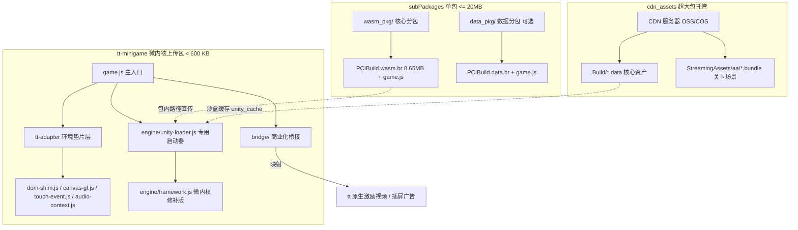
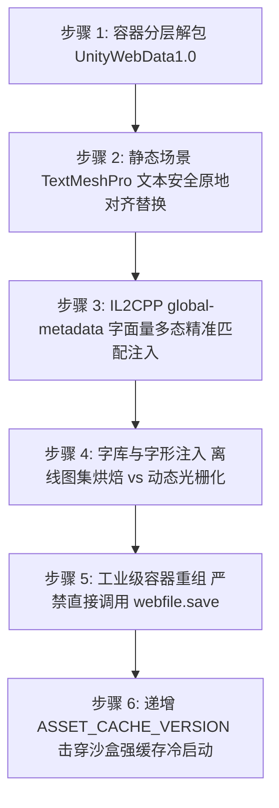

# Unity WebGL 移植抖音小游戏实战与深度避坑指南 (工业级规范)

本文档系统性沉淀了将 **Unity WebGL (Unity 2020 / 2021 / 2022 / Unity 6+ / WebAssembly / IL2CPP)** 导出的商业游戏成品包（无 C# 源码，如海外 Poki / CrazyGames 渠道包）完整套壳移植适配为**抖音小游戏（ByteDance MiniGame）**的端到端技术架构、核心技术战役、75 个关键技术陷阱与真机交付验收标准。

---

## 一、架构理念与微内核套壳体系 (Micro-Kernel Wrapper)

### 1. 核心设计思想
针对第三方渠道购买或逆向提取的已编译成品包，开发者通常**没有 Unity C# 源码工程**，无法通过 Unity Editor 重新编译或接入官方转换插件。必须采取经过工业验证的**“微内核套壳（Micro-Kernel Wrapper）”**技术路线：
- **零源码修改**：不依赖 Unity 原始工程，直接基于导出的 `.wasm`、`.data`、`framework.js` 和 `StreamingAssets` 进行外层沙盒环境重构。
- **微内核极致轻量主包**：主包体积严格控制在 **< 600 KB**（平台硬卡点为 4.0 MB），仅保留 DOM/BOM 适配垫片层、轻量胶水代码和启动器。
- **Wasm 官方分包架构 (`subPackages`)**：原版 40MB+ 的 `.wasm` 经 Brotli 工业级压缩（quality=6）后缩小至 **~8.65 MB**，直接放入代码分包 `wasm_pkg/`。iOS 与 Android 双端统一由底层 C++ mmap 流式解压编译，零 JS 堆内存开销，彻底杜绝真机 OOM 与编译死锁。
- **核心数据与动态资产分发**：
  - **方案 A（分包直读模式，总包体 < 20MB）**：`.data` 同样放入数据分包（如 `data_pkg/`），启动即挂载，离线体验极佳。
  - **方案 B（CDN 远端分发 + 沙盒持久化缓存，总资产 > 20MB）**：将 `.data` 与 Addressables `StreamingAssets/` 托管至 CDN（OSS/COS/火山引擎），客户端通过 `FileSystemManager` 并行拉取并持久化至 `${tt.env.USER_DATA_PATH}/unity_cache`，二次启动秒开。
- **商业化无缝平替**：拦截海外 Poki SDK / CrazyGames SDK 的广告、打点与数据桥接，无缝映射为抖音原生激励视频与插屏广告，并提供防卡死熔断机制。



### 2. 标准工程目录规划与分包结构
```text
my-unity-tt-minigame/
├── game.js                       # 小游戏主启动入口 (全域异常捕获、分包加载、启动 Unity)
├── game.json                     # 全局平台配置 (横屏锁定、iOS 高性能模式、subPackages 声明)
├── project.config.json           # 抖音开发者工具工程配置 (native 模式、关闭 urlCheck)
├── config.js                     # 游戏配置 (CDN 地址、文件版本号、广告位 ID、调试开关)
├── tt-adapter/                   # 【DOM/WebGL 平台环境适配器】
│   ├── index.js                  # 适配器统一入口
│   ├── dom-shim.js               # window/document/navigator/Screen/DOMRect/TextDecoder 垫片
│   ├── canvas-gl.js              # WebGL2/WebGL1 上下文守护、720p 甜点分辨率、双缓冲保留
│   ├── touch-event.js            # 多点触控、鼠标事件归一化分发、Autoplay 首触解锁
│   ├── audio-context.js          # WebAudio API 仿真与 3D Panner 旁路直通
│   └── indexeddb-storage.js      # 本地持久化桥接至 tt.getStorageSync/setStorageSync
├── engine/                       # 【轻量微内核引擎代码】
│   ├── framework.js              # Unity 导出的 framework.js (注入尺寸修复、无参 SendMessage 路由)
│   └── unity-loader.js           # 专用微内核启动器 (WASM 解析、IDBFS 秒级放行、Loading 守护)
├── bridge/                       # 【商业化与生命周期桥接】
│   ├── poki-douyin-bridge.js     # Poki SDK 接口平替
│   └── crazygames-douyin-bridge.js # CrazyGames SDK v3 接口平替 (含 Promise 规范与即时握手)
├── wasm_pkg/                     # 【WASM 官方分包】 (约 8.65MB，严守 20MB 上限)
│   ├── game.js                   # 必需分包入口：module.exports = {};
│   └── [project].wasm.br         # Brotli 压缩后的 WebAssembly 二进制
└── data_pkg/                     # 【可选：数据分包】 (若在 20MB 内可直接分包)
    ├── game.js                   # 必需分包入口：module.exports = {};
    └── [project].data.br         # 资产二进制
```

---

## 二、关键技术避坑全景指南 (工业级攻坚方案)

### 1. WASM 编译死锁与跨端实例化双轨规范 (避坑第 57、58、59、63、64 条)

#### 现象与排查
- **现象 1（Android 卡死在 15%）**：安卓真机停留在“引擎编译中 (15%)”无限挂起，无报错无日志。
- **现象 2（Android 卡死在 40%/50%）**：安卓真机读取沙盒 ArrayBuffer 后，停留在 40% 或 50% 编译死锁。
- **现象 3（iOS 扫码即崩）**：苹果设备弹窗报错：`abort("no native wasm support detected")` 或 `未检测到可用的 WebAssembly.instantiate`。

#### 根因深度剖析
1. **`TTWebAssembly` 官方规范红线**：
   - 字节跳动官方 API `TTWebAssembly.instantiate(path, importObject)` 严格限定第一个参数**必须是小游戏代码包内的相对路径字符串**（如 `'wasm_pkg/game.wasm.br'`）；
   - **绝对不支持** 传入 `ArrayBuffer`；
   - 在 Android 底层 **绝对不支持虚拟沙盒路径（`ttfile://`）**。iOS 由于内核差异恰好能解析沙盒路径，而 Android 底层 JNI 接收到 `ttfile://` 找不到文件，且其 Promise **既不 resolve 也不 reject**，主线程直接死锁在 15%！
2. **全局变量污染死锁**：若适配垫片层误将全局 `WebAssembly` 覆盖赋值为 `TTWebAssembly`，后续读取 ArrayBuffer 调用 `WebAssembly.instantiate(buf)` 时，底层的 C++ 类型断言失败静默丢弃 Promise，导致死锁在 50%！
3. **JS 堆内存峰值 OOM**：在 Android 端通过 `fs.readFile` 读取 42MB WASM 入 JS 堆内存，编译瞬间 V8 分配 3~5 倍工作区（150MB~200MB），瞬间打爆 Android 沙盒内存引发进程被杀。
4. **iOS Emscripten 静态断言阻碍**：`framework.js` 启动阶段执行 `if (typeof WebAssembly != "object") abort(...)`，在 iOS JavaScriptCore 独立环境中，沙盒未在顶层作用域直接暴露该变量，断言失败直接 abort。

#### 工业级终极解法：Wasm 官方分包架构 + 双轨分流编译
1. **Brotli 压缩入分包**：
   ```python
   # 使用 brotli 将 41.8MB WASM 压缩至 8.65MB
   import brotli
   raw = open('Build/PCIBuild.wasm', 'rb').read()
   compressed = brotli.compress(raw, quality=6)
   with open('wasm_pkg/PCIBuild.wasm.br', 'wb') as f:
       f.write(compressed)
   ```
2. **`game.json` 分包声明铁律**：
   - 字段名必须使用大写驼峰 **`subPackages`**（可同时写 `subpackages` 兼备容错）；
   - `root` 字段在 Windows 下**严禁带尾斜杠**（写 `"root": "wasm_pkg"` 而非 `"wasm_pkg/"`，否则 Windows 路径匹配失效导致 IDE 将 8.65MB 算入主包，主包超标至 9.7MB+ 拒绝上传）。
3. **双轨分流实例化实现 (`engine/unity-loader.js`)**：
   ```javascript
   // 统一引擎实例化入口
   function instantiateWasm(wasmPath, imports, onProgress) {
     return new Promise((resolve, reject) => {
       // 全链路 60 秒安全看门狗守护
       const watchdog = setTimeout(() => {
         const msg = 'WebAssembly 实例化超时(60s)，请检查分包配置或重启小游戏';
         tt.showModal({ title: '引擎加载超时', content: msg, showCancel: false });
         reject(new Error(msg));
       }, 60000);

       const handleSuccess = (res) => {
         clearTimeout(watchdog);
         resolve(res.instance || res);
       };

       // 判定是否为包内相对路径
       const isPkgPath = wasmPath && !wasmPath.startsWith('ttfile://') && !wasmPath.startsWith('http://');

       // 轨 1: 代码包内相对路径 -> Android 与 iOS 双端统一走底层流式编译秒开！
       if (isPkgPath && typeof TTWebAssembly !== 'undefined' && typeof TTWebAssembly.instantiate === 'function') {
         console.log('[UnityLoader] 采用包内路径直传 TTWebAssembly:', wasmPath);
         TTWebAssembly.instantiate(wasmPath, imports).then(handleSuccess).catch((err) => {
           console.warn('[UnityLoader] TTWebAssembly 失败，尝试回退:', err);
           fallbackArrayBuffer(wasmPath, imports, handleSuccess, reject);
         });
         return;
       }

       // 轨 2: iOS 苹果端沙盒路径直传 (iOS 支持沙盒路径 mmap 映射)
       const isIOS = (tt.getSystemInfoSync().platform === 'ios');
       if (isIOS && wasmPath && typeof TTWebAssembly !== 'undefined') {
         TTWebAssembly.instantiate(wasmPath, imports).then(handleSuccess).catch(reject);
         return;
       }

       // 轨 3: 沙盒 ArrayBuffer 模式 (严格调用宿主原生 V8 WebAssembly，绝不可调用 TTWebAssembly)
       fallbackArrayBuffer(wasmPath, imports, handleSuccess, reject);
     });
   }

   function fallbackArrayBuffer(wasmPath, imports, successCb, rejectCb) {
     tt.getFileSystemManager().readFile({
       filePath: wasmPath,
       success(res) {
         const buf = res.data;
         // 严格提取宿主原生 V8 WebAssembly
         const nativeEngine = (typeof globalThis !== 'undefined' && globalThis._nativeV8WebAssembly)
           || (typeof WebAssembly !== 'undefined' && WebAssembly !== (typeof TTWebAssembly !== 'undefined' ? TTWebAssembly : null) ? WebAssembly : null);
         if (!nativeEngine || typeof nativeEngine.instantiate !== 'function') {
           return rejectCb(new Error('未检测到支持 ArrayBuffer 的原生 WebAssembly 引擎'));
         }
         nativeEngine.instantiate(buf, imports).then(successCb).catch((err) => {
           // 分步自愈
           nativeEngine.compile(buf).then(mod => nativeEngine.instantiate(mod, imports)).then(successCb).catch(rejectCb);
         });
       },
       fail: rejectCb
     });
   }
   ```
4. **彻底拆除 `framework.js` 静态 abort**：
   将 `if (typeof WebAssembly != "object") abort(...)` 替换为安全警告放行，由微内核 `instantiateWasm` 统一接管。

---

### 2. 画布尺寸陷阱、黑屏与 720p 甜点分辨率模型 (避坑第 1、2、22、28、42、66 条)

#### 陷阱 1：画布 3×3 模糊拉伸渐变陷阱
- **现象**：游戏启动正常、主循环在跑、事件在派发，但画面呈现大面积模糊的天空渐变与单色团块，完全看不到 3D 模型与 UI。
- **根因**：Unity 调用 `_JS_SystemInfo_GetCanvasClientSize`，默认用 `document.querySelector("#unity-canvas")`。在小游戏环境下原生画布不在 DOM 树中，返回 `null`。Unity 兜底为 `1×1` 像素，再乘以 DPR（如 3），得到 `3×3`。Unity 主动将画布重置为 3×3 像素，WebGL 在 3×3 帧缓冲上渲染后被双线性拉伸到全屏，所有画面融化为模糊团块！
- **解决**：在 `framework.js` 中将查询优先回退至 `Module["canvas"]`，返回真实视口宽高（如 `852 × 393`），让 Unity 自然申请高清渲染分辨率。

#### 陷阱 2：严禁使用 `Object.defineProperty` 覆写 `canvas.width/height`
- **现象**：强行用 `Object.defineProperty` 将 `canvas.width` 改为高清尺寸时，游戏界面立即全黑。
- **根因**：`tt.createCanvas()` 是底层 C++ 绑定的原生对象，其 `width/height` Setter 负责触发底层的 C++ Framebuffer 内存分配。使用 `Object.defineProperty` 会永久切断 C++ Setter，导致 WebGL 上下文 Framebuffer Incomplete，造成彻底黑屏！
- **铁律**：必须始终通过常规赋值语句（`canvas.width = targetW; canvas.height = targetH;`）触发底层扩容。

#### 陷阱 3：横屏视口冷启动校准与 16:9 短边 720p 甜点分辨率
- **冷启动尺寸失真**：安卓手机竖直握持扫码时，系统优先上报竖屏数值（`windowWidth < windowHeight`）。若直接使用，Canvas 被初始化为竖屏长条，主相机与 UI 渲染出界呈现全黑。
  - **解法**：强制长边为宽、短边为高：`logicW = Math.max(w, h)`, `logicH = Math.min(w, h)`。
- **短边 720p 甜点分辨率算法**：
  - 手机物理屏（如 2400×1080）若按全像素渲染，单帧像素达 2.6M~3.3M，导致移动端 GPU（Adreno/Mali）填充率饱和严重掉帧；
  - 严禁限制宽度 720（会导致横屏高度仅剩 300 多极端模糊）；
  - **标准算法**：**以短边（物理高度）720p 为基准等比缩放**：
    ```javascript
    const dpr = sysInfo.pixelRatio || 2;
    const rawPixelW = Math.round(logicW * dpr);
    const rawPixelH = Math.round(logicH * dpr);
    const maxShortSide = 720;
    let scale = 1.0;
    if (rawPixelH > maxShortSide) {
      scale = maxShortSide / rawPixelH;
    }
    canvas.width = Math.round(rawPixelW * scale);  // iPhone 15 Pro 横屏呈现为 1560x720 超清无黑边
    canvas.height = Math.round(rawPixelH * scale); // 相比原生 2556x1179 像素负载暴降 63%，极其流畅
    ```

#### 陷阱 4：切场景 95% 黑屏与 WebGL 双缓冲保留 (`preserveDrawingBuffer`)
- **现象**：安卓真机 WASM 实例化成功推进至 95%（`allowSceneActivation = true`），画面突然变黑并不再恢复。
- **根因**：卸载 Loading 场景、执行 GC 并加载主场景耗时数百毫秒期间，Unity 暂停提交 DrawCall。在 Android Adreno GPU 上，默认 `preserveDrawingBuffer: false` 导致系统合成器在每次 vsync 刷新时清空 WebGL 缓冲区为底色黑色。
- **解法**：在 `canvas-gl.js` 与 `unity-loader.js` 的 `webglContextAttributes` 中开启：
  ```javascript
  webglContextAttributes: {
    preserveDrawingBuffer: true, // 开启双缓冲保留，杜绝切场景空档黑屏
    powerPreference: 2           // 强制高性能 GPU
  }
  ```

---

### 3. Unity 6 与现代 Emscripten 胶水层深度垫片 (避坑第 11、20、21、30、36、37、38、51、52、57 条)

| 模块 / 接口 | 故障现象 | 崩溃根因 | 工业级解决方案 |
|---|---|---|---|
| **Module.deinitializers** | 启动报错：`Cannot read properties of undefined (reading 'push')` at `_JS_Init_CopyPaste` | Unity 6 的 Emscripten 运行时向 `Module.deinitializers` 注册退出清理回调，微内核未初始化该数组 | 在 `Module` 实例中显式初始化 `deinitializers: []`，并在 `framework.js` 中使用 `(Module.deinitializers = Module.deinitializers \|\| []).push(...)` 防御 |
| **Module.SystemInfo** | 报错：`Cannot read properties of undefined (reading 'hasWebGPU')` at `_JS_SystemInfo_HasWebGPU` | Unity 6 底层查询系统渲染管线，原版由官方 loader 注入复杂对象，微内核缺失打崩 `_main` | 在 `unity-loader.js` 中注入完整的 `Module.SystemInfo`（`hasWebGL: 2`, `hasWebGPU: 0`, `mobile: true`, `browser`, `os`） |
| **webglContextAttributes** | 报错：`Cannot read properties of undefined (reading 'premultipliedAlpha')` | Unity 6 底层直接访问 `Module.webglContextAttributes` 属性 | 在 `Module` 中注入标准配置：`{ preserveDrawingBuffer: true, powerPreference: 2 }` |
| **iOS performance.now** | 苹果真机扫码弹窗：`evaluating 'performance.now'` undefined | iOS JavaScriptCore (JSC) 独立沙盒环境全局未挂载 `performance` 对象 | **四层立体防御**：在 `game.js` 首行挂载 `performance` 垫片（优先 `tt.getPerformance()`，保底 `Date.now() - timeOrigin`）并广播至 `globalThis`、`window`、`GameGlobal` |
| **Android TextDecoder** | 真机解包报错：`TextDecoder is not defined`，资产释放为 0 假死在 Loading | 字节跳动 Android Krypton C++ 环境全局未暴露 `TextDecoder` / `TextEncoder` | 1. `unity-loader.js` 解包器**内置纯 JS 多字节 UTF-8 解码函数 `decodeUtf8`**，剔除外部依赖；<br>2. `dom-shim.js` 在第 0 毫秒向全部全局域广播 `MiniTextDecoder` / `MiniTextEncoder` |
| **Android randomDevice** | 安卓真机 Loading 卡死，控制台报错：`abort("randomDevice")` | 虚拟文件系统读 `/dev/urandom` 时，私有函数 `getRandomDevice()` 找不到 `crypto` 触发硬编码 abort | 1. 全局补齐 W3C `crypto.getRandomValues` 垫片；<br>2. 加固 `framework.js` 中的 `getRandomDevice()`，优先对接 `Module.randomDevice`，兜底采用高熵伪随机数 |
| **拔除遗留 IDBFS 阻塞** | 引擎初始化完停留在“启动引擎”无后续，`runDependencies` 永远卡在 1 | `preRun` 中 `unityFileSystemInit()` 发起 `addRunDependency("JS_FileSystem_Mount")` 并异步等待浏览器 IndexedDB；小游戏无原生支持导致永久挂起 | 在 `unity-loader.js` 中重写 `unityFileSystemInit` 为同步秒级放行，并在 `framework.js` 中**彻底清除 `JS_FileSystem_Mount` 依赖**，数据解包完成后 `runDependencies` 瞬时归零直接触发 `callMain()` |
| **screen.orientation** | 报错：`screen.orientation.addEventListener is not a function` | Unity 屏幕旋转监听器直接调用 `screen.orientation.addEventListener` 和 `lock()` | `screen.orientation` 实现为具备 `addEventListener`、`removeEventListener`、返回 Promise 的 `lock/unlock` 以及 `type/angle` 的标准对象 |
| **AbortController / Blob** | 发起 WebRequest 报：`AbortController is not defined` | Krypton 全局未暴露 `AbortController`，Unity 网络层直接 `new AbortController` 导致崩溃 | 在 `dom-shim.js` 中补齐 `MiniAbortSignal` 与 `MiniAbortController`，并在 `abort()` 时自动派发事件 |

---

### 4. 海外商业 SDK (CrazyGames / Poki) 桥接与时序避坑 (避坑第 31、39、40、44、53、56、68 条)

#### 陷阱 1：CrazyGames SiteLock 域名防盗链彻底穿透 (Code 3 游戏世界冻结)
- **现象**：海外商业包（如 CrazyGames）正式包体固化了 `allowLocalHost = false`。在本地或小游戏沙盒运行，检测到非线上域名触发 SiteLock Code 3，启动 `SiteLockFreezeGameCoroutine` 协同程序，**将 `Time.timeScale` 强制置零并冻结主画面**！
- **穿透方案**：在 `framework.js` 的 `_JS_SystemInfo_GetDocumentURL` 以及 `dom-shim.js` 的 `location` 与 `document.URL` 中，**强制伪装为平台合法线上生产 URL**：
  ```javascript
  // framework.js
  function _JS_SystemInfo_GetDocumentURL(buffer, bufferSize) {
    var u = "https://www.crazygames.com/game/your-game-slug";
    if (buffer) stringToUTF8(u, buffer, bufferSize);
    return lengthBytesUTF8(u);
  }
  ```
  使 C# 端的 `IsOnValidRemoteHost()` 恒真通过，100% 破除防盗链冻结。

#### 陷阱 2：`_InitSDK` 时序竞争与同步即时放行
- **现象**：Unity C# 启动时，场景脚本在 `Awake` 阶段同步调用 `CrazySDK.data.getItem`，而原版 `_InitSDK` 等待异步 Promise 回调才发送初始化完成信号，导致 C# 抛出 `CrazySDK initialization required` 异常中断存档逻辑。
- **解决方案**：在 `_InitSDK` 内部，进入 `doInit()` 的第一时间同步触发初始化完成信号：
  ```javascript
  function doInit() {
    try { SendMessage("CrazySDKSingleton", "JSLibCallback_Init"); } catch(e) {}
    window.CrazyGames.SDK.init(initOptions).then(function() {
      try { SendMessage("CrazySDKSingleton", "JSLibCallback_Init"); } catch(e) {}
    });
  }
  ```

#### 陷阱 3：广告接口 Promise 规范与防御性链式调用
- **现象**：触发广告时，控制台抛出致命红字：`TypeError: Cannot read properties of undefined (reading 'catch') at _RequestAdSDK`，随后 Unity 触发 `Halting program` 永久停机。
- **根因**：CrazyGames SDK v3 的 `_RequestAdSDK` 显式链式调用了 `.catch(...)`。若桥接层实现 `requestAd` 时仅执行回调而未显式返回 `Promise`，返回值即为 `undefined`，直接触发 JS 致命异常打崩主循环。
- **治理方案**：
  1. `ad.requestAd` 必须返回规范的 `Promise` 并在播放结束时必定 `resolve()`；
  2. 在 `framework.js` 调用处做链式防御：`if (_adPromise && typeof _adPromise.catch === 'function')`；
  3. 未配置广告位时提供 500ms 模拟播放并触发 `adFinished` 放行。

#### 陷阱 4：`SendMessage` 参数签名失配与 `_origTimeScale=0.0f` 时间冻结死锁
- **深层根因**：
  1. Unity C# 的 `JSLibCallback_AdFinished` / `AdStarted` 声明为无参方法 `void JSLibCallback_AdFinished()`。若 JS 端传了空字符串 `""`，底层调用 `_SendMessageString` 寻找带 `string` 参数的方法签名，导致 Unity 拒绝派发该消息，静默丢弃！
  2. CrazySDK 的 `_origTimeScale` 实例字段默认为 `0.0f`。若为防止暂停而跳过 `adStarted`，直接调 `adFinished` 时 C# 执行 `Time.timeScale = _origTimeScale`（即 0.0f），游戏世界时间同样被永久冻结！
- **终极自愈方案**：
  1. **成对同帧同步触发**：模拟模式下**严禁使用任何 `setTimeout`**！必须在同帧内成对触发 `onStart()` 与 `onFinished()`，先由 `onStart` 令 C# 捕获 `_origTimeScale = 1.0f`，毫秒级内由 `onFinished` 触发恢复与发奖；
  2. **SendMessage 安全路由**：凡目标为 `JSLibCallback_AdFinished`、`AdStarted` 或 `Init`，强制走零参数 `_SendMessage(gameObject, func)`；
  3. **rAF 60 帧看门狗**：挂载基于 `requestAnimationFrame` 的看门狗，若广告链路异常强制恢复主循环。

#### 陷阱 5：`window.unityStringify` 与 `UnitySDK` 前置先行垫片
- **现象**：安卓真机进度条至 100% 后停滞在加载画面，控制台停在 `Input System initialize...`。
- **根因**：Unity 引擎在 `Input System initialize` 之后、C# 业务层 `_InitSDK` 运行之前，C++ 底层会提前调用 `_PrefetchAdSDK` 等 JSLib 函数。若旧代码在 `_InitSDK` 内部才对 `window.unityStringify` 赋值，会导致调用时其为 `undefined`，抛出 `TypeError` 阻断 WASM `_main` 主循环。
- **解法**：在 `framework.js` 最顶层与 `dom-shim.js` 中全局顶置挂载 `unityStringify` 与 `UnitySDK` 兜底对象，并对所有 JSLib 包裹全域 `try...catch` 隔离防逃逸。

---

### 5. 全域统一 Loading 遮罩自愈管理 (避坑第 66、67 条)

#### 跨语言信号大断层
- **现象**：安卓真机成功编译 WASM 推进至 100%，界面更新为“矿洞地质初始化中...”后，遮罩未适时解除，将玩家视野永久遮挡在 Loading 画面之后。
- **根因**：Unity C# 启动主场景后调用 JSLib 触发 `CrazyGames.SDK.game.gameplayStart()`，旧代码在桥接层中仅 `console.log`，未调用 `tt.hideLoading()`；而 `unity-loader.js` 的 `print` 只能截获 Unity C++ 的 `stdout`，无法感知普通 JS 日志，导致解除信号彻底遗失。

#### 标准自愈落地规范
1. **全域单例遮罩管理器 (`game.js`)**：挂载 `__dismissLoadingMask`，实行**一票解除、永久封锁重复弹窗、多级阶梯保底**：
   ```javascript
   let isMaskDismissed = false;
   function dismissLoadingMask(reason) {
     if (isMaskDismissed) return;
     isMaskDismissed = true;
     console.log(`[LoadingManager] ✅ 解除遮罩: ${reason}`);
     const hide = () => { try { tt.hideLoading({ fail() {} }); } catch (e) {} };
     hide();
     setTimeout(hide, 200);
     setTimeout(hide, 600);
     setTimeout(hide, 1500);
   }
   root.__dismissLoadingMask = dismissLoadingMask;
   ```
2. **桥接层主动握手**：在 `SDK.init` 与 `gameplayStart` 回调中第一时间触发 `__dismissLoadingMask`。
3. **四重阶梯安全放行网**：在 `postRun` 设立 1.5s 阶梯保底、捕获引擎核心日志（`Game loaded` / `Initialize engine` / `Input System`）设立 2.0s 保底放行，多重护航 100% 顺畅破门进入游戏。

---

### 6. 移动端 WebAudio 真实发声与空间音频直通 (避坑第 3、14、16 条)

1. **真实桥接原生上下文**：移动端小游戏调用 `tt.getAudioContext()` 同步接口，作为核心音频源泉。
2. **3D 空间音频 (createPanner) 旁路直通**：
   - Unity 每帧计算空间音频并调用 `createPanner()`，小游戏缺失该方法会导致主循环递归崩溃；
   - **直通解法**：实现 `createPanner()`，内部返回增益为 1 的真实 `GainNode`，附加 `positionX/Y/Z`、`setPosition`、`rolloffFactor` 等 dummy 属性。音频信号以 100% 音量无损穿透至 `destination`，彻底激活打击音效、方块粉碎声与 BGM。
3. **Autoplay 静音解锁**：iOS 策略要求 `AudioContext` 必须由用户手势触发退出 `suspended`。在触控适配层的任何 `touchstart` 事件中，主动触发 `audioCtx.resume()` 与 `window.dispatchEvent`，三重通道激活音频。

---

### 7. 商业无源码包全量双轨制汉化与工业级解包重组 SOP (避坑第 29、34、46、47、48、60、61、62 条)

在无 C# 源码的商业工程中，文本通常分布在**双轨制系统**中：
- **轨 1：静态场景与 UI Prefabs 文本 (Scene 烘焙的 TextMeshPro / Legacy Text)**
- **轨 2：C# 运行时动态拼接字面量 (IL2CPP `global-metadata.dat` 的 StringLiterals 数据池)**



#### 步骤 1：容器分层解包 (`UnityWebData1.0`)
Unity 的 `.data` 是一个由 `UnityWebData1.0` 头部包装的合包容器。从原包按头部规范提取 `subfiles` 字典（包含 `data.unity3d`、`Il2CppData/Metadata/global-metadata.dat` 等），绝不对顶层 WebFile 容器整体黑盒修改。

#### 步骤 2：静态场景 TextMeshPro 文本原地安全构建
- **铁律**：严禁篡改 GameObject 树结构与 PPtr 引用指针（篡改会导致虚函数签名不匹配触发 `null function or function signature mismatch`）。
- **序列化对齐规范**：
  在场景序列化流中定位 `TextMeshProUGUI`：偏移 88 写入 4 字节 UTF-8 长度，偏移 92 写入新文本 UTF-8 字节，按 4 字节边界补齐 `0x00` 对齐填充，保留尾部 `m_isRightToLeft` 与 `m_fontAsset` 指针。

#### 步骤 3：IL2CPP `global-metadata.dat` (v39) 动态字符串重构注入
- **业务痛点**：离线收益弹窗模板、`Buy x1`、`Axe damage`、排行榜 `Top 100` 等文本来自 C# 运行时格式化拼接，硬编码在 metadata 字符串池中。原地覆盖受限于字节长度无法长句翻译。
- **全自动无损重构注入算法**：
  1. **提取与重排**：通过 Section 0 (`StringLiteralOffsets`) 切分所有原版字符串数组。根据翻译字典替换为新 UTF-8 字节；
  2. **重建 Sec 00 与 Sec 01**：拼接所有字符串字节生成新的 `new_stringLiteralData`，重新生成单调递增的 `new_stringLiteralOffsets` 数组；
  3. **计算平移量与 4 字节对齐**：新 Sec 01 结尾向上 4 字节对齐，计算平移差值 $\Delta = \text{new\_sec2\_off} - \text{old\_sec2\_off}$；
  4. **Header 级联平移更新**：将 Sec 02 到 Sec 30 所有 section 的 `offset` 统一加上 $\Delta$；
  5. **字典多态与控制符对齐铁律**：翻译字典 key 必须与 `all_string_literals.txt` 100% 逐字节对齐（**包含未选中置灰 `<#A6A6A6>`、选中高亮 `<#FFFFFF>`、换行 `\n`、尾部 `<sprite=0>` 图标占位符**），漏写控制符会导致精确匹配落空回退英文！

#### 步骤 4：字库与字形注入（双轨选型）
- **方案 A（离线像素/硬描边图集烘焙，推荐首选）**：
  - 适用：像素风格游戏、追求极小包体（仅增几百 KB）、杜绝低端机动态光栅化掉帧；
  - 规范：选用方舟像素 12px（`ark-pixel-12px-monospaced-zh_cn.ttf`）。将原版 128x128 贴图贴在 PIL 图像**左下角**（保持原生英文字形 UV 绝对不变！）；上方空余区域紧凑烘焙中文字形，并逐字生成 **8 方向 1px 纯黑硬描边（Hard Outline）**；同步更新 `TMP_FontAsset` 的 Glyphs 与 Characters 表。
- **方案 B（Dynamic 动态光栅化模式）**：
  - 适用：矢量文字、文字量极大；
  - 规范：将包含完整中文的 TTF 字库（约 1.8MB）注入 `resources.assets` 中的所有 `Font` 资产；在 `TMP_FontAsset` 二进制偏移 352（`m_AtlasPopulationMode`）处强制写入 `1`（Dynamic），由 FreeType 引擎运行时即时渲染 SDF 图集。

#### 步骤 5：工业级分层重组（严禁直接调用 `webfile.save()`）
- **血泪教训（致命报错）**：
  若使用 UnityPy 直接对顶层 WebFile 容器执行 `webfile.save()`，内部文件偏移与块对齐会被破坏，引擎启动反序列化抛出致命异常：
  `The file 'resources.assets' is corrupted! Remove it and launch unity again! [Position out of bounds!]`
- **工业级标准重组流水线**：
  1. 仅对内存中的 `data_bundle`（`data.unity3d`）调用 `data_bundle.save()`；
  2. 对 `global-metadata.dat` 执行独立结构对齐重构；
  3. 手动拼接标准的 `UnityWebData1.0` 二进制头部与 Body。

#### 步骤 6：版本号递增（击穿真机旧沙盒强缓存）与冷启动
- 移动端真机（iOS / Android）每次启动时，若本地沙盒目录 `unity_cache` 已存在历史文件，**绝不会向 CDN 发起请求**，直接读取旧缓存。
- **发版铁律**：
  1. 递增 `config.js` 的 `ASSET_CACHE_VERSION`（如 `v22_full_zh`）；
  2. 校准 `game.js` 的 `downloadStats` 下载精确字节数；
  3. 手机在多任务列表中**彻底上滑杀掉抖音客户端进程**（杜绝热启动恢复旧沙盒映射）；
  4. 重新扫码冷启动，从 0% 拉取最新资产验证。

---

### 8. 敏感外链四重隐藏与 UI 排版优化 (避坑第 48、49、54、55 条)

#### 敏感外链模块“四重隐藏保障” (合规提审必过)
海外 WebGL 游戏常内置跳转外部主页或非小游戏官方体系的“隐私协议”模块，提审抖音会导致违规直接被拒。实施四重物理隐藏：
1. **第一重**：根 GameObject 的 `m_IsActive` 设为 `0`（False）；
2. **第二重**：所有子节点（提示文本、跳转按钮）的 `m_IsActive` 全部置为 `0`；
3. **第三重**：对应 `RectTransform` 局部缩放 `m_LocalScale` 设为 `(0.0, 0.0, 0.0)`；
4. **第四重**：局部坐标 `m_LocalPosition` 移至视口外部 `(9999.0, 9999.0, 0.0)`。

#### 汉化文本字号缩小与胶囊避让
- 汉化后字符宽度增加导致 TextMeshPro 按钮文字强制折行（如“双倍领取”变两行）：在场景序列化流中将 `m_fontSize` 适度缩小（如 28.0f 降为 18.0f），水平对齐设为 Center (2)，垂直对齐设为 Middle (512)。
- 右上角胶囊避让：右侧核心面板根容器（`PanelManager`）的 `m_AnchoredPosition.y` 向下平移 **-60.0px**，完美避让官方胶囊按键。

---

### 9. 独立免广告中文 Web 试玩链接 (No-Ad Free-Link for Unity) SOP (避坑第 69、70 条)

在发行商务评测、团队内部体验时，往往需要一个“脱离小游戏客户端、任何浏览器点击即开、全中文汉化、且所有广告秒过秒领奖”的独立 Web 试玩包：
1. **资产无损逆向提取**：直接解压小游戏已汉化调优的数据包 `data_pkg/PCIBuild.data.br` 为 `PCIBuild.data`，复用点阵字库与全场景汉化成果。
2. **零延迟免广告仿真微内核 (`crazygames-sdk-v3.js`)**：
   - 拦截 `ad.requestAd`：触发 `adStarted` -> 45ms 延迟 -> `adFinished` 并必定 resolve Promise，实现**点击广告按钮 100% 秒级发放奖励**；
   - 触发前端悬浮飘字广播（`ad-reward-granted`），在屏幕顶部弹出毛玻璃绿色 Toast：`🎁 免广告特权生效：已自动跳过广告，奖励已即刻发放！`；
   - 存档持久化接入浏览器 `localStorage` 并带专属前缀。
3. **SiteLock 白名单穿透**：在 Web 版 `framework.js` 中将 `_JS_SystemInfo_GetDocumentURL` 恒定返回平台官方合法 URL，破除防盗链冻结。
4. **高性能局域网服务 (`run_server.py`)**：自动探测从 8092 开始的空闲端口，输出本机与局域网 IP（手机浏览器同 Wi-Fi 秒开），配置 COOP/COEP 与 WASM MIME。

---

## 三、Android & iOS 双端真机适配交付 CheckList (验收铁律)

在提交版本或声称适配跑通前，必须对照本 CheckList 逐项确认：

| 校验维度 | 标准作业与技术指标 | 验证方法与证据 |
|---|---|---|
| **主包体积红线** | 微内核主包总体积严格 $\le 600\text{ KB}$（平台红线 4.0 MB） | `validate-package.js` 校验通过，开发者工具显示主包体积合格 |
| **Wasm 分包规范** | Brotli 压缩入 `wasm_pkg/`（$\le 10\text{ MB}$），`game.json` 使用驼峰 `subPackages` 且 root 无尾斜杠 | 开发者工具分包列表正常识别，无“主包超标至 9.7MB”报警 |
| **Wasm 实例化模式** | 包内相对路径直传 `TTWebAssembly.instantiate`；严禁向其传 ArrayBuffer；全链路 60s 看门狗 | 控制台打印 `WebAssembly 编译与链接成功`，Android/iOS 双端秒过 |
| **IDBFS 依赖拔除** | 彻底清除 `addRunDependency("JS_FileSystem_Mount")` | 控制台显示解包后 `runDependencies` 瞬时归零，秒级进入 `callMain` |
| **画布清晰度与 DPR** | 控制台输出真实视口（如 852x393），画布常规赋值扩容，720p 甜点缩放 | 画面 3D 模型边缘锐利细腻，无 3x3 模糊渐变，无黑屏 |
| **双缓冲防切场景黑屏** | `webglContextAttributes` 开启 `preserveDrawingBuffer: true` | 切场景或 GC 阶段画面无纯黑闪烁，95% 顺畅过渡进入主场景 |
| **横屏冷启动校准** | 尺寸强制 `Math.max` 赋宽、`Math.min` 赋高 | 竖直握持手机扫码冷启动，画面绝不变成竖屏长条或 UI 出界 |
| **跨端关键环境垫片** | iOS 补齐 `performance.now`；Android 补齐 `TextDecoder`、`crypto.getRandomValues` | iOS 与 Android 真机控制台 0 ReferenceError，无 abort 报错 |
| **广告与 SendMessage** | 成对同帧同步触发 `onStart`/`onFinished`；无参回调走零参数 `_SendMessage` | 点击看广告 100% 发奖，弹窗顺畅关闭，`Time.timeScale` 恢复 1.0f 无冻结 |
| **全域 Loading 管理** | `__dismissLoadingMask` 一票解除 + 阶梯保底 | 游戏主场景出现后遮罩 100% 顺畅淡出，无任何遮罩驻留 |
| **真机 WebAudio 发声** | 接入 `tt.getAudioContext()`；`createPanner` 旁路直通；首触 resume | 真机（iOS/Android）背景音乐与音效出声正常，无空间音频崩溃 |
| **文本与字库汉化** | 静态 TMPro 原地对齐 + metadata 字符串重构注入 + 分层重组严禁 `webfile.save()` | 静态/动态文本 100% 呈现中文，无方块豆腐块，无 assets 损坏崩溃 |
| **版本击穿强缓存** | 每次更新资源必递增 `ASSET_CACHE_VERSION`，校准 `game.js` 字节数 | 真机上滑杀进程冷启动后，控制台显示拉取最新版本资产 |
| **合规与外链隐藏** | 敏感外链四重物理隐藏，侧边栏 y 轴 -60px 避让胶囊 | 界面无外部跳转链接，右上角官方胶囊不遮挡核心交互按钮 |
