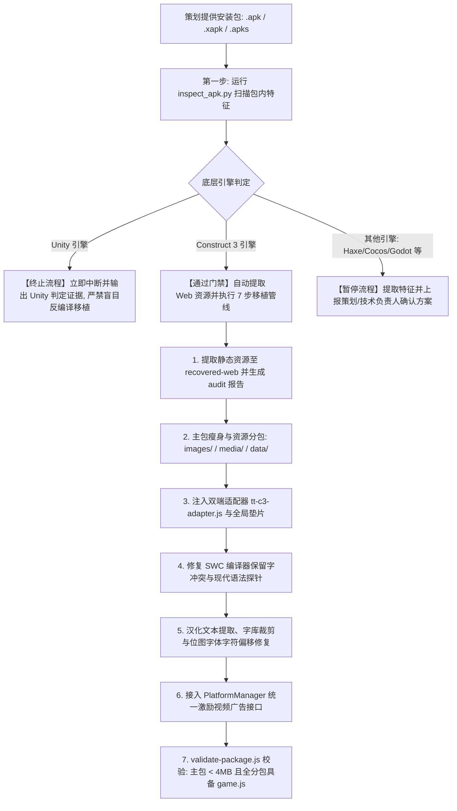

# REBench: 移动端游戏逆向分析与小游戏移植工作台

`REBench` 是专用于移动端游戏安装包（`.apk`、`.xapk`、`.apks`）的**自动化引擎特征识别**、**代码资源提取审计**，以及将 **Construct 3** 游戏完整移植适配为**抖音小游戏（ByteDance MiniGame）**的标准化工程基座。

---

## 目录索引

- [一、核心工作流与引擎门禁](#一核心工作流与引擎门禁)
- [二、已知测试样本矩阵](#二已知测试样本矩阵)
- [三、项目目录架构说明](#三项目目录架构说明)
- [四、常用命令与工具链指南](#四常用命令与工具链指南)
- [五、Construct 3 转抖音小游戏关键技术架构](#五construct-3-转抖音小游戏关键技术架构)
- [六、双端运行时（Krypton 与 Helium）避坑守则](#六双端运行时krypton-与-helium避坑守则)
- [七、AI Agent 专属 Skill (`apk-re-to-minigame`)](#七ai-agent-专属-skill-apk-re-to-minigame)

---

## 一、核心工作流与引擎门禁

为了避免盲目反编译与无效开发，本项目严格执行**第一步引擎门禁判定**：



---

## 二、已知测试样本矩阵

在 `apk/` 目录下实测扫描的部分典型游戏包识别结果：

| 安装包名称 | 识别引擎 | 门禁判定 | 说明 / 后续处理 |
|---|---|---|---|
| **Digger+Escape_1.1.9** | **Construct 3** | **✅ PROCEED** | 165 个对象、5 个场景，已成功移植至 `reverse/digger-tt-minigame` |
| **Blumgi Slime_1.1.0.1** | **Construct 3** | **✅ PROCEED** | 标准 Construct 3 Web 封装，可通过本流程全自动移植 |
| **G-Switch 4_ Creator_1.4.0** | **Haxe / Lime / OpenFL** | **⏸ PAUSE** | 基于 OpenFL/Lime C++ 引擎，非 C3，暂停并评估 |
| **Level Devil - NOT A Troll Game** | **Haxe / Lime / OpenFL** | **⏸ PAUSE** | 基于 Lime 编译，暂停并评估 |
| **Idle Ants - Simulator Game** | **Unity (IL2CPP)** | **🛑 TERMINATE** | 包含 `libil2cpp.so` / `assets/bin/Data/`，立即终止 |
| **Stickman+Parkour_3.5** | **Unity (IL2CPP)** | **🛑 TERMINATE** | 包含 Unity 二进制运行时，立即终止 |

---

## 三、项目目录架构说明

```text
REBench/
├── .agents/skills/apk-re-to-minigame/   # Antigravity 专属移植技能定义
│   ├── SKILL.md                         # 核心指导手册 (含流程、规范与红线)
│   ├── scripts/                         # 自动化辅助工具 (inspect_apk, validate-package)
│   ├── templates/                       # 双端适配器与入口模板 (tt-c3-adapter, game.js)
│   └── references/                      # 深度踩坑知识库 (双端避坑、4MB规范、C3数据结构)
├── apk/                                 # 存放策划提供的新包 (.apk, .xapk)，已被 git 忽略
│   └── .gitkeep                         # 仅保留目录占位
├── reverse/                             # 逆向输出工程目录
│   ├── digger-tt-minigame/              # 【成品】已跑通真机验证的抖音小游戏项目
│   │   ├── adapter/tt-c3-adapter.js     # 抖音小游戏与 C3 核心适配层
│   │   ├── images/                      # 图片分包 (含 game.js, embedded-assets.js)
│   │   ├── media/                       # 音频分包 (含 game.js, *.webm)
│   │   ├── data/                        # 数据分包 (含 game.js, data.json)
│   │   ├── game.js                      # 引导入口 (含全局垫片与分包异步预加载)
│   │   ├── game.json                    # 横屏与分包配置
│   │   └── project.config.json          # 抖音开发者工具工程配置
│   ├── recovered-web/                   # 从 APK 提取的纯 HTML5 静态源码
│   └── recovery-audit.json              # 复杂度审计报告 (对象/场景/事件节点统计)
├── tools/                               # 常用开发辅助脚本
│   ├── embed-images.js                  # 图集 Base64 嵌入与分包 game.js 生成工具
│   └── douyin_mcp_config.py             # 抖音开放平台 MCP 服务配置测试工具
├── tt-minigame/                         # 抖音小游戏官方原生模板参考
├── .gitignore                           # Git 忽略规则 (已严格过滤所有 apk/xapk 大包)
└── README.md                            # 本说明文档
```

---

## 四、常用命令与工具链指南

### 1. 扫描与审计游戏包引擎
```bash
# 扫描任意 APK / XAPK，自动判定引擎；若为 C3 则输出复杂度报告
python .agents/skills/apk-re-to-minigame/scripts/inspect_apk.py "apk/YourGame.xapk" -o audit.json
```

### 2. 提取 Construct 3 Web 资源
```bash
# 直接将 APK 中的 assets/www/ 提取为可在浏览器本地运行的网页工程
python .agents/skills/apk-re-to-minigame/scripts/inspect_apk.py "apk/YourGame.xapk" --extract-web "./recovered-web"
```

### 3. 一键校验抖音小游戏合规性（主包 4MB 限制 & 分包规范）
```bash
# 检查主包体积是否超标，并验证每个分包下是否存在必填的 game.js
node .agents/skills/apk-re-to-minigame/scripts/validate-package.js "reverse/digger-tt-minigame"
```

### 4. 自动处理图集分包与入口补全
```bash
# 自动在 images/、media/、data/ 生成 module.exports = {} 的 game.js，并生成 Base64 图集映射
node tools/embed-images.js "reverse/digger-tt-minigame"
```

---

## 五、Construct 3 转抖音小游戏关键技术架构

### 1. 严格的分包架构与 4MB 红线
- **抖音平台限制**：小游戏主包体积**严格不得超过 4.0 MB**。
- **拆包方案**：
  - **主包**：仅保留代码文件（`scripts/c3runtime.js`, `scripts/main.js`）、适配器（`adapter/tt-c3-adapter.js`）、配置文件与核心启动引导（`game.js`）。当前项目主包仅 **2.897 MB**。
  - **`images/` 分包**：存放所有大图集（`*-sheet0.webp`）或 `embedded-assets.js`。
  - **`media/` 分包**：存放所有音频文件（`*.webm`, `*.m4a`）。
  - **`data/` 分包**：存放工程核心配置 `data.json`。
- **分包根目录铁律**：每一个在 `game.json` 中声明的分包目录，其根目录下**必须有一个 `game.js` 入口文件**，否则抖音编译器会直接报错阻断。

### 2. 异步分包预加载架构
在 `game.js` 中使用 `tt.loadSubpackage` 预加载所有资源分包，在全部就绪后再触发 Cordova 的 `deviceready` 生命周期：
```javascript
async function initGame() {
  await Promise.all([
    loadSub('images'),
    loadSub('media'),
    loadSub('data')
  ]);
  triggerDeviceReady(); // 唤醒 C3 Runtime 初始化
}
```

---

## 六、双端运行时（Krypton 与 Helium）避坑守则

抖音小游戏在 Android 使用 **Krypton (C++)** 引擎，在 iOS 使用 **Helium (C++)** 引擎，真机存在诸多特殊环境限制：

| 故障现象 | 根因分析 | 标准解决方案 |
|---|---|---|
| **Android 扫码黑屏** | Krypton 缺少 `window.visualViewport`，导致 C3 视口计算为 0 崩毁 | 在适配器中补齐具备 `addEventListener` 与尺寸查询能力的 `visualViewport` 垫片 |
| **Android 报 `atob is not defined`** | Krypton 原生 C++ 运行环境未暴露浏览器的 `atob` / `btoa` API | 在 `game.js` 与全局作用域挂载纯 JS 实现的二进制 Base64 解码器 |
| **`Blob is not defined` 报错** | 二进制模型与图集读取依赖 `Blob` 与 `URL.createObjectURL` | 全局注入 `MiniBlob`，并将 `URL.createObjectURL` 转为 Data-URI |
| **iOS 重启变竖屏** | 苹果手机从菜单点击“重新进入小游戏”时，默认按当前握姿重置窗口 | 监听 `tt.onShow`，通过 `tt.setDeviceOrientation({ value: 'landscape' })` 强制锁定横屏 |
| **SWC 编译器报 `Expression expected`** | C3 插件混淆代码中使用了保留字（如 `class switch`） | 在 `objRefTable.js` 中将 `switch` 改写为 `SwitchObject` 或 `_switch` |
| **位图字体 `0` 或 `00` 乱显** | 货币图标（`£/¥`）与数字共用图集，字符集映射出现索引偏差 | 校对 `data.json` 中 `Spritefont2` 的 `character-set` 字符串映射顺序 |

详细分析见文档：[.agents/skills/apk-re-to-minigame/references/krypton-helium-pitfalls.md](file:///d:/Desktop/REBench/.agents/skills/apk-re-to-minigame/references/krypton-helium-pitfalls.md)。

---

## 七、AI Agent 专属 Skill (`apk-re-to-minigame`)

本工程配备了完整的 Antigravity / Claude Agent 技能规范，无论在当前项目还是其他任意工作区，只要对 AI 说：
> **“帮我逆向分析一下这个 APK：xxx.apk / xxx.xapk”**

AI 助手将自动载入本规范：
1. 自动调用 `inspect_apk.py` 进行引擎判定；
2. 遇到 Unity 立即终止并提供技术证据；
3. 遇到 Construct 3 自动跑完解包、分包组织、垫片注入与 4MB 合规校验，交付可直接导入抖音开发者工具的工程！
